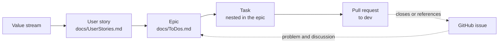

# Task Tracking

This guide explains how maintainers, contributors, and AI agents plan and track work in this repository.
It applies to human and agent work equally.
The [contribution guide](../CONTRIBUTING.md) gives the branch, commit, and pull request rules.

## Planning artifacts

Work moves from a user need to a merged change through five artifacts.



| Artifact | Purpose | Location |
|----------|---------|----------|
| Value stream | The end-to-end flow that delivers one kind of value | The `**Value Stream:**` line of each user story |
| User story | The user need, its benefit, and the business acceptance criteria | [UserStories.md](UserStories.md) |
| Epic | The implementation scope for one story | [ToDos.md](ToDos.md) |
| Task | One unit of work with measurable acceptance conditions | The `tasks` list of its epic |
| Pull request | The change that completes all or part of a task | GitHub, against `dev` |

Completed epics move to [CompletedTasks.md](CompletedTasks.md).
Deferred work moves to [Backlog.md](Backlog.md).

## Issues, epics, and pull requests

GitHub issues and `docs/ToDos.md` have different roles.

- A GitHub issue states a problem, a request, or a question. It holds the public discussion.
- An epic in `docs/ToDos.md` holds the plan, the task status, and the claims for the implementation work.
- A pull request holds the change and its review.

When an issue starts implementation work, add an epic or a task for it.
Put the issue number in the task `notes` or `finding` field.
Put the pull request number in the task `pull_request` field.

The `docs/ToDos.md` file on `dev` is authoritative for task status and claims.
The issue is authoritative for the problem statement and the maintainer discussion.
If the two disagree, correct the task file in your pull request and comment on the issue.

## Value streams

A value stream is the end-to-end sequence of activities that delivers a discrete unit of value.
Record the value stream on the user story, in a `**Value Stream:**` line after `**Implemented in:**`.
An epic gets its value stream through its `user_story` field.
Do not repeat the value stream on the epic or the task.

The maintainers have not ratified these value streams yet.
They are the starting set for current stories.

| Value stream | Delivered value | Stories |
|--------------|-----------------|---------|
| Consensus Correctness | A consensus change with checked models, proofs, or bound tests | US-005, US-006 |
| Release Assurance | A merged change that passes soak, testbed, and release gates | US-003, US-004 |
| Node Operations | A node that stays bounded and observable under load and faults | US-009 |
| Ecosystem Integration | A Rust node that works with the harnesses, clients, and tools around it | US-001, US-002 |

To add a value stream, propose it in the pull request that adds its first user story.
A maintainer approves the name in the review.

## Epics and tasks

Write each epic as a fenced YAML block in `docs/ToDos.md`.
The epic fields are `epic_id`, `title`, `status`, `priority`, `user_story`, and `tasks`.

```yaml
epic_id: EPIC-030
title: "Example epic"
status: pending
priority: p1
user_story: US-010
tasks:
  - id: TASK-030-1
    title: "Example task"
    status: pending
    acceptance:
      - "The new spec test passes in cargo test --release -p casper."
      - "The weekend soak reports no new failure class."
```

- Task identifiers use the form `TASK-NNN-N`, where `NNN` is the epic number.
- Each task has an `acceptance` list of measurable conditions. A condition names a test, a metric, or a soak result.
- The user story keeps the business-level criteria.
- Optional task fields are `notes`, `branch`, `pr_base_branch`, `pull_request`, `blocked_by`, `finding`, and `decision`.

### Task status

| Status | Meaning |
|--------|---------|
| `pending` | Nobody works on the task |
| `in_progress` | A claimed task is in work or in review |
| `complete` | All acceptance conditions are met |
| `blocked` | A dependency in `blocked_by` stops the work |

A task in review stays `in_progress`.
Add `review_requested_at` with the date, and `review_type` with the reviewer kind, for example `human`.
To defer a task, remove it from the epic and add an entry to `docs/Backlog.md`.

## Claim a task

A task claim tells other contributors and agents that you work on the task.

1. Read `docs/ToDos.md` on `dev`. Make sure that the task has no current claim.
2. Set `status: in_progress`.
3. Set `claimed_by` to your identifier.
4. Set `claimed_at` to the current UTC time.
5. Commit the claim in your branch. Open a draft pull request early, so that the claim is visible.

Use one of these identifier forms:

| Contributor | Form | Example |
|-------------|------|---------|
| Human | `human-{git email}` | `human-user@example.com` |
| Solo agent | `{tool}-session[-{id}]` | `claude-session-a1b2c3` |
| Agent team member | `{team}/{member}` | `design-sprint/researcher` |

For a human claim, use your GitHub no-reply address if you do not want to publish your email.
When you stop work, remove the claim or set `blocked` with a reason.

A task claim is not a [claim](Glossary.md#claim) in the CbC sense.
A CbC claim is a correctness property under `docs/claims/`.

## AI-assisted workflows

The Smart Assets skills automate the steps above.
Each skill reads and writes the same files, so human and agent work stays in one record.
The skills are available from the public mirror
[git@github.com:SmartAssets-io/skills.git](https://github.com/SmartAssets-io/skills).
The `top-level-gitlab-profile` repository is the source.

```bash
npx openskills install SmartAssets-io/skills
npx openskills sync
```

| Step | Claude Code command | Skill in the mirror |
|------|---------------------|---------------------|
| Create or link a user story | `/spec:story` | `spec-story` |
| Create a user flow | `/spec:flow` | `spec-flow` |
| Review epics and progress | `/epic-review` | `epic-review` |
| Select the next task | `/nextTask` | `task-next` |
| Implement a task | `/implement` | `task-implement` |
| Run one test-driven cycle | `/tdd` | `task-tdd` |
| Repeat a skill until it is done | `/loop` | `loop` |
| Verify mission-critical code | `/cbc` | `cbc` |
| Review a pull request with several models | `/multi-review` | `review-multi` |
| Close a task or an epic | `/task-complete` | `task-complete` |
| Archive completed epics | `/epic-hygiene` | `epic-hygiene` |
| Commit | `/quick-commit` | `git-commit` |
| Push | `/recursive-push` | `git-push` |
| Apply the workspace policies | `/harmonize` | `sync-sa-framework` |

Each skill definition is the `SKILL.md` file in the skill directory.
For example, the task selection skill is in this file:

```yaml cross-reference
reference:
  purpose: current
  repository: https://github.com/SmartAssets-io/skills
  checkout: ../../../SA/skills
  revision: master
  path: task-next/SKILL.md
  url: https://github.com/SmartAssets-io/skills/blob/master/task-next/SKILL.md
```

[AGENTS.md](../AGENTS.md) and [CLAUDE.md](../CLAUDE.md) give the agent rules for this repository.
An agent obeys the same claim, review, and commit rules as a human contributor.

## Workspace standards

Three Smart Assets standards define the task files.
This guide summarizes the rules that apply here.
The standards remain authoritative.

The Epic Task Structure Reference defines the epic and task YAML:

```yaml cross-reference
reference:
  purpose: current
  repository: https://gitlab.com/smart-assets.io/gitlab-profile
  checkout: ../../../SA/top-level-gitlab-profile
  revision: master
  path: docs/common/epic-task-structure.md
  url: https://gitlab.com/smart-assets.io/gitlab-profile/-/blob/master/docs/common/epic-task-structure.md
```

The User Stories Standard defines the story format:

```yaml cross-reference
reference:
  purpose: current
  repository: https://gitlab.com/smart-assets.io/gitlab-profile
  checkout: ../../../SA/top-level-gitlab-profile
  revision: master
  path: docs/common/user-stories-standard.md
  url: https://gitlab.com/smart-assets.io/gitlab-profile/-/blob/master/docs/common/user-stories-standard.md
```

The Stigmergic Collaboration standard defines claims, review status, and handoffs:

```yaml cross-reference
reference:
  purpose: current
  repository: https://gitlab.com/smart-assets.io/gitlab-profile
  checkout: ../../../SA/top-level-gitlab-profile
  revision: master
  path: docs/common/stigmergic-collaboration.md
  url: https://gitlab.com/smart-assets.io/gitlab-profile/-/blob/master/docs/common/stigmergic-collaboration.md
```

The Cross-Reference Standards define the link forms in this guide:

```yaml cross-reference
reference:
  purpose: current
  repository: https://gitlab.com/smart-assets.io/gitlab-profile
  checkout: ../../../SA/top-level-gitlab-profile
  revision: master
  path: docs/common/cross-reference-standards.md
  url: https://gitlab.com/smart-assets.io/gitlab-profile/-/blob/master/docs/common/cross-reference-standards.md
```

The workspace glossary defines the value stream term:

```yaml cross-reference
reference:
  purpose: current
  repository: https://gitlab.com/smart-assets.io/gitlab-profile
  checkout: ../../../SA/top-level-gitlab-profile
  revision: master
  path: docs/Glossary.md
  url: https://gitlab.com/smart-assets.io/gitlab-profile/-/blob/master/docs/Glossary.md
  anchor: value-stream
```
