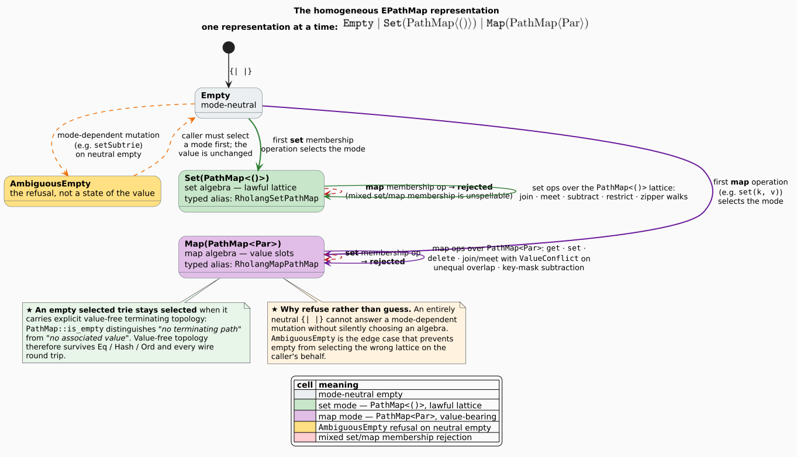
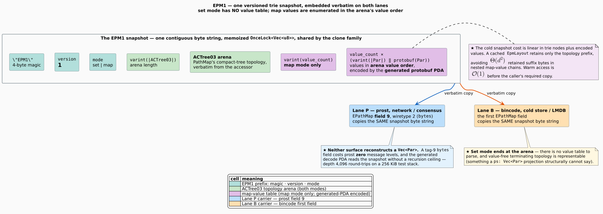
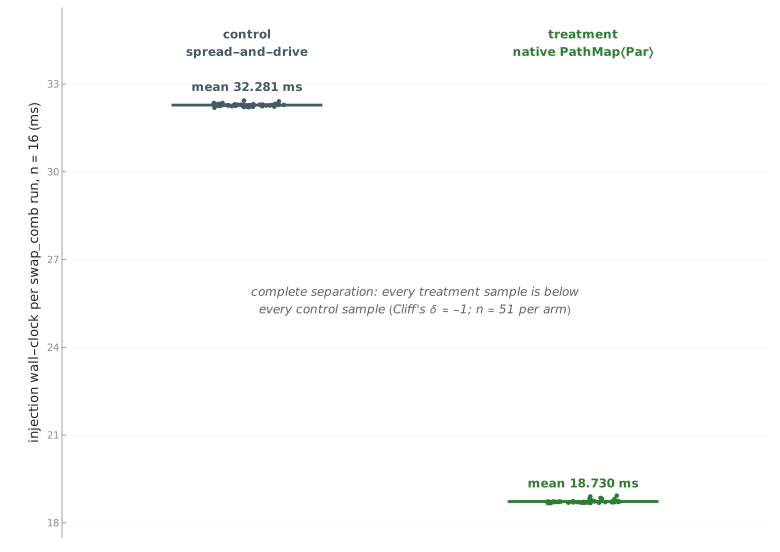
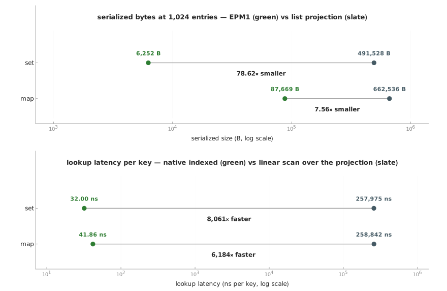
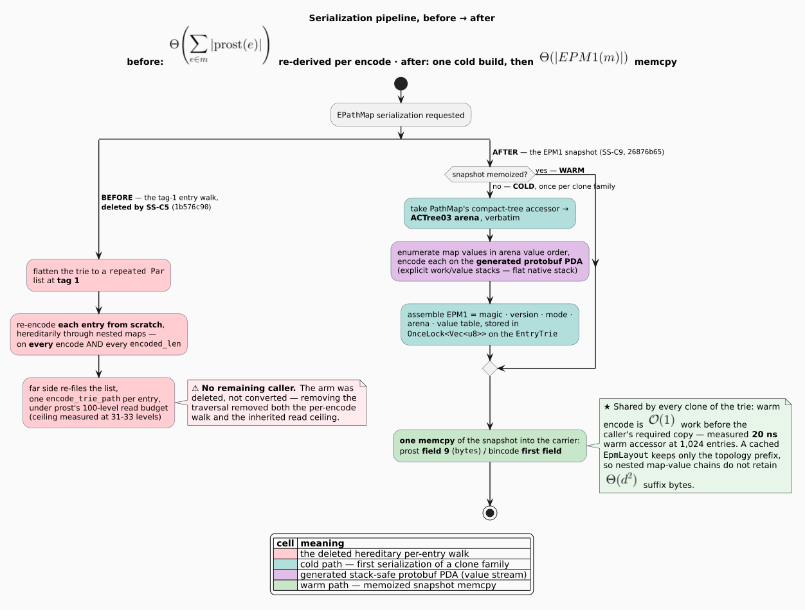
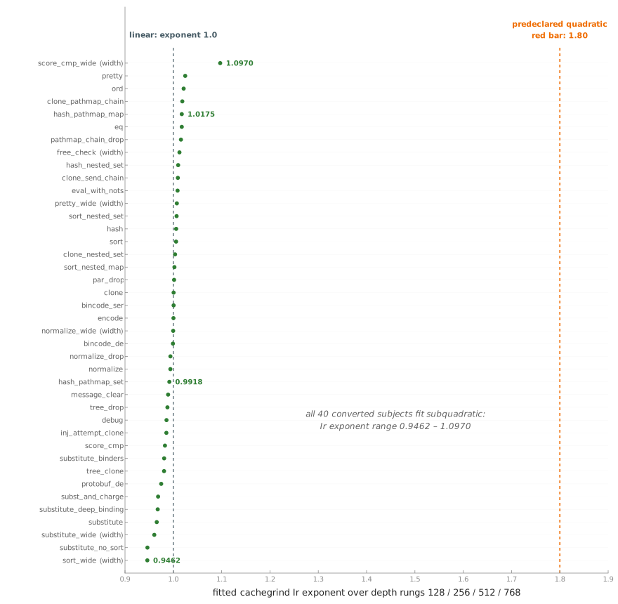
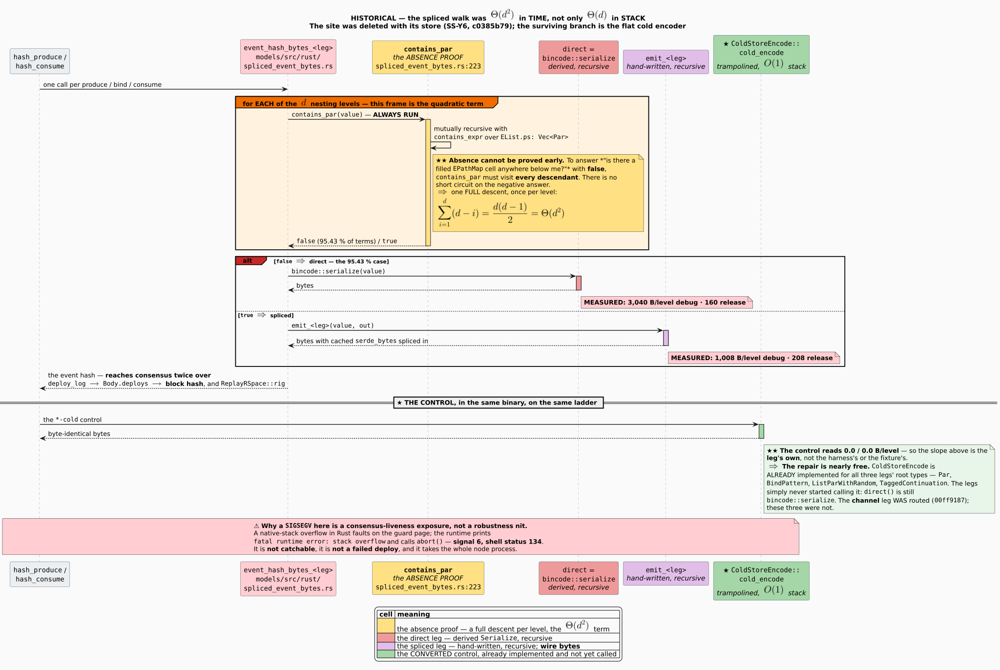
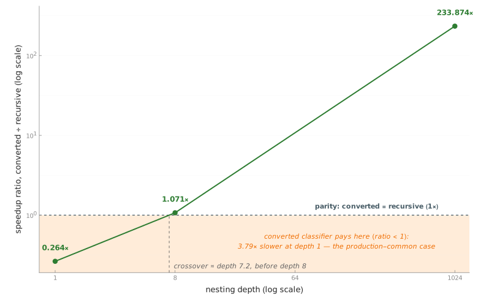

# PathMap-Native EPathMap: A Technical Report on Representation, Wire Format, and Performance

**The Rholang path map as a first-class prefix-compressed trie — in memory, on both wire formats, and in every hashing and ordering preimage**

## Abstract

`EPathMap` — the Rholang expression carrying a path map — is stored by PathMap, a prefix-compressed
byte trie with native zipper, algebra, lattice, and merkle operations. Until this campaign, every
compatibility boundary flattened that trie to a list of `Par` entries before doing anything with it.
Eliminating the projection produced the largest measured wins in the campaign: at a fixed
1,024-entry scale, the EPM1 (EPathMap format, version 1) trie snapshot serializes the set subject in 6,252 B against 491,528 B
for the list projection (**$`78.619\times`$ smaller**) and the map subject in 87,669 B against 662,536 B
($`7.557\times`$); native indexed lookup answers in 32.00 / 41.86 ns per key against roughly 258 µs for a
linear scan over the projection (**$`8{,}060.736\times`$ / $`6{,}183.905\times`$ faster**); and the integrated
evaluator's preregistered end-to-end cell fell from 32.281 ms to 18.730 ms per run
(**41.98 % lower**, 51 samples per arm, every treatment sample below every control sample) while
allocation events fell from 4,119,482 to 278,527 (**93.2 % fewer**).

The final state is a homogeneous representation — `Empty | Set(PathMap<()>) | Map(PathMap<Par>)` —
with mode selection at the first membership operation and a typed `AmbiguousEmpty` refusal instead
of a silent algebra choice; one versioned wire snapshot, **EPM1**, carried verbatim on both wire
formats; and a fully trie-native operation surface, so no surface reconstructs a flat entry list
and generated decoders read the wire without a recursion ceiling (depth 4,096 round-trips on a
256 KiB test stack). The laws are machine-checked: the Rocq model `EPM1.v` is kernel-checked with
zero admissions, a Z3 mode-dispatch counterexample query is unsatisfiable, and language conformance
passes 64/64 executed cases. Two production defects were found by measurement rather than review
and repaired without forking PathMap. The costs are reported with the same candour: the stack-safe
canonical-key classifier pays **$`3.79\times`$ at depth 1** — the production-common case — but
[crosses over before depth 8 and is **$`233.874\times`$ faster by depth 1,024**](#48-costs); and
EPM1's gain is canonicity and single-sourcing, **not** compression (the compression hypothesis was
measured false).

## Highlights

- **Native indexed lookup is $`8{,}060.736\times`$ (set) / $`6{,}183.905\times`$ (map) faster** than a linear scan over
  the list projection at the fixed 1,024-entry scale — 32.00 / 41.86 ns per key against $`\approx 258`$ µs.
- **The wire snapshot is $`78.619\times`$ smaller** for the set subject (6,252 B vs 491,528 B) and $`7.557\times`$
  smaller for the map subject (87,669 B vs 662,536 B).
- **The integrated evaluator runs 41.98 % faster end-to-end** on the preregistered E-8b cell
  (32.281 ms $`\rightarrow`$ 18.730 ms, 51 samples per arm, complete separation of the arms), with **93.2 %
  fewer allocation events** (4,119,482 $`\rightarrow`$ 278,527) — and no PathMap source changed.
- **The read ceiling is gone**: generated decoders round-trip depth 4,096 on a 256 KiB stack where
  the inherited protobuf reader refused ordinary terms at 31–33 levels of nesting.
- **A warm serialization is one memcpy** — the snapshot accessor answers in 20 ns.
- **Every operation is trie-native** — lookup, subtrie navigation, join, meet, subtraction,
  restriction, merkleization, equality, hashing, ordering — over zippers or PathMap algebra.
- **The laws are machine-checked**: Rocq `EPM1.v` kernel-checked with zero admissions; the Z3
  mode-dispatch counterexample query is unsatisfiable; Rholang conformance 64 passed / 0 failed.
- **The costs are published beside the wins**: the stack-safe key classifier pays $`3.79\times`$ at depth 1
  (the production-common case; [crossover before depth 8, $`233.874\times`$ faster by depth 1,024](#48-costs)),
  and EPM1 does not compress.

## Table of contents

- [1. Introduction](#1-introduction)
- [2. Background and glossary](#2-background-and-glossary)
- [3. Methods](#3-methods)
- [4. Results](#4-results)
  - [4.1 The integrated evaluator win](#41-the-integrated-evaluator-win)
  - [4.2 Fixed scale: EPM1 against the list projection](#42-fixed-scale-epm1-against-the-list-projection)
  - [4.3 The native operation surface](#43-the-native-operation-surface)
  - [4.4 Scaling evidence](#44-scaling-evidence)
  - [4.5 Structural wins](#45-structural-wins)
  - [4.6 Formal evidence](#46-formal-evidence)
  - [4.7 Negative results retained](#47-negative-results-retained)
  - [4.8 Costs](#48-costs)
- [5. Discussion](#5-discussion)
- [6. Threats to validity](#6-threats-to-validity)
- [7. Conclusions](#7-conclusions)
- [References](#references)
- [Appendix A — Data availability](#appendix-a--data-availability)

---

## 1. Introduction

A Rholang path map is a trie. PathMap — the trie-map crate underneath it — stores keys as byte
strings with shared prefixes stored once, answers lookups in time proportional to the key length,
and exposes allocation-free cursors, lattice algebra, and merkleization natively. Until this
campaign, none of that reached the system's boundaries: serialization, the network reader, hashing,
ordering, and printing each began by **flattening the trie to a flat list of `Par` entries** — the
Rholang process terms — and operating on the list.

The projection had four costs, each of which the campaign eliminated rather than optimized:

1. **Work before any work.** Every boundary operation paid a full $`\Theta(n)`$ materialization first —
   a lookup PathMap answers in nanoseconds began with a complete walk of the trie.
2. **Representation loss.** A flat entry list structurally cannot say *"this path terminates but
   carries no value"* — value-free terminating topology, which the trie represents natively, was
   unrepresentable on the wire.
3. **A hereditary per-encode walk.** The protobuf encoder re-encoded every entry from scratch on
   every encode and on every length computation.
4. **An inherited read ceiling.** The protobuf reader enforced a fixed 100-level recursion budget,
   measured as a **31–33-level ceiling on ordinary Rholang terms** — while the writer was
   unbounded. A peer could emit what no peer could read: a wire asymmetry a hostile participant
   could exploit.

The campaign's governing rule resolved all four at once: **the trie serializes as a trie, in every
format.** This report presents the final state and its control-versus-treatment measurements. Its
contributions:

- a **homogeneous in-memory representation** with explicit mode selection and a typed refusal in
  place of a silent algebra guess (§4.3, §4.6);
- **EPM1**, one versioned trie snapshot carried verbatim by both wire formats, read by generated
  pushdown automata with no recursion ceiling (§4.2);
- a **fully trie-native operation surface**, including every hashing and ordering preimage (§4.3);
- a **measured end-to-end integration win** in the evaluator under a preregistered protocol (§4.1);
- **machine-checked laws** binding the model to the implementation (§4.6); and
- **honest cost accounting**, including a real regression on the production-common shallow case
  (§4.8) and a falsified compression hypothesis (§4.7).

Everything intermediate — the superseded wire-format stages, per-transition golden-move tables,
defect-discovery narratives, and raw process history — remains in the
[evidentiary ledger](../../design/pathmap/pathmap-report-2026-08-03.md), which this report cites by
section rather than restating.

## 2. Background and glossary

**PathMap and ACTree03.** PathMap is the trie-map crate (workspace sibling `../PathMap`, unmodified
by this campaign — §4.5 covers the one repair that deliberately *stayed out* of it). Its value type
`PathMap<V>` is a **prefix-compressed byte trie** in the lineage of Fredkin's trie
[[Fredkin 1960](#ref-fredkin1960)] and PATRICIA's path compression
[[Morrison 1968](#ref-morrison1968)]: keys are byte strings, shared prefixes are stored once, and a
node may **terminate a path** (be a key) independently of carrying a value. Traversal state is a
**zipper** [[Huet 1997](#ref-huet1997)] — a cursor holding a path buffer and a focus with
ascend/descend/sibling moves; read zippers never allocate per step. **ACTree03** is PathMap's
compact-tree arena: a contiguous byte encoding of the trie's topology, containing structural
leaves, value-bearing nodes, and internal compression nodes that exist only to share structure.

**EPathMap and its modes.** `EPathMap` is the Rholang expression carrying a path map: `{| |}` is
the neutral empty literal, `{| p |}` set membership, `{| k : v |}` a map binding. The final
representation is homogeneous:

```math
\mathit{EPathMap} \;=\; \mathit{Empty} \;\mid\; \mathit{Set}(\mathit{PathMap}\langle()\rangle) \;\mid\; \mathit{Map}(\mathit{PathMap}\langle \mathit{Par}\rangle)
```

The **mode** (set or map algebra) is selected by the first membership operation; mixed membership
is rejected, and a mode-dependent mutation asked of the neutral empty returns the typed refusal
`AmbiguousEmpty` instead of silently guessing an algebra. An empty *selected* trie remains distinct
from the neutral empty via value-free topology — the property the wire format preserves.

**Figure 1 — The homogeneous representation and its mode transitions.** A state diagram, because
mode selection is a one-way transition system over membership operations.



<!-- *(source: [`epathmap-representation-states.puml`](../../design/pathmap/figures/epathmap-representation-states.puml))* -->

**The two wire lanes.** A `Par` reaches storage and the network on two independent formats: the
network/consensus lane (protobuf via `prost`) and the node-local cold-store lane (`bincode` over
`serde` into LMDB (Lightning Memory-Mapped Database); this lane is also the event-hash preimage).
EPM1 — *EPathMap format, version 1* — is one versioned byte string embedded verbatim by **both**
lanes: protobuf carries it as field 9, bincode as the first `EPathMap` field.

**The canonical key stream.** For a path map $`m`$, $`U(m)`$ denotes the trie's own canonical byte
array: the concatenated canonical key stream, each key complete, in trie order, with a designated
escape arm keying a non-ground entry by its canonical protobuf bytes. $`U`$ is one function applied
to the value a surface writes; EPM1 embeds that single-sourcing rule permanently, and §4.7 records
the defect class it excludes.

**Figure 2 — The EPM1 wire layout.** A byte-layout diagram, because the format's claim is
positional: version, mode, framed topology arena, then the ordered value table.



<!-- *(source: [`epm1-wire-layout.puml`](../../design/pathmap/figures/epm1-wire-layout.puml))* -->

**Algorithm 1 (EPM1-ENCODE).** The wire production, in literate form; both lanes call it through
the snapshot cache, so a warm encode never re-enters it.

```pseudocode
EPM1-ENCODE(m):                          // m : a non-empty EPathMap
    if CACHE(m) is filled: return copy of CACHE(m)   // the 20 ns warm path
    out ← "EPM1" ‖ version ‖ mode(m)     // mode ∈ {set, map}
    arena ← COMPACT-TREE(m)              // ACTree03 topology bytes
    out ← out ‖ varint(|arena|) ‖ arena  // framed: length, then bytes
    out ← out ‖ varint(value-count(m))
    for v in values(m) in trie order:    // ordered value table
        b ← CANONICAL-PROTOBUF(v)        // via the generated encode PDA
        out ← out ‖ varint(|b|) ‖ b
    CACHE(m) ← out
    return out
```

The decoder is the mirror image, driven by generated pushdown automata rather than host
recursion, and rejects redundant varints, truncated frames, and trailing bytes — the rejection
behavior §4.6's kernel-checked theorems pin. `‖` denotes byte concatenation. Because the topology
arena is PathMap's own compact encoding carried verbatim, a round trip preserves it byte-for-byte;
the value table's ordinals stay associated with exactly one in-range value each.

**Glossary.**

| term | definition |
|---|---|
| trie | a tree keyed by string position: each edge extends the key; shared prefixes are stored once |
| zipper | an allocation-free cursor over a persistent structure, with ascend/descend/sibling moves |
| PDA | pushdown automaton — an explicit, heap-backed control machine replacing host-stack recursion (defunctionalized continuations [[Reynolds 1972](#ref-reynolds1972); [Danvy & Nielsen 2001](#ref-danvy2001)], trampolined [[Ganz et al. 1999](#ref-ganz1999)]) |
| EPM1 | *EPathMap format, version 1* — the versioned trie snapshot both wire lanes embed verbatim |
| snapshot cache | the once-filled cache of a clone family's completed EPM1 bytes; the first serialization fills it, every later encode copies it |
| escape arm | the reserved key form embedding a non-ground entry's canonical protobuf bytes inside a trie key |
| canonical-key classifier | the predicate deciding whether a term may key the trie directly or must take the escape arm; it runs on every segment of every trie key |
| merkleization | hashing a tree by hashing its children's hashes [[Merkle 1988](#ref-merkle1988)]; here with BLAKE2b-256 [[Aumasson et al. 2013](#ref-aumasson2013)] as the compression function |
| byte golden | a checked-in serialized fixture compared by a Secure Hash Algorithm digest (SHA-256), never by length alone |
| CBR | consensus behavior register — the repository's classification of every byte-moving or consensus-visible change |
| RSS | resident set size — a process's physical-memory footprint |
| Ir / Dr / Dw | cachegrind's deterministic counters: instructions retired, data reads, data writes |
| Welch's t | a two-sample significance test not assuming equal variances [[Welch 1947]](#ref-welch1947) |
| Cohen's d | a standardized effect size: the mean difference in pooled-standard-deviation units |
| Cliff's delta | an ordinal effect size in $`[-1, 1]`$; $`\delta = -1`$ means every treatment sample is below every control sample |
| CI | confidence interval |

## 3. Methods

**Hardware and machine state.** All measurements ran on one workstation — an AMD Ryzen
Threadripper PRO 5975WX (Zen 3, 32 cores / 64 threads), 128 GiB of DDR4-2933 ECC (error-correcting code) memory, the
`amd-pstate-epp` driver under the `performance` governor, on Arch Linux. The full benchmarking
environment, its honest caveats, and the instrument definitions are the companion
[stack-safety technical report §3](../stack-safety/stack-safety-technical-report-2026-08-12.md#3-methods);
this report cites those methods rather than restating them.

**The two-anchor discipline.** This report's numbers come from two distinct measurement anchors,
named in the metadata block, and the distinction is methodological: **fixed-scale claims (§4.2,
§4.3, §4.4) and integration claims (§4.1) never mix anchors.** The fixed-scale numbers were
measured at `e67a6aaa`; the integration cell was measured at the later `b30a1568` after the
evaluator-side repairs landed.

**Byte goldens as anti-vacuity controls.** Serialized-form claims are checked against committed
fixtures compared by SHA-256 digest — never by length, which would accept same-size permutations.
Goldens that a change is *not* supposed to move serve as the anti-vacuity control: a change that
moved every fixture would indicate emitter drift rather than a converted surface.

**The fixed-scale benchmark.** One workload: 1,024 entries, 3 shared prefix segments, 64-byte map
values; 11 samples reported at the median; release profile; one Cargo job; executed under a
`systemd-run` scope with a 4 GiB RSS hard maximum and zero swap. *Cold* means the first
serialization of a clone family (cache empty); *warm* means the cache is filled. These are
fixed-machine comparative measurements, not universal latency claims — **the engineering conclusion
is the ratio and the complexity class.**

**The integration cell (E-8b).** The end-to-end claim was preregistered as pgmcp experiment 171
before its treatment ran: metric = injection wall-clock per `swap_comb` run at $`n = 16`$;
54 repetitions per arm with the first 3 excluded as warm-up (51 measured); one-sided Welch's t at
$`\alpha = 0.05`$; CPU pinned to core 0 under the performance governor; a 10 GiB memory cap with
zero swap. The deterministic allocation counts come from heaptrack on the same cell.

**Deterministic complexity fits.** Scaling exponents are cachegrind Ir/Dr/Dw counters fitted over
depth rungs 128 / 256 / 512 / 768, with a parameter-invariant child process subtracted at every
rung and a predeclared quadratic red bar at exponent 1.80. Deterministic instruments are primary;
wall clock corroborates. Stack-safety claims (depth 4,096 on a 256 KiB stack; flat bytes-per-level)
use the companion report's forked bisection instrument.

---

## 4. Results

Results are ordered from most to least impressive; the section closes with the costs.

### 4.1 The integrated evaluator win

The strongest single result is end-to-end. After the reducer stopped reconstructing and
copy-on-write cloning the native `PathMap<Par>` — evaluation preserves the native root, shared
clone-family teardown releases one root, and the persistent index is bound once per query phase —
the preregistered E-8b cell (pgmcp experiment **171**) accepted its locked criterion:

| arm | mean | median |
|---|---:|---:|
| control — spread-and-drive evaluation | 32.280954 ms | 32.276612 ms |
| treatment — native `PathMap<Par>` evaluation | 18.730472 ms | 18.712728 ms |

The mean difference is **$`-13.550482`$ ms ($`-41.98\%`$)** with a 95 % confidence interval of
$`[-13.569871,\ -13.531093]`$ ms, one-sided Welch p-value $`9.88 \times 10^{-210}`$, and Cohen's
$`d = -274.697`$. The nonparametric view is starker: the Mann–Whitney p-value underflows to
numerical zero and Cliff's $`\delta = -1`$ — **every treatment sample lies below every control
sample**. Allocation events on the same cell fell from **4,119,482 to 278,527 (93.2 % fewer)**.
The full fired-result equivalence suite and all 45 stack-gate subjects pass, and **no PathMap
source changed** — the entire win is the consumer's projection removed. (A first integration
attempt was rejected under the same locked criterion and is retained as pgmcp experiment 170; see
the ledger §5.4.1 for its record.)

**Figure 3 — The two arms, distributionally.** A jittered strip plot, because with complete
separation the distributions themselves are the finding; 51 samples per arm with per-arm mean bars.



<!-- *(source: [`e8b-arm-strips.wl`](figures/e8b-arm-strips.wl); data:
[`e8b-native-pathmap-par-e6a-2026-08-04.tsv`](../../design/stack-safety/measurements/e8b-native-pathmap-par-e6a-2026-08-04.tsv))* -->

### 4.2 Fixed scale: EPM1 against the list projection

At the fixed 1,024-entry scale, the list projection is the control and EPM1 with native operations
is the treatment. The table is generated from the durable measurement file by
`tools/mk_tables.py`; the engineering conclusion is the ratio and the complexity class.

<!-- mk_tables:fixed-scale:begin generated by tools/mk_tables.py — do not hand-edit -->
| Measurement | Unit | Set | Map |
|---|---|---:|---:|
| EPM1 bytes | B | 6,252 | 87,669 |
| list-projection bytes | B | 491,528 | 662,536 |
| size ratio, projection ÷ EPM1 | x | 78.619 | 7.557 |
| native indexed lookup | ns/key | 32.00 | 41.86 |
| linear projected lookup | ns/key | 257,975.03 | 258,842.32 |
| lookup ratio, projected ÷ native | x | 8,060.736 | 6,183.905 |
| cold EPM1 encode | ns | 105,990 | 478,094 |
| warm snapshot accessor | ns | 20 | 20 |
| direct EPM1 decode | ns | 407,751 | 1,576,672 |
| generated protobuf decode from shared `Bytes` | ns | 2,704,396 | 4,044,712 |
| bincode decode from generated encoder bytes | ns | 2,711,680 | 4,093,684 |
| native join | ns | 84,830 | 853,895 |
| merkleize | ns | 60,204 | 197,864 |
<!-- mk_tables:fixed-scale:end -->

Three rows carry the headline. The wire snapshot is **$`78.619\times`$ smaller** on the set subject and
**$`7.557\times`$** on the map subject — the projection re-encoded every entry as a full `Par`, while EPM1
carries the trie's own compact topology once. Native indexed lookup answers in **32.00 / 41.86 ns
per key** where the projection forces a linear scan at roughly 258 µs per key
(**$`8{,}060.736\times`$ / $`6{,}183.905\times`$**). And a warm serialization is one memcpy: the **20 ns** snapshot
accessor is the whole cost of every encode after the first, on both wire lanes.

The command-level envelope: the warm release run completed in 6.34 s at a 104,036 KiB peak RSS;
the preceding cold build-plus-run took 4 min 34.55 s at 957,940 KiB — both without swap.

**Figure 4 — Fixed-scale dominance.** Dumbbell panels on logarithmic position axes, because the
gaps span two to four orders of magnitude and position (not bar length) is the honest encoding at
log scale; every dot carries its value.



<!-- *(source: [`epm1-fixed-scale-bars.wl`](figures/epm1-fixed-scale-bars.wl); data:
[`epm1-fixed-scale-2026-08-03.tsv`](../../design/pathmap/measurements/epm1-fixed-scale-2026-08-03.tsv))* -->

### 4.3 The native operation surface

Every `EPathMap` operation is trie-native: lookup, subtrie navigation, branch removal, `dropHead`,
join, meet, subtraction, restriction, merkleization, equality, hashing, and ordering all run over
read/write zippers or PathMap algebra directly. `keys` is the sole operation that constructs a
flat collection — and it is the caller's request for one, not a hidden implementation step. Mode
selection happens at the first membership operation; a mode-dependent mutation asked of the neutral
empty returns the typed `AmbiguousEmpty` refusal.

The serialization pipeline is single-sourced through the same machinery: both wire lanes embed the
identical EPM1 snapshot, the snapshot cache makes the warm path one copy, and the generated decode
pushdown automata read it back with no recursion ceiling — depth 4,096 round-trips on a 256 KiB
test stack, where the inherited protobuf reader had refused ordinary terms at 31–33 nesting levels.

**Figure 5 — The serialization pipeline.** An activity diagram, because the claim is about flow:
one canonical byte production feeding both lanes, the cache, and every hashing preimage.



<!-- *(source: [`epathmap-serialization-pipeline.puml`](../../design/pathmap/figures/epathmap-serialization-pipeline.puml))* -->

### 4.4 Scaling evidence

The two PathMap hashing subjects sit in the campaign's 40-subject deterministic-time cohort, whose
cachegrind fits bound every converted subject's instruction growth: `hash_pathmap_set` fits Ir
exponent **0.9918** (Dr 0.9948, Dw 0.9882) and `hash_pathmap_map` fits **1.0175** (Dr 1.0190,
Dw 1.0152) over the depth rungs — linear, in a cohort whose full range is 0.9462 to 1.0970 against
the predeclared quadratic red bar of 1.80. No converted subject in the campaign approaches the bar.

**Figure 6 — The cohort's fitted exponents** (shared with the companion stack-safety report, whose
§4.1 discusses the full cohort). A dot plot against the linear reference and the predeclared bar;
the two PathMap subjects are value-labelled.



<!-- *(source: [`phase7-ir-exponents.wl`](../stack-safety/figures/phase7-ir-exponents.wl); data:
[`phase7-cachegrind-fits-2026-08-03.tsv`](../../design/stack-safety/measurements/phase7-cachegrind-fits-2026-08-03.tsv))* -->

### 4.5 Structural wins

**Reverse-zipper totality.** The expression evaluator streams set keys and map key/value pairs
directly from reverse PathMap order instead of retaining a forward vector of projected child
pointers — zero projected pointers, with canonical forward evaluation order and map association
preserved. Hardening this path surfaced two production defects **by measurement rather than
review**, both repaired without forking PathMap: an ACTree03 reader that surfaced internal
compression nodes as observable terminating paths on dense maps, and a reverse-zipper sibling walk
that panicked on a dense zero mask word. The repaired reverse walk is total and allocation-free,
expressed purely in the zipper's public primitives. (The discovery narratives are the ledger's
§5.7; the durable facts are what this section states.)

**The dissolved intern store.** The global least-recently-used (LRU) intern store for `EPathMap`
— 64 buckets, plus a spliced event-hash emitter — was **deleted, not repaired**: obtaining a
shared entry cost a full streamed digest walk plus a second full encode walk to verify the bucket —
*two walks to avoid one*. Its deletion moved **zero byte goldens**, its membership probe became
constant-false, and roughly 2,300 lines of emitter, store, and suite were removed. The event-hash
preimage is now single-sourced through the same EPM1 bytes as everything else.

**Figure 7 — Historical (pre-fix) behavior: the spliced walk.** A sequence diagram of the deleted
dispatch path, kept because it documents what the deletion removed — the depicted site no longer
exists.



<!-- *(source: [`spliced-walk-quadratic-time.puml`](../../design/pathmap/figures/spliced-walk-quadratic-time.puml))* -->

### 4.6 Formal evidence

The EPathMap laws are machine-checked, and the binding between theorem and implementation is
itself checked.

**Rocq.** Three files are kernel-checked with **no `Admitted`, `admit`, or `Axiom`**; `EPM1.v`
models the canonical length framing, the topology bytes, the ordered value table, and
generated-decoder value equivalence. Six bindings deserve names:

- `subtract_overlap_is_value_independent_key_mask` — the first model specified map subtraction as
  a value comparison while the Rust test specified the intended key-mask operation; the theorem was
  corrected and kernel-checked. The divergence surfaced as a red check, not as a green theorem
  about the wrong law — evidence the proof-to-test binding is live.
- `epm1_framed_decode_encode_identity` and `epm1_preserves_topology_and_ordered_value_table`
  (commit `87e514b6`) — the model carries EPM1's actual base-128 arena length, topology frame,
  value count, and ordered length-framed value bodies, and proves rejection of redundant varints,
  truncated frames, and trailing bytes.
- `epm1_round_trip_preserves_topology_value_association` and
  `associated_map_ordinals_are_in_range_and_unique` — the topology arena survives byte-for-byte
  and each ordinal stays associated with exactly one in-range value.
- `epm1_generated_pda_values_equal_recursive_encoding` — instantiates the generic fold theorem for
  every map value and lifts equality pointwise to the complete ordered value table; exercised at
  depth 4,096 on a 256 KiB stack.
- The generic `compile_run_equivalence` theorem, admission-free, backs the generated ordering that
  map algebra reaches through the metered evaluator.

**Z3.** The mode-dispatch counterexample query is **unsatisfiable** — no reachable input drives a
set-mode value into map dispatch or the reverse.

**Conformance and suites.** The MeTTaIL Rholang conformance suite passes 64 / 0 with 5 intentional
ignores — the cases that formerly failed on the projected carrier execute on the native trie. The
supporting test matrix, by suite: algebra 6; EPM1 snapshot 15; zero-copy decode refinement 7 + 42 +
59 (codec, shape, and independent byte differentials); reverse-zipper printer 44 with 62
integration, 2 provenance, and 3 census checks; native zipper 7; collection methods 2; zipper path
management 8; zipper query methods 18 (native subtrie values equal an absolute-key scan oracle);
escape-arm stack safety 6; read-dispatch registry 4; byte goldens 7.

### 4.7 Negative results retained

Two negative results are part of the record and belong beside the wins:

- **EPM1 is not compression.** The serialized key stream does not exploit prefix sharing — the
  hypothesis that it would was **measured false**. EPM1's gain is canonicity and single-sourcing;
  the size wins of §4.2 come from not re-encoding entries as full terms, not from entropy coding.
- **The first integration attempt failed its locked criterion** and was rejected as preregistered
  (pgmcp experiment 170); the accepted result of §4.1 is its successor under the same protocol.

A third negative — a play/replay event-hash divergence caused by serializing unblanked entry keys
beside blanked values — was measured, repaired, and is **permanently excluded** by EPM1's
single-sourcing rule: one canonical byte production feeds every preimage.

### 4.8 Costs

The conversion's price is concentrated exactly where production traffic is: shallow keys. The
stack-safe canonical-key classifier — which runs on every segment of every trie key — is
**$`3.79\times`$ slower at depth 1** (about 96 ns $`\rightarrow`$ 363 ns per escape payload), and depth 1 is the
production-common case. The crossover is before depth 8 (measured ratio $`1.071\times`$ there), and at
depth 1,024 the converted classifier is $`233.874\times`$ faster; a report publishing only the
$`233.874\times`$ would be advocacy rather than measurement.

**Figure 8 — The classifier's price ladder.** A log-log line with the sub-parity region shaded and
labelled, because the win and the cost are one curve.



<!-- *(source: [`classifier-price-ladder.wl`](figures/classifier-price-ladder.wl); data:
[`classifier-ladder.tsv`](data/classifier-ladder.tsv))* -->

---

## 5. Discussion

**Representation change beats traversal conversion where it applies.** The companion stack-safety
programme converted traversals — replacing host-stack recursion with explicit machines. This
campaign's biggest numbers came from a different move: changing what the boundaries operate *on*.
Once the trie itself crossed every boundary, whole traversals ceased to exist — there is no
projection walk left to convert, no per-entry re-encode to amortize, and the E-8b win of §4.1 was
obtained **without changing a line of PathMap**.

**Canonicity is the product; speed is the dividend.** EPM1's defining property is that one byte
production — the same framed topology and ordered value table — feeds both wire lanes, the
snapshot cache, and every hashing and ordering preimage. That single-sourcing is what permanently
excludes the play/replay divergence class of §4.7; the $`78.619\times`$ and $`8{,}060.736\times`$ of §4.2 are what the
same property happens to pay.

**Deletion is a fix.** The intern store fell to an accounting argument — two walks to avoid one —
not to a rewrite. The strongest evidence that it was the right kind of fix is negative space: zero
byte goldens moved, and the event-hash preimage came out simpler than the machinery that had been
guarding it.

**Measurement found what review did not.** Both production defects of §4.5 were surfaced by
instruments — a dense-map golden and a zipper walk under a property harness — after the code had
been reviewed. The campaign's discipline of publishing negative results (§4.7) and prices (§4.8)
is the same discipline that caught them.

## 6. Threats to validity

- **Fixed-machine, fixed-scale numbers.** Every ratio in §4.2 is a comparative measurement on one
  workstation at one workload shape (1,024 entries, 3 shared prefix segments, 64-byte values). The
  complexity classes travel; the constants do not.
- **One integration cell.** The end-to-end win of §4.1 is one preregistered workload
  (`swap_comb`, $`n = 16`$). It was chosen adversarially for projection cost, which is the effect
  under test — but it is one cell, not a workload census.
- **Two anchors.** Fixed-scale and integration numbers were measured at different tree states,
  named in the metadata block; conflating them would misattribute the evaluator-side repairs.
- **The production-common case pays.** Production keys are overwhelmingly shallow, which is
  exactly where the classifier's $`3.79\times`$ regression sits (§4.8). The report treats this as a real
  cost, not a footnote; the crossover before depth 8 bounds it.
- **Snapshot report of a living record.** The evidentiary ledger continues to accrue evidence
  after this report's snapshot anchor; identifiers cited here are stable and never reused, so its
  rows remain resolvable from this document indefinitely.

## 7. Conclusions

The Rholang path map is now a trie everywhere: in memory as a homogeneous
`Empty | Set | Map` representation with an explicit mode transition and a typed refusal; on both
wire formats as one versioned, cached, verbatim EPM1 snapshot readable without a recursion
ceiling; and in every operation, hash, and ordering the runtime performs on it. The measured
consequences at fixed scale are size and lookup improvements of one to four orders of magnitude,
an end-to-end evaluator win of 41.98 % with a 93.2 % reduction in allocation events under a
preregistered protocol, machine-checked format laws with zero admissions, and one honestly priced
regression on shallow keys. The evidentiary ledger remains the complete record; this report is its
anchor-dated, human-readable distillation.

## References

Abbreviations used in the entries below:

| abbreviation | expansion |
|---|---|
| ACM | Association for Computing Machinery |
| ACNS | Applied Cryptography and Network Security (conference) |
| BLAKE2 | the BLAKE2 cryptographic hash family — a proper name, not an initialism; it appears in the Aumasson et al. title |
| CRYPTO | International Cryptology Conference |
| ICFP | International Conference on Functional Programming |
| LNCS | Lecture Notes in Computer Science (Springer series) |
| MD5 | Message-Digest Algorithm 5 (named only inside the BLAKE2 paper's title) |
| PLDI | Programming Language Design and Implementation |
| PPDP | Principles and Practice of Declarative Programming |
| SIGPLAN | ACM Special Interest Group on Programming Languages |

###### ref-aumasson2013

**[Aumasson et al. 2013]** Aumasson, J.-P., Neves, S., Wilcox-O'Hearn, Z., & Winnerlein, C. (2013).
*BLAKE2: Simpler, Smaller, Fast as MD5.* In ACNS 2013, LNCS 7954, 119–135.
[doi:10.1007/978-3-642-38980-1_8](https://doi.org/10.1007/978-3-642-38980-1_8)

###### ref-danvy2001

**[Danvy & Nielsen 2001]** Danvy, O., & Nielsen, L. R. (2001). *Defunctionalization at work.* In
Proceedings of the 3rd ACM SIGPLAN International Conference on Principles and Practice of
Declarative Programming (PPDP '01), 162–174.
[doi:10.1145/773184.773202](https://doi.org/10.1145/773184.773202)

###### ref-fredkin1960

**[Fredkin 1960]** Fredkin, E. (1960). *Trie memory.* Communications of the ACM, 3(9), 490–499.
[doi:10.1145/367390.367400](https://doi.org/10.1145/367390.367400)

###### ref-ganz1999

**[Ganz et al. 1999]** Ganz, S. E., Friedman, D. P., & Wand, M. (1999). *Trampolined style.* In
Proceedings of the 4th ACM SIGPLAN International Conference on Functional Programming (ICFP '99),
18–27. [doi:10.1145/317636.317779](https://doi.org/10.1145/317636.317779)

###### ref-huet1997

**[Huet 1997]** Huet, G. (1997). *The Zipper.* Journal of Functional Programming, 7(5), 549–554.
[doi:10.1017/S0956796897002864](https://doi.org/10.1017/S0956796897002864)

###### ref-knuth1984

**[Knuth 1984]** Knuth, D. E. (1984). *Literate programming.* The Computer Journal, 27(2), 97–111.
[doi:10.1093/comjnl/27.2.97](https://doi.org/10.1093/comjnl/27.2.97)

###### ref-merkle1988

**[Merkle 1988]** Merkle, R. C. (1988). *A digital signature based on a conventional encryption
function.* In Advances in Cryptology — CRYPTO '87, LNCS 293, 369–378.
[doi:10.1007/3-540-48184-2_32](https://doi.org/10.1007/3-540-48184-2_32)

###### ref-morrison1968

**[Morrison 1968]** Morrison, D. R. (1968). *PATRICIA — Practical Algorithm To Retrieve
Information Coded in Alphanumeric.* Journal of the ACM, 15(4), 514–534.
[doi:10.1145/321479.321481](https://doi.org/10.1145/321479.321481)

###### ref-nethercote2007

**[Nethercote & Seward 2007]** Nethercote, N., & Seward, J. (2007). *Valgrind: a framework for
heavyweight dynamic binary instrumentation.* In Proceedings of the 28th ACM SIGPLAN Conference on
Programming Language Design and Implementation (PLDI '07), 89–100.
[doi:10.1145/1250734.1250746](https://doi.org/10.1145/1250734.1250746)

###### ref-reynolds1972

**[Reynolds 1972]** Reynolds, J. C. (1972). *Definitional interpreters for higher-order programming
languages.* In Proceedings of the ACM Annual Conference (ACM '72), 717–740.
[doi:10.1145/800194.805852](https://doi.org/10.1145/800194.805852)

###### ref-welch1947

**[Welch 1947]** Welch, B. L. (1947). *The generalization of "Student's" problem when several
different population variances are involved.* Biometrika, 34(1–2), 28–35.
[doi:10.1093/biomet/34.1-2.28](https://doi.org/10.1093/biomet/34.1-2.28)

## Appendix A — Data availability

**The evidentiary ledger is the experiment log of record.** The
[pathmap ledger](../../design/pathmap/pathmap-report-2026-08-03.md) holds everything this report
cites without restating: the wire-format lineage and its superseded stages, the per-transition
golden-move tables, the negative-result details, the defect-discovery narratives, and the complete
reproduction commands (its Appendix A — every suite and benchmark under `systemd-run` resource
caps, teed to files). This report is a snapshot at `feature/mettail@9e44e570d`; evidence recorded
after that anchor appends to the ledger first.

**Claims, experiments, and data.**

| claim (section) | pgmcp experiment | durable data | ledger section |
|---|---|---|---|
| integrated evaluator $`-41.98\%`$ (§4.1) | **171** — preregistered, accepted | [`e8b-native-pathmap-par-e6a-2026-08-04.tsv`](../../design/stack-safety/measurements/e8b-native-pathmap-par-e6a-2026-08-04.tsv) (51 samples/arm; decision metadata in its header; kept in the stack-safety tree) | §5.4.1 |
| rejected first integration attempt (§4.7) | **170** — preregistered, rejected | ledger record | §5.4.1 |
| fixed-scale table (§4.2) | **177** — `pm-tr-epm1-fixed-scale-2026-08-12`, retrospective registration of the published table, accepted (artifact 309) | [`epm1-fixed-scale-2026-08-03.tsv`](../../design/pathmap/measurements/epm1-fixed-scale-2026-08-03.tsv) | §5.4 |
| scaling exponents (§4.4) | **176** — `ss-tr-phase7-ir-exponents-2026-08-12`, retrospective, accepted (artifact 308) | [`phase7-cachegrind-fits-2026-08-03.tsv`](../../design/stack-safety/measurements/phase7-cachegrind-fits-2026-08-03.tsv) | §5.6 |
| per-level conversions (companion report) | **175** — `ss-tr-per-level-conversions-2026-08-12`, retrospective, accepted | companion report Appendix A | stack-safety abstract |

Experiments 170 and 171 were preregistered before their treatments ran; experiments 175–177 are
explicitly *retrospective* registrations of numbers already published in the ledgers, recorded so
the raw values live in the pgmcp experiment ledger with their acceptance criteria restated.

**Curated figure data.** The figure-driving values curated for this report live in
[`data/classifier-ladder.tsv`](data/classifier-ladder.tsv); every row carries the ledger section
and a verbatim source quote, and `tools/mk_tables.py provenance` verifies each quote against the
ledger mechanically. The embedded fixed-scale table is generated by `tools/mk_tables.py` and
byte-checked by its `check` subcommand.

