# Stack Safety in the F1r3node Rholang Interpreter: A Technical Report

**Eliminating depth-proportional native-stack consumption over the `Par` term family**

## Abstract

A `Par` — the term representation of the F1r3node Rholang interpreter — is a mutually recursive family of 37 protobuf message types, every cycle of which passes through `Par` itself. Until 2026-07-26, essentially every traversal of that family was written as recursive descent, so each consumed native call stack in proportion to the nesting depth of an attacker-chosen term; because a native-stack overflow in Rust is a segmentation fault on the guard page rather than a catchable panic, program-controlled nesting depth controlled node liveness. The worst reachable instances were concrete and small: 8.8 kB of source text aborted a node through the term destructor alone, and a 43,565-byte deploy aborted it through unauthenticated pre-consensus gRPC ingress, before any budget existed to charge.

This report is the anchor-dated summary of the campaign that removed that class. At the snapshot anchor, the term-family register carries **45 converted production subjects — 37 on the depth axis and 8 on the width axis — and zero tripwire subjects**, with every subject driven on the ordinary execution architecture: no `RUST_MIN_STACK`, no `stacker`, no traversal-depth ceiling anywhere in production. The strengthened hand-written recursion census enumerates 566 recursive components (41 mentioning the term family, 18 mutual) with zero unmeasured dispositions, and whole-project re-analysis of 202/202 production files in `f1r3node-rust-mettail` and 1,910/1,910 in `mettail-rust` reports zero direct and zero mutual production recursion (2026-08-08, revalidated 2026-08-12). The 40-subject deterministic-time cohort contains no quadratic subject: fitted instruction-count exponents span 0.9462–1.0970 against a predeclared 1.80 failure bar.

Representative endpoints: the substitution driver fell from 195,728 bytes of stack per nesting level to 0; a clone-driven workload that previously died in an approximately 30 GB out-of-memory kill now peaks at 112 MB (roughly 270-fold); a generated-parser boundary workload fell from 248.42 s to 10.83 s (22.94-fold) by eliminating 336,387,001 redundant ancestry visits; and the end-to-end deploy ceiling rose from 286 to 6,831 nesting levels while its designated control moved by approximately nothing, exactly as predicted. The costs are reported with the same candor: the single-walk cold-store encoder performs 3.25 times more heap writes and doubles peak heap on the production shape, one sibling benchmark shows the converted encoder slightly slower, and the stack-safe canonical-key classifier is 3.79 times slower at depth 1, the production-common case.

## Highlights

- **Substitution: 195,728 $`\rightarrow`$ 0 bytes of native stack per nesting level.** The interpreter's costliest traversal became depth-independent; its replacement state is a linear 6,341.25 B/level of heap, about 31 times smaller than the frame it replaced.
- **Approximately 30 GB (out-of-memory kill) $`\rightarrow`$ 112 MB peak ($`\approx 270\times`$)** on the deep-chain clone workload, by a representation change that made `Clone` a reference-count bump; cloning a depth-4,096 term now allocates zero additional bytes.
- **336,387,001 $`\rightarrow`$ 0 redundant graph-structured-stack ancestry visits**, and 248.42 s $`\rightarrow`$ 10.83 s ($`22.94\times`$), on the 1,000-binder generated-parser boundary workload.
- **Metering-handshake depth ceiling 729 $`\rightarrow`$ at least 1,048,576 ($`\geq 1{,}438\times`$)**, with the slope driven from 2,852 B/level to 0.
- **End-to-end `plain_deploy` ceiling 286 $`\rightarrow`$ 6,831 levels ($`23.9\times`$)** while the `env_get_deploy` control moved 283 $`\rightarrow`$ 274 ($`\approx 1\times`$, as predicted before measurement).
- **The protobuf read ceilings {31, 32, 33} are removed**: generated decode automata read depth 4,096 on a 256 KiB stack where the vendored reader refused depth 34.
- **Cold-store encoding allocates $`770\times`$ fewer blocks and is $`1.07\times`$–$`1.19\times`$ faster** on the production-weighted mix — a stack-safety conversion that also won time and allocation.
- **Integrated evaluator benchmark 41.98 % faster** (32.281 ms $`\rightarrow`$ 18.730 ms) after the native `PathMap<Par>` integration, with 93.2 % fewer allocation events (companion report).
- **Zero production recursion, whole-project**: 202/202 and 1,910/1,910 production files analyze to zero direct and zero mutual-recursion findings, revalidated 2026-08-12.
- **The costs are in the same register as the wins**: $`3.25\times`$ heap writes on the converted encoder, a $`0.954\times`$–$`0.962\times`$ sibling-benchmark slowdown, and a $`3.79\times`$ classifier penalty at depth 1 are reported beside the headline results, not instead of them.

## Contents

- [Abstract](#abstract)
- [Highlights](#highlights)
- [1. Introduction](#1-introduction)
  - [1.1 The problem is liveness, not performance](#11-the-problem-is-liveness-not-performance)
  - [1.2 What makes a fix a fix](#12-what-makes-a-fix-a-fix)
  - [1.3 Contributions and reading contract](#13-contributions-and-reading-contract)
- [2. Background and glossary](#2-background-and-glossary)
  - [2.1 The term family](#21-the-term-family)
  - [2.2 The two wire formats](#22-the-two-wire-formats)
  - [2.3 The observable](#23-the-observable)
  - [2.4 Glossary](#24-glossary)
- [3. Methods](#3-methods)
  - [3.1 Hardware](#31-hardware)
  - [3.2 Machine state at measurement time](#32-machine-state-at-measurement-time)
  - [3.3 Toolchain and build configuration](#33-toolchain-and-build-configuration)
  - [3.4 Instruments](#34-instruments)
  - [3.5 Procedure](#35-procedure)
  - [3.6 The bisection instrument and its floor](#36-the-bisection-instrument-and-its-floor)
  - [3.7 The paired timing design](#37-the-paired-timing-design)
  - [3.8 Anti-vacuity discipline](#38-anti-vacuity-discipline)
- [4. Results](#4-results)
  - [4.1 Outcome at a glance](#41-outcome-at-a-glance)
  - [4.2 Family A — the core traversals](#42-family-a--the-core-traversals)
  - [4.3 Family G, with Family F — the mettail-rust closures](#43-family-g-with-family-f--the-mettail-rust-closures)
  - [4.4 Family C — the codecs](#44-family-c--the-codecs)
  - [4.5 Family D — the deploy path](#45-family-d--the-deploy-path)
  - [4.6 Family B — the evaluator and the async driver](#46-family-b--the-evaluator-and-the-async-driver)
  - [4.7 Family E — the instrument measured on itself](#47-family-e--the-instrument-measured-on-itself)
  - [4.8 The honest tail — X, Y, and the unobtainable](#48-the-honest-tail--x-y-and-the-unobtainable)
  - [4.9 Falsified predictions, consolidated](#49-falsified-predictions-consolidated)
  - [4.10 Costs](#410-costs)
- [5. Discussion](#5-discussion)
- [6. Threats to validity](#6-threats-to-validity)
- [7. Conclusions](#7-conclusions)
- [References](#references)
- [Appendix A — data availability](#appendix-a--data-availability)

---

## 1. Introduction

### 1.1 The problem is liveness, not performance

Rholang is a concurrent language in the reflective higher-order calculus tradition [[Meredith & Radestock 2005](#ref-meredith2005)], descended from the pi-calculus [[Milner, Parrow & Walker 1992](#ref-milner1992)]. Its terms nest without bound: `[[[[0]]]]` is a legal list, and so is the same expression with a million brackets. A node accepts such terms from the network, normalizes them, evaluates them, serializes them, and stores them — and every one of those verbs was, until this campaign, implemented as recursive descent: a function that calls itself, or a mutually recursive partner, once per nesting level.

In Rust that consumes the native call stack, a fixed-size region terminated by a guard page. Running off the end raises the segmentation-fault signal (`SIGSEGV`), which the Rust runtime converts to `fatal runtime error: stack overflow` followed by `abort()` — the abort signal (`SIGABRT`), shell status 134. This is not a panic. `catch_unwind` cannot intercept it, no enclosing error arm observes it, and the whole process dies rather than one worker task. The question "how deep may an incoming term be?" is therefore not a performance question; it is the question "can an unauthenticated party stop this node?", and in a consensus system that is a liveness and availability property.

The campaign's opening reproducer makes the scale concrete: a 30-character Rholang program with no guest language and no lambda calculus, `@"OUT"!([[[[[[[[[[0]]]]]]]]]])` at nesting depth 10, aborted the reducer on the 2 MiB stack a `tokio` worker thread receives. The cold-store variant of the same class was worse than any transient fault: the `bincode` format has no recursion limit in any shipped version, and the state importer stores cold-store bytes without deep-decoding them, so a too-deep datum enters storage through a path that structurally cannot observe its depth — and then aborts the node on every read-back, on every restart, and on every peer that synced the same state. Every other member of the family is a transient worker fault; that one is permanent and replicated.

### 1.2 What makes a fix a fix

A constant-factor improvement is not a fix. Reducing a traversal from 195,728 to 27,179 bytes per level multiplies the maximum admissible depth by seven and leaves the class — and therefore the vulnerability — exactly where it was. The campaign adopted a binary criterion, enforced mechanically by its gate:

> A traversal is **converted** when its minimum surviving native stack is *identical* at nesting depth 4 and at nesting depth 4,096, in both build profiles.

Membership in the converted register is the deliverable, and it only ever grows: a traversal enters only by being converted, never by having a ceiling raised. Everything not yet converted sat in a tripwire list under a per-profile ceiling certifying only "not worse"; at the snapshot anchor both production tripwire lists are empty. The criterion is deliberately about the slope and not the intercept — several conversions raise the fixed setup cost, and that is the expected direction for a driver that owns two work vectors.

### 1.3 Contributions and reading contract

This report contributes: (1) the final register state — 45 converted production subjects, zero tripwires — presented as nine generated, machine-checked family tables in which every stable identifier appears exactly once; (2) the closure evidence around the register: a 566-component recursion census with zero unmeasured dispositions and whole-project zero-recursion analyses of both repositories; (3) the measurement methodology — a forked-child bisection instrument with a typed floor, a paired timing design, and an anti-vacuity discipline — presented with its own failures as results; and (4) the candid costs and the falsified predictions, in the same register as the wins.

The reading contract: this report carries control and final treatment results only. The [evidentiary ledger](../../design/stack-safety/stack-safety-report-2026-07-29.md) remains the complete record — per-fix defect narratives, repair architectures with rejected alternatives, per-clause provenance tags, and full bisection ladders — and it is a living document: results recorded after this report's snapshot anchor append there first. Register identifiers (`SS-A2`, `SS-G45`, …) are stable and never reused, so every row cited here resolves permanently.

---

## 2. Background and glossary

### 2.1 The term family

`Par` is the Rholang process term, defined in `RhoTypes.proto` and compiled by `prost` into the `models` crate. The schema carries 57 message types and 5 oneof types; the child relation over them has 58 nodes and 95 edges, decomposing under Tarjan's algorithm [[Tarjan 1972](#ref-tarjan1972)] into 22 strongly connected components (SCCs — maximal subgraphs in which every node reaches every other), of which exactly one is cyclic, with 37 members.

The set containing `Par` alone is a feedback vertex set of size one: removing `Par` and recomputing leaves nothing cyclic. This was computed, not assumed — the incoming analysis had asserted a three-frame cycle, and a 37-member component may in general contain sub-cycles avoiding any given vertex. Two consequences are used throughout: the longest chain of derived traversal that can run before reaching a `Par` is three edges, so the per-level cost of any derived traversal is bounded by the schema rather than by the input; and one iterative teardown of `Par` bounds the whole schema's teardown.

### 2.2 The two wire formats

A `Par` is serialized two different ways, by two different codecs, for two different purposes; this is the single most load-bearing structural fact in the report.

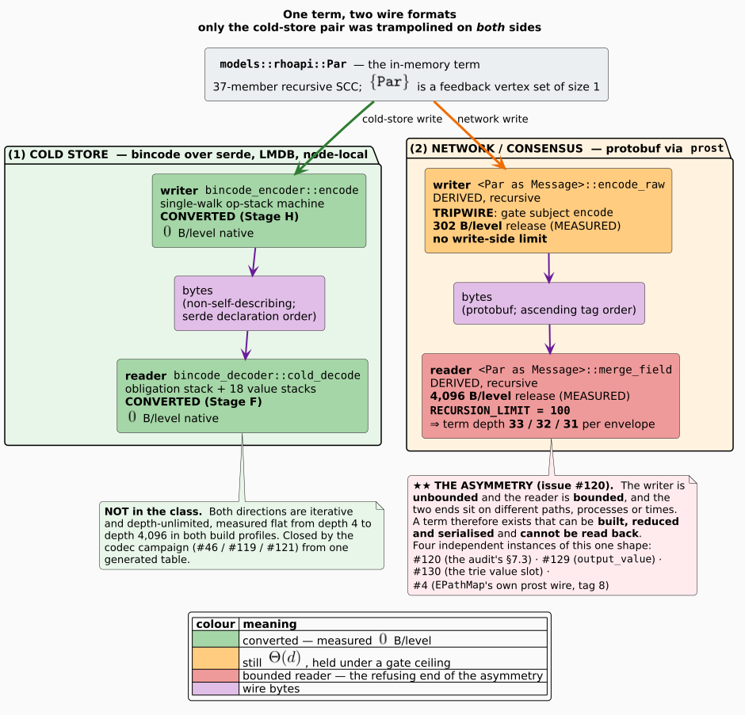

**Figure 1 —** One term, two wire formats: the node-local cold store (bincode over serde, into the LMDB (Lightning Memory-Mapped Database) store) and the network/consensus wire (protobuf via prost), with the conversion status of each side. A component diagram is used because the claim is about which codec sits on which path, not about any single codec's internals.

<!-- Source: [`two-wire-formats.puml`](../../design/stack-safety/figures/two-wire-formats.puml). -->

| | cold store | network / consensus |
|---|---|---|
| codec | `bincode` 1.3.3 over `serde` | protobuf via `prost` 0.13.5 |
| direction of travel | node-local, into LMDB | between nodes, and into blocks |
| writer depth limit | none | none |
| reader depth limit | none | `RECURSION_LIMIT = 100` |

The `prost` reader's limit is a private, unconfigurable constant. Because the `Par` cycle costs three message levels per Rholang nesting level, and an envelope of wrapper depth $`W`$ (the number of protobuf message layers wrapped around the term before the first `Par`) consumes $`W`$ of the budget, the admissible term depth under the vendored reader was

```math
D_{\max}(W) \;=\; \left\lfloor \frac{100 - 1 - W}{3} \right\rfloor
```

which yields three distinct ceilings — 33, 32, and 31 — across the nine real envelopes the gate drives. The gate's ceiling test fails if it ever finds fewer than three, because it exists to refute the sentence "the ceiling is one number." The `bincode` side has no recursion limit in versions 1.3.3, 2.0.1, or `bincode-next` 3.1.1 — only a byte limit defaulting to unlimited — which is why the cold-store reader was a depth-proportional traversal with no ceiling other than the stack, and why its failure mode was the permanent, replicated one of §1.1.

### 2.3 The observable

Let $`S(d)`$ be the smallest thread stack, in bytes, on which a given traversal survives an input of nesting depth $`d`$. Empirically every traversal in this family is affine in $`d`$:

```math
S(d) \;=\; c \;+\; B \cdot d
```

where $`c`$ is a fixed intercept (parser tables, the driver frame, the deepest non-recursive prelude) and $`B`$ is the slope in bytes of native stack per nesting level — written **B/level** throughout. The estimator is a two-point difference over a ladder $`[d_{\mathrm{lo}}, d_{\mathrm{hi}}]`$, with each endpoint obtained by bisecting the thread's stack size in a forked child process (an overflow aborts and cannot be caught in-process):

```math
\widehat{B} \;=\; \frac{S(d_{\mathrm{hi}}) - S(d_{\mathrm{lo}})}{d_{\mathrm{hi}} - d_{\mathrm{lo}}}
```

The quantity that decides liveness is $`D_{\max} = \lfloor (S_{\mathrm{avail}} - c)/B \rfloor`$, and only $`B`$ distinguishes the complexity classes. A conversion must drive $`B`$ to zero; it is explicitly not required to reduce $`c`$, and several conversions raise the intercept. Asserting a shape — the two ladder ends are equal — rather than a byte count also makes the criterion profile-independent by construction, which matters because the debug-to-release slope ratio in this family ranges from 2.2× to 12.1× and is per traversal, not uniform.

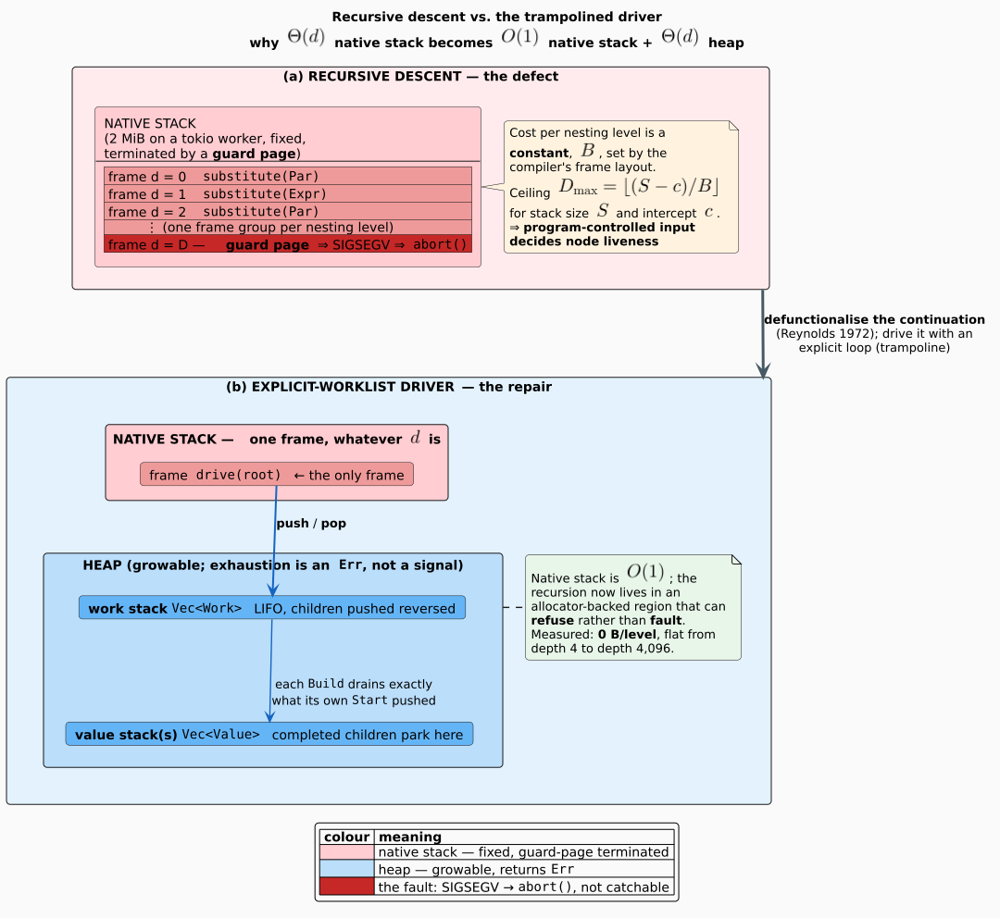

**Figure 2 —** The central picture: why recursive descent grows the native stack with input depth while an explicit-worklist driver holds it constant and grows the heap instead. A side-by-side state diagram is used because the difference is where the continuation lives, which only a picture of both stacks at the same instant makes visible.

<!-- Source: [`recursive-vs-trampolined.puml`](../../design/stack-safety/figures/recursive-vs-trampolined.puml). -->

### 2.4 Glossary

Every symbol, acronym, and term of art used in this report, defined before first use in the results.

| term | definition |
|---|---|
| **B/level** | bytes of native stack consumed per additional nesting level; the slope $`B`$ of §2.3. |
| $`D_{\max}`$ | the greatest nesting depth a traversal survives on a given stack: $`\lfloor (S_{\mathrm{avail}} - c)/B \rfloor`$. |
| **guard page** | an unmapped page placed just past the end of a thread's stack; touching it raises `SIGSEGV`. |
| **`SIGSEGV` vs `SIGABRT`** | the two signals in a stack death: the overflow is `SIGSEGV` (signal 11) on the guard page — not a panic, not unwindable; Rust's handler then calls `abort()`, raising `SIGABRT` (signal 6, shell status 134). The observable is usually 134, the cause is always 11, and neither is a failed deploy — both take the whole node process. |
| **trampoline** | a control structure in which a function returns a description of remaining work to a driver loop instead of calling its continuation; the loop's single frame replaces the recursion's $`d`$ frames [[Ganz, Friedman & Wand 1999](#ref-ganz1999)]. |
| **worklist / work stack** | the concrete vector holding pending work items; last-in-first-out (LIFO) order reproduces depth-first traversal. A companion *value stack* parks completed children for bottom-up folds. |
| **defunctionalization** | Reynolds's transformation replacing continuation functions with a first-order data type plus an apply loop [[Reynolds 1972](#ref-reynolds1972); [Danvy & Nielsen 2001](#ref-danvy2001)]; every driver in this campaign is a defunctionalized continuation, in the lineage of the SECD (stack, environment, control, dump) and CEK (control, environment, kontinuation) machines [[Landin 1964](#ref-landin1964); [Felleisen & Friedman 1987](#ref-felleisen1987); [Ager et al. 2003](#ref-ager2003)]. |
| **PDA** | pushdown automaton — the campaign's name for an explicit-state traversal machine: a typed work stack, optional value stack, and a dispatch loop. |
| **WPDA** | weighted pushdown automaton — the generated parsing machinery's weighted PDA variant in `mettail-rust`. |
| **SCC** | strongly connected component of a call graph or type-child graph; the unit at which a conversion must be scoped (§5, lesson 2). |
| **converted / tripwire** | the two gate registers. *Converted* means measured $`B = 0`$ at both ladder ends in both profiles; *tripwire* means measured $`B > 0`$, held under a ceiling that certifies only "not worse." |
| **anti-vacuity** | a check that the checker can fail: a control the assertion must reject, run in-suite, so a green result cannot come from a probe that measures nothing. |
| **bisection floor** | the smallest value the stack-bisection instrument can emit for any subject — 12,288 B (§3.6). A reading at the floor carries no subject information; the floor is a type, rendered "<12 KiB (below the instrument floor)," never a number. |
| **Ir / Dr / Dw** | instruction references, data reads, data writes — Valgrind cachegrind's deterministic counters, used as the primary time axis (§3.4). |
| **RSS** | resident set size — a process's resident physical memory; peak RSS is the high-water mark. |
| **DHAT / massif** | Valgrind's dynamic heap analysis tool (allocation counts, heap traffic) and heap profiler (peak heap, heap over time) [[Nethercote & Seward 2007](#ref-nethercote2007)]. |
| **GSS** | graph-structured stack — the shared-call-stack structure of generalized-LL parsing. |
| **GLL** | generalized LL (left-to-right scan, leftmost derivation) — the parsing algorithm family of the generated parser. |
| **RSpace** | the tuple space: the store through which Rholang sends and receives rendezvous. **COMM** is one communication event (a send-receive rendezvous). |
| **PathMap / EPathMap** | PathMap is the persistent trie library; `EPathMap` is the `Par` expression carrying one (set mode `PathMap<()>`, map mode `PathMap<Par>`, plus a distinct empty state). **ACTree03** is PathMap's compact trie-topology byte encoding. |
| **EPM1** | EPathMap format, version 1 — the versioned wire snapshot both wire formats embed verbatim. |
| **CBR** | consensus behavior register — the companion register recording every change that may move consensus-visible bytes; entries are cited as CBR-*n*. |
| **FLT** | foreign-language term — a guest-language term embedded in Rholang via `mettail-rust`. |
| **AST** | abstract syntax tree — here usually `mettail-rust`'s generated term enums (`Proc` and category siblings). |
| **AC** | associative-commutative — of operators and template collections whose element order is not semantic. |
| **KAT** | Kleene algebra with tests — a logic family whose evaluators are register subjects in Family G. |
| **LTL** | linear temporal logic — likewise a Family G evaluator subject. |
| **MSO** | monadic second-order logic — likewise a Family G evaluator subject. |
| **REPL** | read-evaluate-print loop, the interactive front end whose observation rendering shares the runtime's traversals. |
| **`PPar` / `HashBag`** | mettail's parallel-composition carrier and its multiset representation. |
| **R3** | the finite-route persistent-root rewrite specialization promoted to a generated production driver (register row SS-G47); "SA" in that row's ratio is the general set-automaton route. |
| **de Bruijn shift** | the binder-index adjustment applied when a term moves under $`k`$ binders [[de Bruijn 1972](#ref-debruijn1972)]; the subject of register rows SS-G41 and SS-Y7. |
| **tripwire subject names** | subjects are named `<operation>` or `<operation>_<shape>` (for example `substitute_no_sort`, `pretty_nested_map`); the same name refers to the same subject in the ledger and here. |
| **OOM** | out-of-memory: the kernel kill or allocator failure raised by heap exhaustion — unlike stack exhaustion, an event a caller can bound and handle. |
| **gRPC** | the node's remote-procedure-call ingress framework (gRPC is its proper name). |
| **LMDB** | Lightning Memory-Mapped Database — the store under the cold-store lane. |

---

## 3. Methods

This section presents the ledger's methods linearly. The ledger itself orders the same material as §4.5, then §4.7, then §4.8, and finally §4.6, deliberately (its anti-vacuity section closes the methods); its section numbers are externally cited and are not renumbered here.

### 3.1 Hardware

All measurements ran on one host (source: ledger §4.1, cross-checked against `lscpu` at measurement time): an AMD Ryzen Threadripper PRO 5975WX (Zen 3), 32 cores / 64 threads across 4 core-complex dies, base approximately 3.6 GHz with maximum boost 4,561.833 MHz; 128 GiB of DDR4-2933 ECC (error-correcting code) registered memory on 8 channels, a single NUMA (non-uniform memory access) node; NVMe storage; the `amd-pstate-epp` frequency driver in active mode with the `performance` governor on every core; Arch Linux.

### 3.2 Machine state at measurement time

The measurement host was shared with concurrent agent workloads throughout, and the report records that as a fact rather than asserting it away. At the timing cell the pinned core read 77.2 % of maximum boost; the 1-minute load average ranged from about 13 to 35 on a 32-core machine across the sessions. A settle interval of 302 s preceded the first timing cell, satisfying the 300 s discipline arithmetically — the machine was quieter, not quiet. This threatens the absolute timings, which are therefore never quoted as hardware characteristics, and not the relative ones, which the paired design of §3.7 protects by interleaving both arms within each repetition.

### 3.3 Toolchain and build configuration

Rust `rustc 1.95.0-nightly` (2026-02-08) and matching cargo; the measurement profile is release (`opt-level = 3`) with `-C target-cpu=native`, and every figure labeled debug is an ordinary `-O0` build through LLVM (Low Level Virtual Machine, the compiler infrastructure's historical name; no alternative codegen backend is configured). At the original measurement pin the repository set `RUST_MIN_STACK=8388608`; it affected spawned threads only, never a main thread, every stack probe overrode it with an explicit stack size, and the override was later deleted outright — production correctness requires no enlarged stack. Probes retain explicit 2 MiB or 256 KiB stacks so an ambient environment change cannot mask a regression.

### 3.4 Instruments

| instrument | what it produced |
|---|---|
| `stack_depth_gate` (forked-child minimum-stack bisection, 4,096 B resolution) | every B/level figure and every converted/tripwire verdict |
| `four_quadrant_s0_baseline` (an ignored test in the same binary) | the eight-traversal pre-conversion baseline table |
| `deploy_depth_ceiling` | the end-to-end deploy ceilings, from source text through the real runtime on an explicit 2 MiB `tokio` worker |
| `valgrind --tool=massif --time-unit=B` | peak heap and the heap-over-time series |
| `valgrind --tool=dhat` | allocation counts, total bytes, heap read/write traffic |
| paired throughput harness | wall clock: 60 measured repetitions after 10 warm-ups per arm per run, three whole-bench runs, per-repetition A/B interleaving with order rotated by repetition parity |
| `valgrind --tool=cachegrind --cache-sim=yes` | deterministic Ir/Dr/Dw counters for the time-complexity fits |
| `perf record -e cpu-clock --call-graph dwarf` | the CPU profile of the codec comparison |

One deviation from the standing measurement discipline is recorded rather than glossed: `perf record --call-graph lbr` could not be used. The precise-sampling modifier is implemented on Intel by PEBS (precise event-based sampling), which does not exist on AMD Zen 3, and Zen 3's counterpart (IBS) refuses per-thread mode; the profile was therefore taken with the software `cpu-clock` event and DWARF unwinding, which costs sampling fidelity but not symbol attribution. The compensating rule, fixed in place after cachegrind and the hardware instruction counter agreed to four significant figures on a question wall clock could not resolve: the deterministic instrument is primary, and wall clock is corroboration only.

### 3.5 Procedure

Every measurement cell ran pinned with `taskset` (the gate, the deploy bisection, the heap profilers, and the bench each on their own cores), under `systemd-run` memory scopes, with every command's output teed to a file and the file analyzed — no benchmark was re-run to see a different part of its output. For wall-clock rows the decision rule is the paired $`t`$-test on per-repetition differences [[Student 1908](#ref-student1908)] with the median-of-repetition ratio as the point estimate; where an effect is smaller than the instrument's measured run-to-run spread, the row reports a bracket rather than a magnitude. Non-timing rows (B/level, $`D_{\max}`$, DHAT block counts, cachegrind counters) are deterministic, and a difference is reported when the values differ at instrument resolution.

### 3.6 The bisection instrument and its floor

Every B/level figure comes from one procedure: probe stack sizes exponentially upward from 16 KiB until the forked subject survives, then bisect the bracketing interval to a 4,096 B resolution. The instrument has a provable floor: a subject that survives the first probe never enters the doubling loop, so the bisection runs on the interval from 8,192 to 16,384 bytes and terminates on its first midpoint,

```math
\mathrm{mid} \;=\; \frac{8{,}192 + 16{,}384}{2} \;=\; 12{,}288 ,
```

so 12,288 B is the smallest value the bisection can ever emit, for any subject. A reading at the floor carries no subject information and must never be divided by; in both repositories the floor is unspellable as a number — the instrument returns a typed result whose floor arm renders "<12 KiB (below the instrument floor)" and cannot be consumed by arithmetic. A slope survives the floor where an endpoint does not, because a slope is a difference and a constant common to both endpoints cancels: when both ends read the floor the slope is exactly 0, which is correct.

**Algorithm 1 (MIN-STACK-BISECT).** The instrument, in literate form; the ledger's §4.7 carries the full treatment including the forked-child survival semantics.

```pseudocode
MIN-STACK-BISECT(subject, depth):
    hi ← PROBE_START                        // 16 KiB
    while not SURVIVES(subject, depth, hi):
        hi ← 2 · hi                         // exponential probe upward
    lo ← hi / 2                             // last failing size (8 KiB when
                                            //   the first probe survived)
    while hi − lo > RESOLUTION:             // RESOLUTION = 4,096 B
        mid ← (lo + hi) / 2
        if SURVIVES(subject, depth, mid): hi ← mid
        else:                              lo ← mid
    if hi ≤ FLOOR: return BelowResolution   // FLOOR = 12,288 B — a type,
    return Bytes(hi)                        //   never a number
```

`SURVIVES` runs the subject at the given nesting depth on a freshly forked child whose thread stack is exactly the probed size, and reads survival from the child's exit status — a missing probe binary panics the harness, and a refused `execve` reads as "did not survive," so the instrument fails loudly rather than emitting a false zero. The slope B/level is then the two-point difference of bisected endpoints at depths 4 and 4,096, divided by the depth span; a conversion claim requires that difference to be exactly 0 in both build profiles.

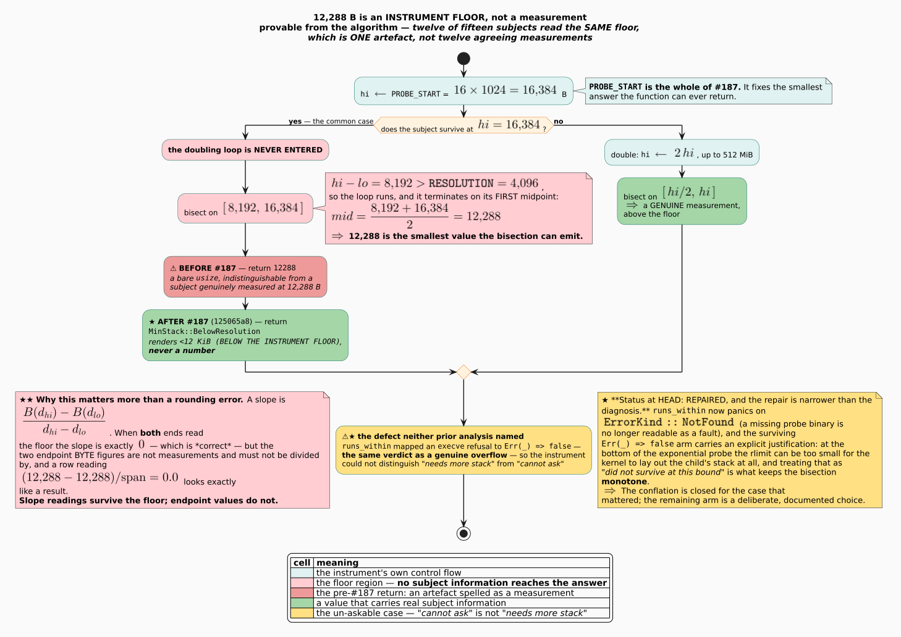

**Figure 3 —** The exponential probe, the bisection, and the typed refusal below the floor. An activity diagram over an annotated interval ladder is used because the floor is a control-flow fact — a subject surviving the first probe never enters the doubling loop — and the claim is only visible if the branch not taken is drawn.

<!-- Source: [`bisection-instrument-floor.puml`](../../design/stack-safety/figures/bisection-instrument-floor.puml). -->

### 3.7 The paired timing design

Model one repetition's time as $`t_{X,i} = \mu_X + \delta(w_i) + \varepsilon_{X,i}`$, where $`\mu_X`$ is arm $`X`$'s true mean, $`\delta`$ is drift belonging to the time window $`w_i`$ rather than to the code, and $`\varepsilon`$ is independent noise with variance $`\sigma_\varepsilon^2`$. Then

```math
\operatorname{Var}\big(\widehat{\Delta}_{\mathrm{blocked}}\big) \;=\; \frac{2\sigma_\varepsilon^2}{n} \;+\; 2\sigma_\delta^2 ,
\qquad
\operatorname{Var}\big(\widehat{\Delta}_{\mathrm{paired}}\big) \;=\; \frac{2\sigma_\varepsilon^2}{n} .
```

The window term contains no $`n`$: repetitions shrink the noise term and do nothing to the drift term, so a blocked design (each arm timed in its own window) reports tight-looking results whose dominant error is never estimated, and an unpaired statistic such as Welch's [[Welch 1947](#ref-welch1947)] built from within-arm variances certifies a quiet window rather than a real difference. This is the measurement-bias class of [[Mytkowicz et al. 2009](#ref-mytkowicz2009)]; the design discipline is [[Georges et al. 2007](#ref-georges2007)].

The design difference was measured on this host rather than argued. On the encoder bench the blocked design's three whole-bench runs spread 27 % (ratios 1.261×, 1.471×, 1.154×) at load average 16.7, and on the sibling bench it flipped its verdict outright (1.0748× then 0.9461×, a 13 % spread). The paired design's three runs spread 1.9 % and 0.8 % respectively — at roughly double the machine load. Fourteen times less spread on a busier machine identifies the design, not the host, as the dominant term. The quotability rule this yields: an effect is quoted as a magnitude only when it exceeds the instrument's measured spread; a smaller effect may still be signed when two instruments agree on direction, but its magnitude is a bracket, not a number.

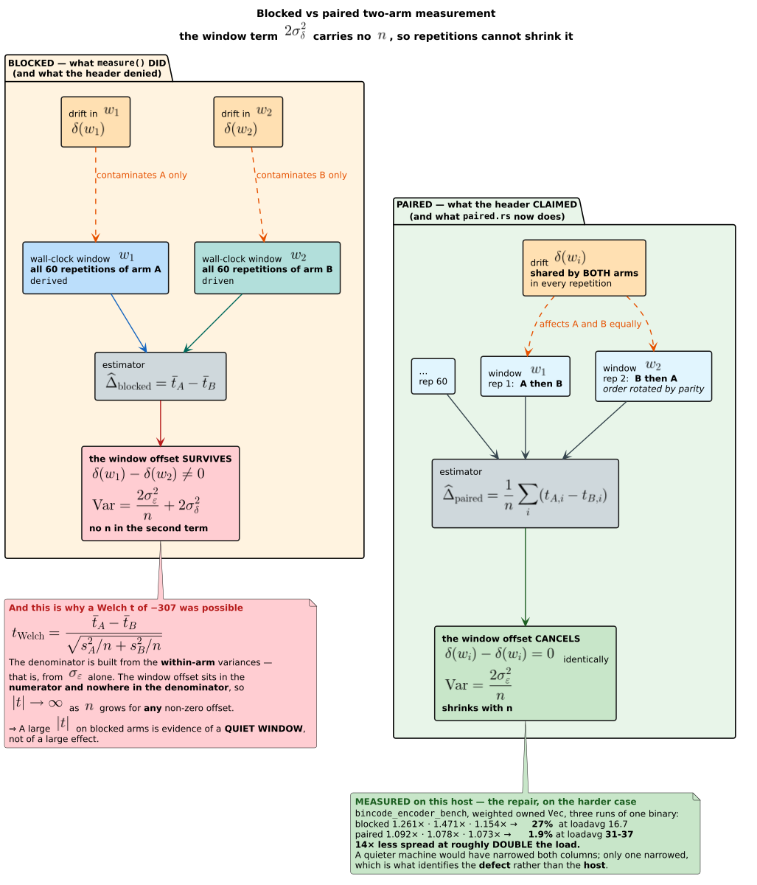

**Figure 4 —** The blocked design places all of one arm inside one drifting window; the paired design alternates arms within each repetition so the window term cancels in the difference. A two-lane timing diagram is used because the defect is about when each arm runs relative to the drifting host.

<!-- Source: [`blocked-vs-paired.puml`](../../design/stack-safety/figures/blocked-vs-paired.puml). -->

### 3.8 Anti-vacuity discipline

Every measurement in §4 comes from a harness that has been shown to fail. Four false zeros in this campaign came from probes that measured nothing: a decode probe with a wrong protobuf field number, so the payload was skipped as an unknown field; a property-test generator whose collection sizes were `0..1`, meaning exactly zero elements, always; a source-scan rule that discarded 97 % of the largest interpreter file; and a shell invocation that did not word-split its subject list. The gate accordingly carries synthetic controls its own checkers must reject — `synthetic_recurse` at 111 B/level release and `synthetic_drop` at 31 B/level release — beside iterative twins at 0, and the tripwire refuses to finish unless the set of subjects it actually drove is exactly the declared register. A green run therefore certifies both that the subjects are flat and that the instrument can still tell flat from sloped.

---

## 4. Results

### 4.1 Outcome at a glance

At the snapshot anchor the production register contains **45 converted subjects — 37 on the depth axis and 8 on the width axis — and zero tripwire subjects on either axis**. The independent SS-B5 lifecycle gate separately closes one recursive non-`Par` error-forest family at 20,000 levels on a 256 KiB stack. No production path uses `RUST_MIN_STACK`, `stacker`, or a traversal-depth ceiling; the retired-mechanism registry checks for each by scan.

The closure evidence around the register is threefold. First, the strengthened hand-written recursion census enumerates **566 recursive components — 41 mentioning the term family, 18 mutual — across 24 dispositioned files including `node/src`, with zero unmeasured dispositions**: every component is either a converted register subject or a classified bounded non-term cycle. Second, whole-project call-graph analysis completed on 2026-08-08 over 202/202 production files in `f1r3node-rust-mettail` and 1,910/1,910 in `mettail-rust`, each reporting zero direct-recursion functions and zero mutual-recursion findings; fresh runs on 2026-08-12 revalidate both results (226 and 1,589 supported production files analyzed, unsupported-language and oversized files reported explicitly, zero failed files), with the apparent residuals shown by source inspection to be test-only recursive oracles or analyzer aliasing artifacts. The ledger's living-status chronicle records the closure sequence between the measurement anchor and the snapshot commit by commit; this report carries only its endpoint. Third, the 40-subject deterministic-time cohort — the historical Phase-7 population, deliberately not rewritten to include the five later matcher subjects, which carry independent depth/width and elapsed-time evidence — contains no quadratic subject: Ir exponents fit between 0.9462 and 1.0970 against a predeclared failure bar of 1.80, and the largest data-counter exponent is 1.4007 Dw, on the width-axis comparator.

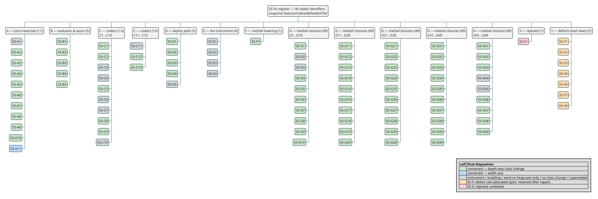

**Figure 5 —** All 96 stable SS identifiers at the snapshot anchor, one cell each, colored by final disposition: green for depth-axis conversions, blue for width-axis conversions, slate for instrument/enabling/work-only/no-class-change/superseded rows, amber for SS-Y defect rows (allocated while open, retained after repair), red for the rejected SS-X candidate. A work-breakdown grid is used because the claim is a census — every identifier visible at once, none double-counted.

<!-- Source: [`register-disposition-map.puml`](figures/register-disposition-map.puml), generated from [`data/headline-metrics.tsv`](data/headline-metrics.tsv) by `tools/mk_tables.py register-map`. -->

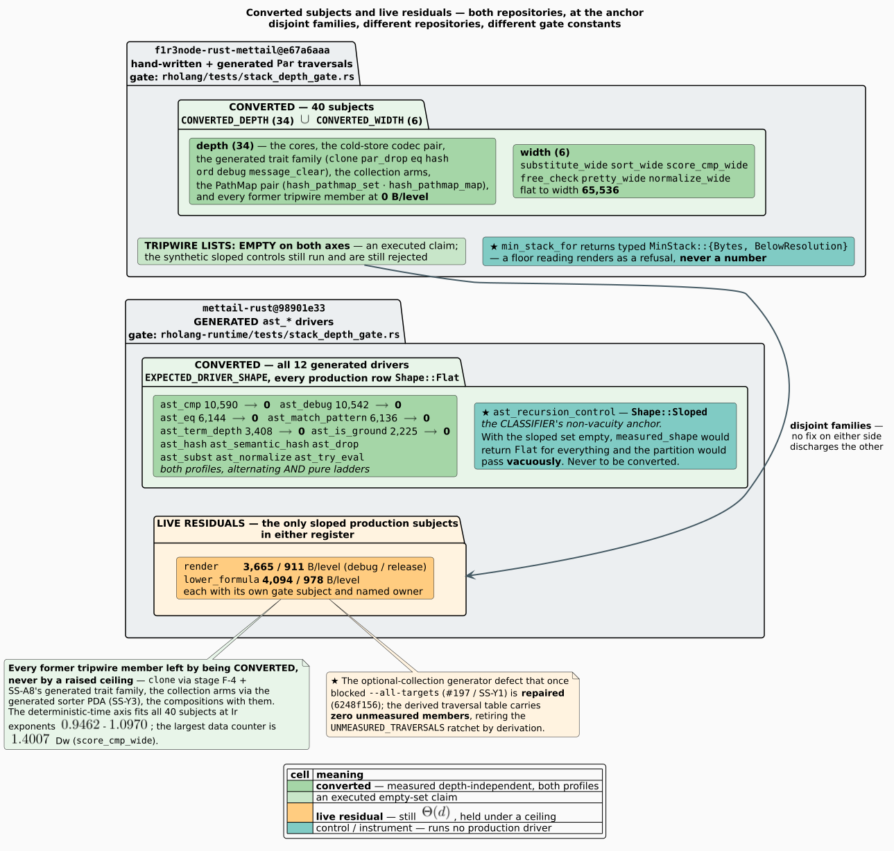

**Figure 6 —** The converted and tripwire register populations across both repositories, ending at 45 converted and zero tripwires. A grouped bar chart is used because the claim is two counts per repository and their end state.

<!-- Source: [`converted-vs-tripwire-cross-repo.puml`](../../design/stack-safety/figures/converted-vs-tripwire-cross-repo.puml). -->

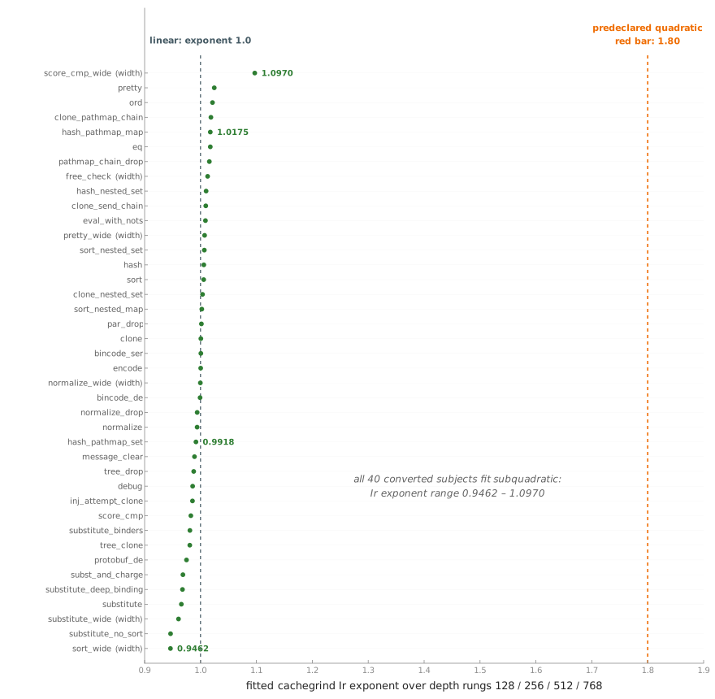

**Figure 7 —** Fitted Ir exponents for the 40-subject deterministic-time cohort, all between 0.9462 and 1.0970, far below the predeclared 1.80 quadratic bar. A dot plot against the bar is used because the claim is that a population clears a threshold.

<!-- Source: [`phase7-ir-exponents.wl`](figures/phase7-ir-exponents.wl), data [`phase7-cachegrind-fits-2026-08-03.tsv`](../../design/stack-safety/measurements/phase7-cachegrind-fits-2026-08-03.tsv). -->

**Table conventions.** Every SS identifier appears in exactly one family table in §4.2–§4.8, and the tables are generated from the ledger's §0 register by [`tools/mk_tables.py`](../tools/mk_tables.py) and machine-checked against it: `check` byte-compares each embedded fragment against a freshly generated one, and `coverage` asserts the 96-identifier census (95 register-table rows plus the rejected candidate the ledger keeps in prose). In generated rows, the word *unmeasured* marks a cell for which no measurement exists — every such entry is itemized with its reason in ledger §5.9 — and an em-dash marks an axis that does not apply. The tables' contents are not hand-edited; the prose around them carries the interpretation.

### 4.2 Family A — the core traversals

Family A is the interpreter's substitution, sorting, normalization, and pure-evaluation cores — the traversals that run on every deploy — plus the generated trait family and the spatial matcher that later joined them.

<!-- mk_tables:family-A:begin generated by tools/mk_tables.py — do not hand-edit -->
| ID | Subject | Class | Control $`\rightarrow`$ Final | Disposition | Evidence |
|---|---|---|---|---|---|
| SS-A1 | substitution SCC leg-1 de-clone | depth | 36,416 $`\rightarrow`$ 27,179 B/level | no class change ($`-25.4\%`$ only) | [§5.1](../../design/stack-safety/stack-safety-report-2026-07-29.md#51-family-a--the-substitution-sorting-normalisation-and-evaluation-cores) |
| SS-A2 | substitution SCC $`\rightarrow`$ explicit worklist | depth | 195,728 $`\rightarrow`$ 0 B/level (debug) | converted | [§5.1](../../design/stack-safety/stack-safety-report-2026-07-29.md#51-family-a--the-substitution-sorting-normalisation-and-evaluation-cores) |
| SS-A3 | score-tree comparator, walk, lifecycle traits | depth | 1,329/201/1,578/370/719 $`\rightarrow`$ 0 B/level | converted | [§5.1](../../design/stack-safety/stack-safety-report-2026-07-29.md#51-family-a--the-substitution-sorting-normalisation-and-evaluation-cores) |
| SS-A4 | ParSortMatcher sort and sort_wide | depth | 78,592 $`\rightarrow`$ 0 B/level (debug) | converted | [§5.1](../../design/stack-safety/stack-safety-report-2026-07-29.md#51-family-a--the-substitution-sorting-normalisation-and-evaluation-cores) |
| SS-A5 | rho-pure-eval eval_with SCC | depth | 3,359 $`\rightarrow`$ 0 B/level | converted | [§5.1](../../design/stack-safety/stack-safety-report-2026-07-29.md#51-family-a--the-substitution-sorting-normalisation-and-evaluation-cores) |
| SS-A6 | PrettyPrinter pushdown driver, canonical collections | depth | unmeasured $`\rightarrow`$ 0 B/level | converted; SS-Y8 retains the repaired evidence gap | [§5.1](../../design/stack-safety/stack-safety-report-2026-07-29.md#51-family-a--the-substitution-sorting-normalisation-and-evaluation-cores) |
| SS-A7 | normalizer 26-function SCC $`\rightarrow`$ norm_drive | depth | 7,261 $`\rightarrow`$ 0 B/level | converted | [§5.1](../../design/stack-safety/stack-safety-report-2026-07-29.md#51-family-a--the-substitution-sorting-normalisation-and-evaluation-cores) |
| SS-A8 | generated Par family traversal PDAs | depth+width | recursive derive/host calls $`\rightarrow`$ generated explicit PDAs | converted | [§5.12](../../design/stack-safety/stack-safety-report-2026-07-29.md#512-generated-par-pda-closure-ss-a8-ss-e2) |
| SS-A9 | node JSON boundary conversion and traits | depth | recursive calls/derives $`\rightarrow`$ explicit PDAs; depth 16,384 on 256 KiB | converted | [§5.13](../../design/stack-safety/stack-safety-report-2026-07-29.md#513-the-node-json-boundary-ss-a9) |
| SS-A10 | spatial matcher SCC with PathMap retry | depth+width | $`\approx`$ 70,237 $`\rightarrow`$ 0 B/level (debug); depth 4,096, width 65,536 | converted | [§5.16](../../design/stack-safety/stack-safety-report-2026-07-29.md#516-spatial-matcher-and-pathmap-native-retry-pda-ss-a10) |
| SS-A11 | RSpace candidate selection and enumeration PDA | width | $`\Theta(b) \rightarrow O(1)`$ stack; 20,000 binds on 256 KiB in 2.61 s | converted | [§5.16.5](../../design/stack-safety/stack-safety-report-2026-07-29.md#5165-rspace-candidate-selection-and-enumeration-pda-ss-a11) |
<!-- mk_tables:family-A:end -->

**SS-A2, the substitution conversion, is the family's centerpiece.** The substitution SCC descended one call per term level at 195,728 B/level in debug — the costliest slope in the corpus. Per-frame attribution under a debugger put 169,728 B of each level, 87 percent, in a single function: a 40-arm match over the expression enum, whose mutually exclusive arms rustc does not overlap at `-O0`. What replaced it is an explicit last-in-first-out work stack of defunctionalized continuations over borrowed sub-terms — work items borrow rather than own, because a worklist of owned sub-terms would have had to clone them through a clone that was itself depth-proportional — with the binder environment carried as a delta into one borrowed root environment. The environment decision was measured before it was designed: under a deep binding the pre-conversion subject read 48,878 B/level against 33,242 under a ground one, and the 15,636 B/level difference matched the term clone's own slope to within 1.5 percent, so a worklist storing an owned environment per item would have stayed depth-proportional however the traversal was written. After conversion the deep- and ground-environment readings are identical, both 0 B/level.

The de-cloning leg that preceded the conversion is retained as SS-A1 in the table and is the binary criterion at work: it removed real quadratic heap churn and a quarter of the release constant, and it could not change the class, so it is recorded as no class change. A report that showed only the successful leg would misrepresent how much work a class change actually takes.

The rest of the family followed the same shape with per-subject twists recorded in the ledger: the normalizer's 26-function SCC fell from 43,542 (debug) and 7,261 (release) B/level to 0 on both; the sorter and its score tree fell from 78,592 (debug) to 0, with the comparator converted as a subject in its own right because a linear chain sorts as a one-element vector and never enters the comparator at all; and the pretty printer's owned canonical collections were completed by the SS-Y8 repair after an evidence gap was found (§4.8). The 30-character reproducer of §1.1 now survives the default worker stack, and its gate test is no longer ignored.

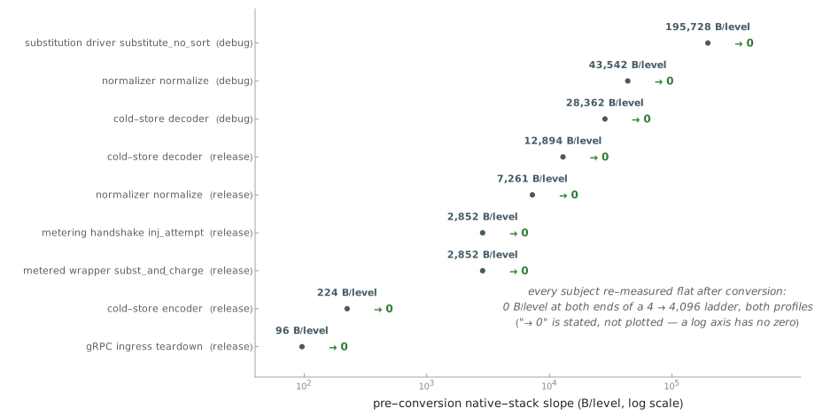

**Figure 8 —** Pre-conversion native-stack slopes for the headline conversions, every one driven to 0; the horizontal axis is logarithmic, and since a log axis has no zero, the zero endpoint is typographic rather than positional. A dot plot is used because the claim is a set of paired before/after magnitudes spanning three orders of magnitude.

<!-- Source: [`bpl-eliminations.wl`](figures/bpl-eliminations.wl), data [`data/bpl-conversions.tsv`](data/bpl-conversions.tsv). -->

### 4.3 Family G, with Family F — the mettail-rust closures

`mettail-rust` is the companion repository that lowers guest-language terms into `Par`. Family F is its original lowering fix; Family G is the long closure of every recursive traversal in its generated and hand-written machinery, ending in work/heap refinements on machinery that was already stack-safe.

<!-- mk_tables:family-F:begin generated by tools/mk_tables.py — do not hand-edit -->
| ID | Subject | Class | Control $`\rightarrow`$ Final | Disposition | Evidence |
|---|---|---|---|---|---|
| SS-F1 | 87-member lowering component $`\rightarrow`$ one worklist | depth | 2,157 $`\rightarrow`$ 1 B/level | converted | [§5.6.1](../../design/stack-safety/stack-safety-report-2026-07-29.md#561-the-lowering-component-3c0c3585) |
<!-- mk_tables:family-F:end -->

<!-- mk_tables:family-G:begin generated by tools/mk_tables.py — do not hand-edit -->
| ID | Subject | Class | Control $`\rightarrow`$ Final | Disposition | Evidence |
|---|---|---|---|---|---|
| SS-G1 | AST children Box $`\rightarrow`$ Arc | representation | $`\approx`$ 30 GB OOM $`\rightarrow`$ 112 MB; 0 B/level; 0 bytes allocated | converted (by representation) | [§5.11](../../design/stack-safety/stack-safety-report-2026-07-29.md#511--ss-g1--the-arc-fix-eliminating-a-traversal-instead-of-converting-it) |
| SS-G2 | nine generated iterative drivers measured | instrument | flat on pure chain; 1,215–10,592 B/level (debug) alternating | historical — superseded by SS-G4 | [§5.10.10](../../design/stack-safety/stack-safety-report-2026-07-29.md#51010--the-nine-generated-drivers-measured--the-2--2-that-identified-the-mechanism) |
| SS-G3 | eight unmeasured generated drivers get subjects | instrument | unmeasured $`\rightarrow`$ measured: 8 of 9 sloped | instrument — defect found | [§5.10.10](../../design/stack-safety/stack-safety-report-2026-07-29.md#51010--the-nine-generated-drivers-measured--the-2--2-that-identified-the-mechanism) |
| SS-G4 | all eleven generated ast_* drivers | depth | 10,590/10,542/6,144/6,136/3,408/2,225 $`\rightarrow`$ 0, both profiles | converted; SS-Y1 retained as repaired defect | [§8.6.1](../../design/stack-safety/stack-safety-report-2026-07-29.md#861--162189--the-eleven-generated-drivers-converted-and-the-root-cause-that-unifies-154-with-162) |
| SS-G5 | twelfth generated driver, try_eval | depth | ast_try_eval(_cast) $`\rightarrow`$ 0, both profiles | converted | [§5.6.5](../../design/stack-safety/stack-safety-report-2026-07-29.md#565--the-twelfth-generated-driver-and-the-seven-numerals-beside-it-ed44c429) |
| SS-G6 | par_hash cost attributed to models Hash impl | depth | 625/113 $`\rightarrow`$ 0; both ceilings deleted | converted; both ceilings deleted | [§5.6.6](../../design/stack-safety/stack-safety-report-2026-07-29.md#566--174-attributed-to-models-impl-hash-for-par-3276c1ee) |
| SS-G7 | native-evaluator cycles $`\rightarrow`$ per-SCC PDAs | depth | $`\Theta(d) \rightarrow O(1)`$ stack; 20,000 alternating edges on 256 KiB | converted | [§5.6.11](../../design/stack-safety/stack-safety-report-2026-07-29.md#5611-ss-g7--native-evaluator-cycles-become-one-pda-per-dependency-scc-b0aa4e09) |
| SS-G8 | production carriers and PraTTaIL logic families | depth | $`\Theta(d) \rightarrow O(1)`$ stack; 20,000 levels; gate 23.73 s / 163,844 KiB | converted (named operations) | [§5.18](../../design/stack-safety/stack-safety-report-2026-07-29.md#518-recursive-carrier-lifecycle-and-weighted-logic-closure-ss-g8) |
| SS-G9 | AnyAlgebra continuations; KAT subset decision | depth | 20,000 wrappers/KAT nodes on 256 KiB; gate 0.25 s / 46,168 KiB | converted (named decision SCC) | [§5.18.8](../../design/stack-safety/stack-safety-report-2026-07-29.md#5188-post-census-operational-decision-closure-ss-g9) |
| SS-G10 | Rholang type-inference predicate SCCs | depth | $`\Theta(d) \rightarrow O(1)`$ stack; 20,000 continuation levels on 256 KiB | converted (named inference SCCs) | [§5.18.9](../../design/stack-safety/stack-safety-report-2026-07-29.md#5189-rholang-type-inference-closure-ss-g10) |
| SS-G11 | Rholang AST analysis and fold rewrite | depth | $`\Theta(d) \rightarrow O(1)`$ stack; 20,000 levels; gate 0.42 s / 59,172 KiB | converted (every production SCC in rholang_ast.rs) | [§5.18.10](../../design/stack-safety/stack-safety-report-2026-07-29.md#51810-rholang-ast-analysis-and-fold-rewrite-closure-ss-g11) |
| SS-G12 | lowered guard formula encoding and substitution | depth | $`\Theta(d) \rightarrow O(1)`$ stack; 20,000 levels; gate 0.27 s / 77,100 KiB | converted (named formula SCCs) | [§5.18.11](../../design/stack-safety/stack-safety-report-2026-07-29.md#51811-lowered-guard-formula-closure-ss-g12) |
| SS-G13 | lowered guard operand arithmetic | depth | $`\Theta(d) \rightarrow O(1)`$ stack; 20,000 levels; gate 0.15 s / 113,112 KiB | converted (operand SCC) | [§5.18.12](../../design/stack-safety/stack-safety-report-2026-07-29.md#51812-lowered-guard-operand-closure-ss-g13) |
| SS-G14 | bound-Par guard substitution | depth | $`\Theta(d) \rightarrow O(1)`$ stack; 20,000 levels; gate 0.20 s / 131,632 KiB | converted | [§5.18.13](../../design/stack-safety/stack-safety-report-2026-07-29.md#51813-lowered-guard-bound-substitution-closure-ss-g14) |
| SS-G15 | surface guard formulas and operands | depth | $`\Theta(d) \rightarrow O(1)`$ stack; 20,000 levels; gate 0.03 s / 29,560 KiB | converted | [§5.18.14](../../design/stack-safety/stack-safety-report-2026-07-29.md#51814-surface-rholang-guard-closure-ss-g15) |
| SS-G16 | direct surface receive traversals | depth | $`\Theta(d) \rightarrow O(1)`$ stack; 20,000 levels; gate 0.05 s / 30,960 KiB | converted (named direct traversals) | [§5.18.15](../../design/stack-safety/stack-safety-report-2026-07-29.md#51815-direct-surface-receive-traversal-closure-ss-g16) |
| SS-G17 | receive collection patterns | depth+width | $`\Theta(d) \rightarrow O(1)`$ stack; 20,000 levels + 4,096 bag elements | converted | [§5.18.16](../../design/stack-safety/stack-safety-report-2026-07-29.md#51816-receive-collection-pattern-closure-ss-g17) |
| SS-G18 | HashBag hash summaries and PPar merge | depth | hash $`\Theta(n) \rightarrow \Theta(1)`$; merge $`\Theta(n^2) \rightarrow \Theta(n)`$; 20,000 merges in 0.11 s | converted (former merge recursion) | [§5.18.17](../../design/stack-safety/stack-safety-report-2026-07-29.md#51817-parallel-hash-and-multiplicity-closure-ss-g18) |
| SS-G19 | surface send-sugar canonicalization | depth | $`\Theta(d) \rightarrow O(1)`$ stack; 20,000 levels; gate 0.09 s / 51,660 KiB | converted | [§5.18.18](../../design/stack-safety/stack-safety-report-2026-07-29.md#51818-surface-send-canonicalizer-closure-ss-g19) |
| SS-G20 | grammar walks and token codecs | depth | $`\Theta(d) \rightarrow O(1)`$ stack; copy $`\Theta(d^2) \rightarrow \Theta(d)`$; three 20,000-depth gates | converted | [§5.18.19](../../design/stack-safety/stack-safety-report-2026-07-29.md#51819-ast-grammar-and-token-codec-closure-ss-g20) |
| SS-G21 | REPL observation de-reflection | depth | $`\Theta(d) \rightarrow O(1)`$ stack; copy $`\Theta(d^2) \rightarrow \Theta(d)`$; 20,000 levels | converted | [§5.18.20](../../design/stack-safety/stack-safety-report-2026-07-29.md#51820-observation-surface-de-reflection-closure-ss-g21) |
| SS-G22 | LTL precedence parser | depth | $`\Theta(d) \rightarrow O(1)`$ stack; $`\Theta(t)`$ time/heap; four 20,000-depth gates | converted | [§5.18.21](../../design/stack-safety/stack-safety-report-2026-07-29.md#51821-ltl-precedence-parser-closure-ss-g22) |
| SS-G23 | reflected metadata rendering | depth | $`\Theta(d) \rightarrow O(1)`$ stack; $`\Theta(n+b)`$ time; four 20,000-depth gates | converted | [§5.18.22](../../design/stack-safety/stack-safety-report-2026-07-29.md#51822-reflected-metadata-renderer-closure-ss-g23) |
| SS-G24 | Dovetail metapattern analysis and lowering | depth | $`\Theta(d) \rightarrow O(1)`$ stack; 20,000 levels; gate 0.70 s / 117,260 KiB | converted | [§5.18.23](../../design/stack-safety/stack-safety-report-2026-07-29.md#51823-dovetail-metapattern-analysis-and-lowering-closure-ss-g24) |
| SS-G25 | Dovetail set-automaton evaluation | depth | $`\Theta(d) \rightarrow O(1)`$ stack; 20,000 levels; gate 0.16 s / 33,528 KiB | converted | [§5.18.24](../../design/stack-safety/stack-safety-report-2026-07-29.md#51824-dovetail-set-automaton-evaluator-closure-ss-g25) |
| SS-G26 | observation scans and bag flattening | depth | $`\Theta(d) \rightarrow O(1)`$ stack; $`\Theta(m) \rightarrow O(1)`$ aux; 20,000 levels | converted | [§5.18.27](../../design/stack-safety/stack-safety-report-2026-07-29.md#51827-runtime-observation-scan-and-flatten-closure-ss-g26) |
| SS-G27 | zip/map matching and numeric casts | depth | $`\Theta(d) \rightarrow O(1)`$ stack; 20,000 groups/wrappers; two direct gates | converted | [§5.18.28](../../design/stack-safety/stack-safety-report-2026-07-29.md#51828-generic-matching-and-numeric-cast-closure-ss-g27) |
| SS-G28 | delta-one matching | depth | $`\Theta(d) \rightarrow O(1)`$ stack; $`\Theta(d)`$ scan $`\rightarrow`$ $`O(1)`$ expected; 20,000 levels | converted | [§5.18.29](../../design/stack-safety/stack-safety-report-2026-07-29.md#51829-delta-one-matching-closure-ss-g28) |
| SS-G29 | schedule, AC-template, fragment encoding | depth | $`\Theta(d) \rightarrow O(1)`$ stack; $`\Theta(n^2) \rightarrow \Theta(n)`$ expected; 20,000 levels | converted | [§5.18.30](../../design/stack-safety/stack-safety-report-2026-07-29.md#51830-rho-network-schedule-template-and-fragment-closure-ss-g29) |
| SS-G30 | shift-chain and AC-template rebuild PDAs | depth+width | $`\Theta(d) \rightarrow O(1)`$ stack; fold $`\Theta(n^2) \rightarrow \Theta(n)`$; 20,000 levels/components | partial resource closure; slope repaired by SS-G41 | [§5.18.31](../../design/stack-safety/stack-safety-report-2026-07-29.md#51831-rho-network-shift-and-template-rebuild-closure-ss-g30) |
| SS-G31 | reflected oshift and wide AC soup | depth+width | $`\Theta(d) \rightarrow O(1)`$ stack; cloning $`\Theta(n^2) \rightarrow \Theta(n)`$; 20,000 levels/elements | converted (both named traversals) | [§5.18.32](../../design/stack-safety/stack-safety-report-2026-07-29.md#51832-reflected-host-shift-and-bound-ac-template-closure-ss-g31) |
| SS-G32 | closed-ground validation; deadlock Tarjan depth-first search | depth | $`\Theta(d) \rightarrow O(1)`$ stack; Tarjan $`\Theta(V+E)`$; 20,000 values/vertices | converted (both named traversals) | [§5.18.33](../../design/stack-safety/stack-safety-report-2026-07-29.md#51833-closed-ground-validation-and-deadlock-scc-closure-ss-g32) |
| SS-G33 | naive reference-backend walks | depth | $`\Theta(d) \rightarrow O(1)`$ stack; 20,000 levels on 256 KiB | converted (all four named traversals) | [§5.18.34](../../design/stack-safety/stack-safety-report-2026-07-29.md#51834-naive-reference-backend-walk-closure-ss-g33) |
| SS-G34 | macro capture-layout walks | depth | $`\Theta(d) \rightarrow O(1)`$ stack; 20,000 levels; gate 0.05 s / 27,764 KiB | converted (all three named traversals) | [§5.18.36](../../design/stack-safety/stack-safety-report-2026-07-29.md#51836-macro-capture-layout-recursion-closure-ss-g34) |
| SS-G35 | native-evaluator term-parameter walks | depth | $`\Theta(d) \rightarrow O(1)`$ stack; 20,000 levels; gate 0.01 s / 28,692 KiB | converted (both named traversals) | [§5.18.37](../../design/stack-safety/stack-safety-report-2026-07-29.md#51837-native-evaluator-term-parameter-recursion-closure-ss-g35) |
| SS-G36 | shared macro schema walks | depth | nine components $`\Theta(d) \rightarrow O(1)`$ stack; 20,000 levels | converted (all nine components) | [§5.18.38](../../design/stack-safety/stack-safety-report-2026-07-29.md#51838-shared-macro-schema-walk-closure-ss-g36) |
| SS-G37 | parser pattern and type-token walks | depth | eight components $`\Theta(d) \rightarrow O(1)`$ stack; 20,000 levels | converted (all eight components) | [§5.18.39](../../design/stack-safety/stack-safety-report-2026-07-29.md#51839-macro-parser-and-type-emission-closure-ss-g37) |
| SS-G38 | token counters, AC templates, FIRST classification | depth | five components $`\Theta(d) \rightarrow O(1)`$ stack; 20,000 levels | converted (all five components) | [§5.18.40](../../design/stack-safety/stack-safety-report-2026-07-29.md#51840-token-template-and-projection-first-closure-ss-g38) |
| SS-G39 | stratification predicates and Tarjan SCC | depth | three components $`\Theta(d) \rightarrow O(1)`$ stack; 20,000 levels/vertices | converted (all three components) | [§5.18.41](../../design/stack-safety/stack-safety-report-2026-07-29.md#51841-stratification-predicate-premise-and-scc-closure-ss-g39) |
| SS-G40 | shared-prefix factoring trie | depth | $`\Theta(d) \rightarrow O(1)`$ stack; $`\Theta(p)`$ expected grouping; 20,000 levels | converted | [§5.18.42](../../design/stack-safety/stack-safety-report-2026-07-29.md#51842-shared-prefix-factoring-trie-closure-ss-g40) |
| SS-G41 | one-pass native binder shift | work | carrier $`\Theta(k^2) \rightarrow \Theta(1)`$; traversal $`\Theta(kn) \rightarrow \Theta(n)`$; 85 B carrier | converted; bytes/COMM move under CBR-L20 | [§5.18.43](../../design/stack-safety/stack-safety-report-2026-07-29.md#51843-one-pass-native-shift-fusion-and-constant-size-carrier-closure-ss-g41-ss-y7) |
| SS-G42 | nested OptionalGroup/BinderList WPDA | depth | nesting limit + recursive walk $`\rightarrow`$ $`O(1)`$ stack, $`O(d)`$ heap frames | converted | [§5.18.44](../../design/stack-safety/stack-safety-report-2026-07-29.md#51844-nested-optional-and-binder-list-wpda-closure-ss-g42) |
| SS-G43 | vendored Ascent lifecycle; constructor emission | depth | input-shaped recursion $`\rightarrow`$ $`O(1)`$ stack; copy $`\Theta(d^2) \rightarrow \Theta(W)`$ | converted | [§5.20](../../design/stack-safety/stack-safety-report-2026-07-29.md#520-semantic-scc-constructor-and-pathmap-streaming-closure-ss-g43-ss-c13) |
| SS-G44 | GSS ancestry and election prefixes | work | ancestry $`\Theta(d^2) \rightarrow \Theta(d)`$; RSS 8,286,196 $`\rightarrow`$ 188,924 KiB at 20,000 | heap/work refinement | [§5.21](../../design/stack-safety/stack-safety-report-2026-07-29.md#521-generated-parser-ancestry-and-election-prefix-closure-ss-g44) |
| SS-G45 | canonical-GLL boundary reachability lattice | work | visits 336,387,001 $`\rightarrow`$ 0; 248.42 $`\rightarrow`$ 10.83 s ($`22.94\times`$) | heap/work refinement | [§5.22](../../design/stack-safety/stack-safety-report-2026-07-29.md#522-canonical-gll-boundary-summary-closure-ss-g45) |
| SS-G46 | slotted matcher identity; indexed channels | work | channels $`\Theta(d^2) \rightarrow \Theta(d)`$; states 6 $`\rightarrow`$ 2; depth 20,000 | converted | [§5.23](../../design/stack-safety/stack-safety-report-2026-07-29.md#523-slotted-state-and-indexed-channel-closure-ss-g46) |
| SS-G47 | certified persistent R3 root driver | work | R3/SA wall ratio 0.7354 $`\rightarrow`$ 0.1866; certificate depth 20,000 | converted (certified result); bytes/COMM move under CBR-L24 | [§5.24](../../design/stack-safety/stack-safety-report-2026-07-29.md#524-certified-persistent-root-production-driver-closure-ss-g47) |
| SS-G48 | positional AC remainder reconstruction | work | reconstruction $`\Theta(nr) \rightarrow \Theta(n+r)`$; strict descent recovered | converted (corrected semantics); retired as bug-fix CBR-052 | [§5.25](../../design/stack-safety/stack-safety-report-2026-07-29.md#525-positional-ac-remainder-reconstruction-and-co-install-progress-closure-ss-g48) |
| SS-G49 | retained FLT candidate matcher | work | retained matching 6.46–$`8.30\times`$ faster; 266 vs 2,816 states | converted; retired under CBR-023 | [§5.26](../../design/stack-safety/stack-safety-report-2026-07-29.md#526-retained-flt-candidate-matcher-integration-ss-g49) |
<!-- mk_tables:family-G:end -->

**SS-G1, the Arc fix, is the most effective single fix in the corpus by two orders of magnitude — and the only one that eliminates a traversal instead of converting it.** Heap profiling attributed 96 percent of a chain workload's peak heap (288 MB of 300 MB) to the iterative clone deep-copying the accumulated subtree at every chain step, because the generated AST held recursive children as `Box<Cat>`. The repair changed the representation: recursive children became `std::sync::Arc<Cat>`, so the derived `Clone` is a reference-count bump per child — constant-time, non-recursive, stopping at the `Arc` boundary — and the work-stack clone driver that had existed solely to keep deep chains off the native stack became dead code and was deleted. The results: the `chain_10000` workload's peak memory fell from approximately 30 GB (an out-of-memory kill) to 112 MB, roughly 270-fold; `chain_2000` fell from 1.53 GB to 26.5 MB and from 4.34 s to 0.11 s; and a subtraction experiment with the dynamic heap analysis tool confirmed the mechanism directly — building a depth-4,096 term and cloning it allocates 461,449 bytes in 8,204 blocks, byte-for-byte and block-for-block identical to building it without the clone. Cloning a depth-4,096 term allocates zero additional bytes.

How SS-G1 was decided is this report's two-axis decision lesson. The same hypothesis was first evaluated on the time axis and correctly refused: a profile gate measured AST clone at 0.78 percent of total runtime on the rewrite-heaviest workload, thirteen times below the gate's threshold, so even total elimination could not pay on wall clock. Five days later it was evaluated on the space axis and correctly accepted: 96 percent of peak heap. Neither decision was wrong — the first gate measured the wrong resource for the defect that was actually there — and the general consequence is that a wall-clock-only acceptance gate will refuse a fix worth 270-fold in memory. An acceptance gate must name the resource it gates. The fix does not transfer to `Par` for three independently sufficient reasons recorded in the ledger: `Par`'s recursion runs through repeated fields whose elements must be copied regardless of the wrapper, `Par` is mutated in place at 38 functional-record-update sites in one crate alone, and the protobuf code generator cannot emit `Arc` fields.

**SS-G45 is the largest pure-work win.** The generated canonical-GLL parser answered cross-category boundary-reachability queries by repeated exhaustive caller-ancestry searches over the graph-structured stack: in the 1,000-binder workload, 515,500 boundary queries revisited 336,387,001 GSS nodes. An incremental monotone target-category lattice replaces the repeated walks — the exact workload fell from 248.42 s to 10.83 s ($`22.94\times`$) with boundary visits driven to zero and peak RSS essentially unchanged (609,152 $`\rightarrow`$ 605,132 KiB) — while the positive path retains the exhaustive cycle-safe walk, and an independent 1,000-case oracle plus the full regression suites hold the results fixed.

Three further rows deserve one line each. SS-G44 removed the generated parser's two remaining quadratic heap behaviors — repeated first-parent ancestry walks and copied election prefixes — taking the unary depth-20,000 parse from 8,286,196 to 188,924 KiB peak RSS and from 8.57 s to 2.22 s. SS-G49 gave FLT candidate matching a retained set automaton owned by the matcher: retained matching is 6.46–8.30 times faster in two paired runs, and 256 shared-suffix patterns occupy 266 states against an independent upper bound of 2,816. SS-G41 fused the depth-composed de Bruijn-style binder shift [[de Bruijn 1972](#ref-debruijn1972)] into one constant-size call, collapsing a quadratically retained metadata carrier to 85 bytes and 17 allocations at every ladder point (the defect row it discharges is SS-Y7, §4.8).

**SS-F1, the original mettail fix, is the report's cleanest illustration that the SCC is the unit of conversion.** The reproducer aborted the lowering binary at nesting depth 169, yet it never recurses through a self-call: its cycle passes through twelve iterator-adapter monomorphizations, and a Tarjan decomposition puts 87 functions in one component. Converting the 18 direct self-call sites would have left the reproducer exactly as it was; converting the component took the lowering from 2,157 B/level (release) to 1.

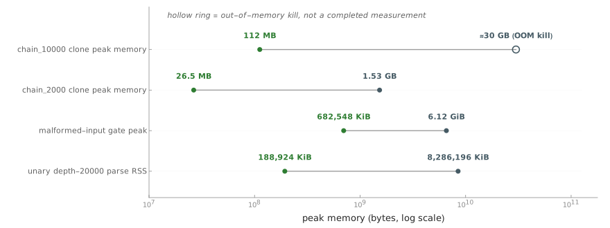

**Figure 9 —** The peak-memory wins, control versus treatment, on a logarithmic axis: the Arc representation fix (two workloads), the malformed-input gate, and the parser prefix closure. A paired dumbbell plot is used because each claim is one measured pair spanning up to five orders of magnitude.

<!-- Source: [`memory-before-after.wl`](figures/memory-before-after.wl), data [`data/memory-wins.tsv`](data/memory-wins.tsv). -->

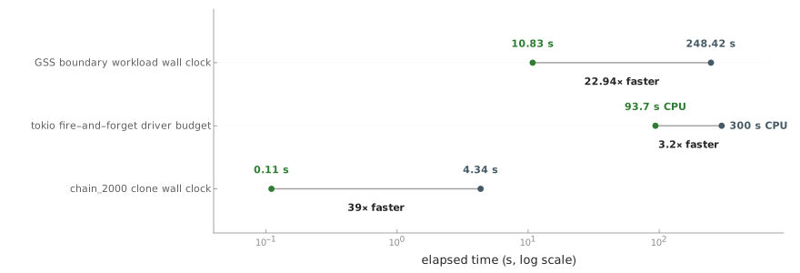

**Figure 10 —** The wall- and CPU-time wins, control versus treatment: the GSS boundary workload, the detached async driver, and the chain-clone workload. A paired dumbbell plot on a log axis is used for the same reason as Figure 9.

<!-- Source: [`time-before-after.wl`](figures/time-before-after.wl), data [`data/time-wins.tsv`](data/time-wins.tsv). -->

### 4.4 Family C — the codecs

Family C is the two wire formats of §2.2 plus the boundary codecs that feed them. Its rows split into three groups: the cold store, converted on both sides; the protobuf network format, closed by generated machinery; and the EPathMap wire rows, whose bodies live in the PathMap ledger.

<!-- mk_tables:family-C:begin generated by tools/mk_tables.py — do not hand-edit -->
| ID | Subject | Class | Control $`\rightarrow`$ Final | Disposition | Evidence |
|---|---|---|---|---|---|
| SS-C1 | cold-store decoder (bincode) | depth | 12,894 $`\rightarrow`$ 0 B/level | converted | [§5.3.3](../../design/stack-safety/stack-safety-report-2026-07-29.md#533-the-cold-store-decoder--an-obligation-stack-with-eighteen-value-stacks-9a5521a2) |
| SS-C2 | cold-store encoder (bincode) | depth | $`\approx`$ 224 $`\rightarrow`$ 0 B/level | converted | [§5.3.2](../../design/stack-safety/stack-safety-report-2026-07-29.md#532-the-cold-store-encoder--a-single-walk-trampolined-serializer-c28f4cf6-a169cc61) |
| SS-C3 | schema-code generator, one walk four outputs | enabling | — | enabling | [§5.3.2](../../design/stack-safety/stack-safety-report-2026-07-29.md#532-the-cold-store-encoder--a-single-walk-trampolined-serializer-c28f4cf6-a169cc61) |
| SS-C4 | prost encoder quadratic-work fix | work | 302 $`\rightarrow`$ 302 B/level; work $`\Theta(d^2) \rightarrow \Theta(n)`$ | dormant (work fix only) | [§5.3.5](../../design/stack-safety/stack-safety-report-2026-07-29.md#535-the-prost-network-encoder-56fb1fd0--converted-in-work-not-in-stack-and-dormant) |
| SS-C5 | prost EPathMap entry walk deleted | deletion | — (traversal removed) | converted (by deletion) | [pathmap §5.2](../../design/pathmap/pathmap-report-2026-08-03.md#52-the-wire-lineage-and-the-epm1-format) |
| SS-C6 | U(m) memoized; warm encode one memcpy | work | $`\Theta(entries)`$ $`\rightarrow`$ 0 (amortised) | no class change (work, not stack) | [pathmap §5.2](../../design/pathmap/pathmap-report-2026-08-03.md#52-the-wire-lineage-and-the-epm1-format) |
| SS-C7 | bincode EPathMap FORM 2 byte array | representation | — (reader unchanged; ceiling not inherited) | superseded by SS-C9 | [pathmap §5.2](../../design/pathmap/pathmap-report-2026-08-03.md#52-the-wire-lineage-and-the-epm1-format) |
| SS-C8 | FORM 2 keyed by written entries | representation | — (blanking on trampolined codecs, bounded) | folded into EPM1 (CBR-043) | [pathmap §5.2–§5.3](../../design/pathmap/pathmap-report-2026-08-03.md#52-the-wire-lineage-and-the-epm1-format) |
| SS-C9 | homogeneous EPathMapRepr and EPM1 snapshot | representation | depth 4,096 on 256 KiB; no entry projection | converted (by representation) | [pathmap §5.1–§5.5](../../design/pathmap/pathmap-report-2026-08-03.md#51-the-homogeneous-representation) |
| SS-C10 | evaluator streams PathMap directly, no projection | work | n·sizeof(&Par) (set) / 2n·sizeof(&Par) (map) $`\rightarrow`$ 0; $`\Theta(n)`$ traversal | stack safety inherited from SS-B1; heap refinement | [pathmap §5.7](../../design/pathmap/pathmap-report-2026-08-03.md#57-reverse-zipper-totality) |
| SS-C11 | reducer-identity root preservation and teardown | work | 4,119,482 $`\rightarrow`$ 278,527 allocation events; 32.281 $`\rightarrow`$ 18.730 ms | measured-neutral optimization | [§5.17](../../design/stack-safety/stack-safety-report-2026-07-29.md#517-epathmap-evaluator-and-clone-family-teardown-integration-ss-c11) + [pathmap §5.4.1](../../design/pathmap/pathmap-report-2026-08-03.md#541-integration-path-root-preservation-and-e-8b) |
| SS-C12 | direct ACTree03 replay and deferred folds | depth | $`\Theta(d) \rightarrow O(1)`$ stack; $`\Theta(d^2) \rightarrow \Theta(d)`$; gate 6.12 GiB $`\rightarrow`$ 682,548 KiB | converted (decoder SCC); byte/acceptance neutral | [§5.19](../../design/stack-safety/stack-safety-report-2026-07-29.md#519-direct-epm1-canonical-validation-and-fold-construction-closure-ss-c12) |
| SS-C13 | borrowed/owned canonical-Par streaming PDA | depth | all-entry frontier $`\rightarrow`$ $`O(1)`$ trie cursors; 20,000 levels on 256 KiB | converted | [§5.20](../../design/stack-safety/stack-safety-report-2026-07-29.md#520-semantic-scc-constructor-and-pathmap-streaming-closure-ss-g43-ss-c13) |
<!-- mk_tables:family-C:end -->

**The cold store is converted on both sides and is faster for it.** The decoder — the shallowest member of the whole family at 28,362 (debug) and 12,894 (release) B/level, and the only member whose failure mode is permanent and replicated — became an obligation stack of bounded opcodes with eighteen per-type value stacks, measured flat at both ends of the ladder in both profiles. Its obligation is language identity, not round-trip: for every byte string, the machine and the retained compiler-generated oracle must agree — same value, or both reject — because a node that accepts a byte string another rejects forks. That obligation was exercised over a constructed corpus covering every enum arm and 1.88 million malformed inputs (truncations at every byte offset, byte substitutions, out-of-range variant indices, hostile length claims), all agreeing, with depth 4,096 both decoded and correctly rejected-when-truncated on a 256 KiB stack. The encoder became a pre-order opcode stack over borrows with no value stack at all — serialization into a contiguous buffer needs no parking, the same structural observation as Cheney's collector [[Cheney 1970](#ref-cheney1970)] — with an opcode stack that is proportional to depth, not size: 5 entries at width 4 and at width 65,536, 2.000 entries per level at 32 bytes each, a figure reproduced independently by the heap profiler's 524,288-byte high-water mark at depth 4,096.

The conversion also won time and allocation, and the magnitudes are stated with the §3.7 discipline. On the production-weighted mix (95.43 percent of measured produces are depth 2), the converted encoder is faster than the derive it replaces: the sign is confirmed by two instruments, and the honest magnitude statement is a bracket, 1.07×–1.19× — a range the true value lies in, not a confidence interval. The mechanism is visible in the CPU profile: the derive traverses every term twice (a sizing walk, then a writing walk), the sizing walk is the more expensive of the two, and the single-walk machine deletes it. Where the caller reuses an output buffer, 20,000 encodes cost 26 allocation blocks against the derive's 20,022 — 770 times fewer.

**The protobuf read ceilings are removed.** The generated `prost::Message` implementation family (SS-A8) made encode, length, merge, and clear explicit machines; nested unknown groups are skipped iteratively; and the generated decode automata read depth 4,096 on a 256 KiB stack where the vendored reader's private limit had refused depth 34 — the three envelope-derived ceilings {31, 32, 33} of §2.2 no longer exist. The dormant SS-C4 row is retained honestly: it converted the encoder's quadratic re-measurement work and did not make anything stack-safe, and its length-table architecture carried forward into the generated family. SS-C12 additionally closed the canonical-validation resource envelope: the malformed-input gate that previously drove a 6.12 GiB cgroup peak now completes in 682,548 KiB, with the canonical-key worklist running to depth 20,000 on a 256 KiB stack.

**The EPathMap rows are pointers, and that is a contract, not an omission.** Rows SS-C5 through SS-C10, the PathMap half of SS-C11, and defect row SS-Y6 carry their bodies in the [PathMap ledger](../../design/pathmap/pathmap-report-2026-08-03.md) and the [companion technical report](../pathmap/pathmap-technical-report-2026-08-12.md); this report keeps their register rows and their stack-safety consequences (the deleted per-entry walk has no remaining caller, and the per-key read ceiling it fed died with it). SS-C11's integration result is shared: 4,119,482 $`\rightarrow`$ 278,527 allocation events (93.2 percent fewer) and 32.281 $`\rightarrow`$ 18.730 ms (41.98 percent faster) on the locked evaluator benchmark. The related node JSON boundary (SS-A9, Family A) converts `Par` to the response representation and its `Clone`/`Serialize`/`Debug`/`Drop` behavior through explicit machines, exercised at depth 16,384 on a 256 KiB stack.

### 4.5 Family D — the deploy path

Family D is the end-to-end path a deploy travels — gRPC ingress, admission, normalization, metering, evaluation — measured as ceilings on a real runtime with source text as input.

<!-- mk_tables:family-D:begin generated by tools/mk_tables.py — do not hand-edit -->
| ID | Subject | Class | Control $`\rightarrow`$ Final | Disposition | Evidence |
|---|---|---|---|---|---|
| SS-D1 | task-spawn per-branch deep clone removed | depth | 2,867 $`\rightarrow`$ 0 B/level (this site) | converted (this site) | [§5.5.3](../../design/stack-safety/stack-safety-report-2026-07-29.md#553-the-three-repairs) |
| SS-D2 | ownership moved into the substitution | depth | 15 deep copies removed; incl. $`O(n^2) \rightarrow O(n)`$ | converted | [§5.5.3](../../design/stack-safety/stack-safety-report-2026-07-29.md#553-the-three-repairs) |
| SS-D3 | inj_attempt read-back clone $`\rightarrow`$ by-move | depth | 2,852 $`\rightarrow`$ 0 B/level | converted (call-site elimination) | [§5.5.3](../../design/stack-safety/stack-safety-report-2026-07-29.md#553-the-three-repairs) |
| SS-D4 | gRPC ingress teardown | depth | 96.0 $`\rightarrow`$ 0 B/level | converted | [§5.5.3](../../design/stack-safety/stack-safety-report-2026-07-29.md#553-the-three-repairs) |
| SS-D5 | metered wrappers take term by value | depth | 2,852 $`\rightarrow`$ 146 B/level | no class change (encoded_len remains) | [§5.5.4](../../design/stack-safety/stack-safety-report-2026-07-29.md#554-results-and-a-control-that-behaved-exactly-as-predicted) |
<!-- mk_tables:family-D:end -->

**Two ceilings and a control.** The end-to-end result is three numbers measured on the same instrument: the `plain_deploy` ceiling rose from 286 to 6,831 nesting levels on a 2 MiB worker (23.9×); the `inj_attempt` metering handshake's ceiling rose from 729 to at least 1,048,576 (at least 1,438×, the instrument's search bound, not an observed failure) as its slope fell from 2,852 B/level to 0; and the `env_get_deploy` control — a deploy shape whose depth cost runs through a code path the repairs deliberately did not touch — moved from 283 to 274, approximately 1×, exactly as predicted before measurement. The control is the reason the headline is credible: a report quoting only `plain_deploy` would be false, because what changed is which shape is worst, and the control shape's traversal was only later converted by the generated `Clone` machinery of Family A. The unauthenticated ingress teardown — reachable before the deploy is stored, before consensus, and before any budget exists to charge — went from a 21,781-level ceiling at 96.0 B/level to no ceiling below 262,144 at slope 0; the pre-repair severity was a 43,565-byte deploy aborting the node.

**The falsified prediction, told honestly.** The hypothesis recorded before measurement held that `Env::get`'s semantically necessary clone was the deploy path's binding constraint, because that is where a deep term enters the environment. Measurement falsified it: a no-binder shape and a communicated-binder shape both measured the same 7,253 B/level, differing only by a 20,480-byte intercept — three levels of headroom, not a new ceiling. The real culprit, established by debugger attribution at the overflow, was the metered substitution wrapper cloning its input term on the ordinary send path, with no binder, no communication, and no environment involved. The repairs then followed ownership rather than the hypothesis: the per-branch deep clone at the task-spawn boundary was deleted, ownership was carried through the evaluation plumbing (removing 15 deep copies, including a loop that had rebuilt its remaining cases quadratically), and the metering handshake's read-back clone became a by-move accessor that reproduces the original's left-biased search order exactly.

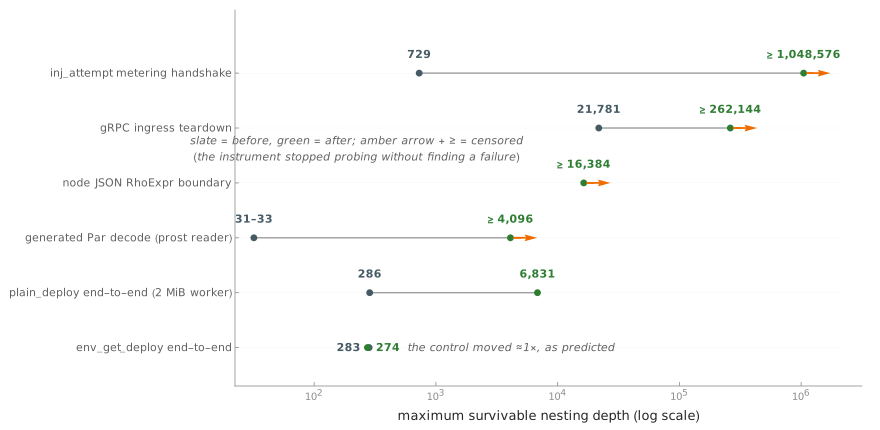

**Figure 11 —** The measured depth ceilings before and after repair — the two lifted ceilings, the two demonstrated bounds, and the control that stayed put — on a logarithmic depth axis. A dumbbell plot is used because each row is one before/after pair and the control's near-zero movement is the point.

<!-- Source: [`depth-ceilings-dumbbell.wl`](figures/depth-ceilings-dumbbell.wl), data [`data/depth-ceilings.tsv`](data/depth-ceilings.tsv). -->

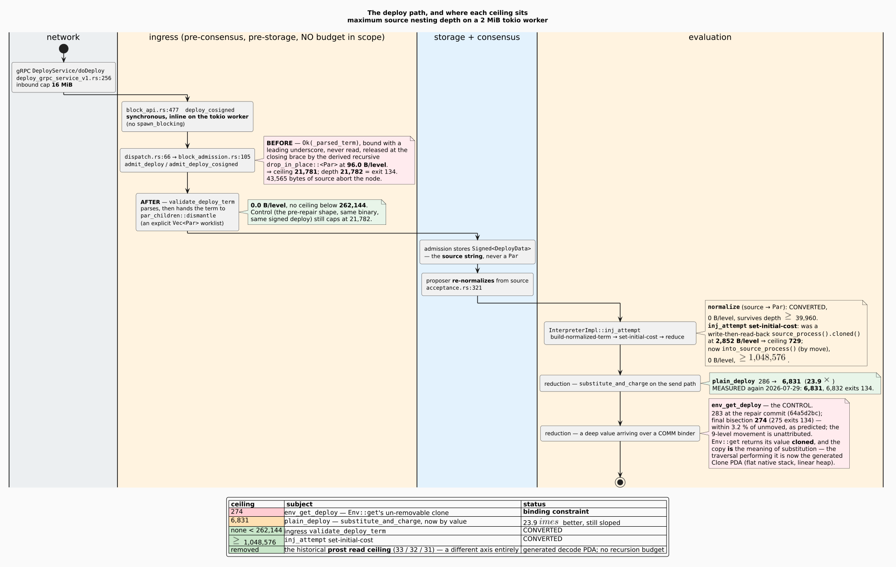

**Figure 12 —** The deploy path end-to-end — ingress, admission, normalization, metering, evaluation — with each traversal's measured ceiling in place. An annotated flow diagram is used because the severity argument depends on where each ceiling sits relative to authentication, storage, and charging, which only a path drawing shows.

<!-- Source: [`deploy-path-ceilings.puml`](../../design/stack-safety/figures/deploy-path-ceilings.puml). -->

### 4.6 Family B — the evaluator and the async driver

<!-- mk_tables:family-B:begin generated by tools/mk_tables.py — do not hand-edit -->
| ID | Subject | Class | Control $`\rightarrow`$ Final | Disposition | Evidence |
|---|---|---|---|---|---|
| SS-B1 | expression evaluator SCC $`\rightarrow`$ eval_drive | depth | overflow $`\approx`$1.5k $`\rightarrow`$ OK at 50,000 | converted | [§5.2.1](../../design/stack-safety/stack-safety-report-2026-07-29.md#521-the-expression-evaluator-trampoline-a929a2d6) |
| SS-B2 | five async join sites detached | depth | 300 s $`\rightarrow`$ 93.7 s CPU | converted (heap chain) | [§5.2.2](../../design/stack-safety/stack-safety-report-2026-07-29.md#522--the-tokio-fire-and-forget-driver--establishing-the-mechanism-not-assuming-it) |
| SS-B3 | StackGrowingFuture and stacker deleted | deletion | — (dependency deleted) | converted (by deletion); dependency removed | [§5.2.2](../../design/stack-safety/stack-safety-report-2026-07-29.md#522--the-tokio-fire-and-forget-driver--establishing-the-mechanism-not-assuming-it) |
| SS-B4 | native-method replay $`\rightarrow`$ typed continuations | depth | overflow at depth 16 $`\rightarrow`$ depth 4,096 on 256 KiB in 0.49 s | converted | [§5.2.1](../../design/stack-safety/stack-safety-report-2026-07-29.md#521-the-expression-evaluator-trampoline-a929a2d6) |
| SS-B5 | InterpreterError forest lifecycle work stacks | lifecycle | $`\Theta(d) \rightarrow O(1)`$ stack; 20,000 levels on 256 KiB | converted | [§5.2.1a](../../design/stack-safety/stack-safety-report-2026-07-29.md#521a-interpretererror-lifecycle-closure-ss-b5) |
<!-- mk_tables:family-B:end -->

The six mutually recursive expression evaluators became thin wrappers over one explicit-worklist driver, sharing their post-order arm bodies with a retained recursive twin so the differential oracle tests the driving — push order, pop order, fold resumption, error position — rather than re-testing arm semantics. Arithmetic nesting that overflowed near depth 1,500 and list nesting that overflowed near 750 both run at 50,000; the adversarial native-method replay chain, where a method result can reveal another method expression and the recursive control overflowed at 16 links, runs 4,096 links on a 256 KiB stack in 0.49 s at 118,276 KiB peak RSS (SS-B4). SS-B5 closed the one recursive family the term-family census structurally could not see — the interpreter's error forest, whose clone, equality, formatting, root-cause, and drop behavior all descended error depth — at 20,000 mixed levels on a 256 KiB stack in 0.03 s.

The `tokio` result is two fixes, not one, and establishing that was the work. Inline awaiting nested `poll` calls in the same native frame — recursion wearing an async costume, which the deleted `StackGrowingFuture`/`stacker` mitigation had been feeding rather than removing — while awaited spawned children pinned a parked-parent chain of live future objects on the heap, a different resource entirely. The repair detached all five join sites behind a per-deploy atomic completion counter with an error sink; the deleted mitigation removed the `stacker` dependency outright (SS-B3). The reference contract that previously required a 300 s budget completes in 93.7 s of thread CPU — approximately 3.2 times less work measured in the one clock invariant to machine contention — and the differential harness holds cost, failure status, balance, and the communication multiset byte-identical, with replay equal to play.

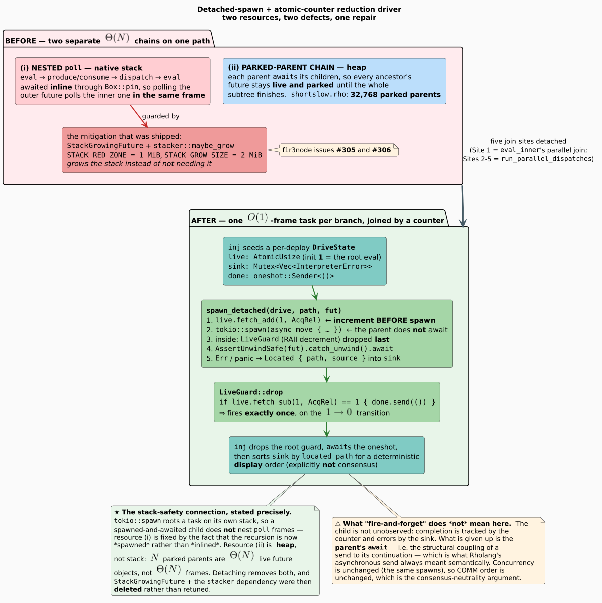

**Figure 13 —** Two resources, two defects, one repair: inline-awaited `poll` nesting on the native stack and the parked-parent chain on the heap, both removed by counted detached spawns. A structural before/after diagram is used because the claim is which resource each chain lived in.

<!-- Source: [`async-detached-driver.puml`](../../design/stack-safety/figures/async-detached-driver.puml). -->

### 4.7 Family E — the instrument measured on itself

The measurements in this report are admissible only because the instrument is itself under test; this family is where the instrument caught defects in its own machinery.

<!-- mk_tables:family-E:begin generated by tools/mk_tables.py — do not hand-edit -->
| ID | Subject | Class | Control $`\rightarrow`$ Final | Disposition | Evidence |
|---|---|---|---|---|---|
| SS-E1 | Phase 3b prerequisite instrument | instrument | unmeasured (instrument, not a traversal) | instrument — no class change by construction | [§5.6.7](../../design/stack-safety/stack-safety-report-2026-07-29.md#567-ss-e1--3bs-prerequisite-instrument-and-the-two-checks-that-were-blind) |
| SS-E2 | traversal registry bound to proof manifest | instrument | 30 depth + 6 width subjects; zero tripwires | enabling and closure evidence | [§5.12](../../design/stack-safety/stack-safety-report-2026-07-29.md#512-generated-par-pda-closure-ss-a8-ss-e2) |
| SS-E3 | Phase 7 resource-closure ladders | instrument | 40 subjects all subquadratic; four transfers linear | enabling and closure evidence | [§5.14](../../design/stack-safety/stack-safety-report-2026-07-29.md#514-resource-closure--heap-and-deterministic-time-ss-e3) + [pathmap §5.6](../../design/pathmap/pathmap-report-2026-08-03.md#56-hash-and-clear-ladders) |
| SS-E4 | entry-depth histograms; reverse-zipper repair | instrument | four non-vacuous populations; reverse walk preserved | enabling, measurement, and corrective evidence | [§5.15](../../design/stack-safety/stack-safety-report-2026-07-29.md#515-subject-depth-distributions-ss-e4) + [pathmap §5.7](../../design/pathmap/pathmap-report-2026-08-03.md#57-reverse-zipper-totality) |
<!-- mk_tables:family-E:end -->

Four self-findings are load-bearing for everything else in this report. First, the converted-subject list once existed in four prose copies and every copy had drifted; the reconciliation was shown red four times before green, and the fourth failure is the instructive one — the gate and the audit disagreed on membership while both counted nine, so a count check would have missed it entirely. The register is now derived from the gate's constants and the gate records every subject it actually drives, refusing to finish on any mismatch. Second, the gate's own headline test was fixture-dependent: it certified source depth 100,000 only because its fixture ended in an explicit iterative dismantle that no production caller performs — the distance between "100,000 is fine" and "4,415 aborts the node" was one call in a fixture. Third, the harness's property-test generator was totally vacuous: an exclusive `0..1` size range meant every generated collection had exactly zero elements, so every property quantified over a two-element universe. Repairing it surfaced a real finding — the canonical sorter is a normalizer and therefore not injective, so three tests asserting a biconditional were passing on sampling luck and could not be relied on to gate the sorter's own conversion. Fourth, the subject-specific entry-depth distributions were measured rather than assumed: the production-facing corpora are shallow (the cold-store encoder's 9,655 observed roots never exceed depth 5, and 95.43 percent of the throughput bench's 1,773 datums sit at depth 2), each subject population is required to be non-vacuous, and the first corpus run itself exposed a production totality defect in a reverse-zipper edge case, repaired without forking the PathMap dependency.

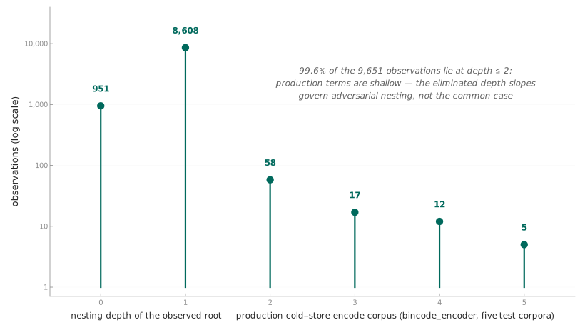

**Figure 14 —** Observed nesting-depth distributions of the production-facing corpora, one population per subject — shallow everywhere, which is exactly why the eliminated slopes govern adversarial rather than typical inputs (§6). A small-multiples histogram is used because the claim is four separate populations, not one pooled one.

<!-- Source: [`subject-depth-histogram.wl`](figures/subject-depth-histogram.wl), data [`phase7-depth-histograms-2026-08-03.tsv`](../../design/stack-safety/measurements/phase7-depth-histograms-2026-08-03.tsv). -->

### 4.8 The honest tail — X, Y, and the unobtainable

<!-- mk_tables:family-X:begin generated by tools/mk_tables.py — do not hand-edit -->
| ID | Subject | Class | Control $`\rightarrow`$ Final | Disposition | Evidence |
|---|---|---|---|---|---|
| SS-X1 | exhaustive PartialEq/Hash candidate | rejected | — (not stack safety) | rejected candidate | [§5.8](../../design/stack-safety/stack-safety-report-2026-07-29.md#58-the-rejected-candidate) |
<!-- mk_tables:family-X:end -->

<!-- mk_tables:family-Y:begin generated by tools/mk_tables.py — do not hand-edit -->
| ID | Subject | Class | Control $`\rightarrow`$ Final | Disposition | Evidence |
|---|---|---|---|---|---|
| SS-Y1 | optional-collection generator defect (E0624/E0606) | defect | — (compile errors E0624/E0606) | defect — repaired (6248f156) | [§8.6](../../design/stack-safety/stack-safety-report-2026-07-29.md#86-the-issue-keyed-residuals-at-their-final-dispositions) |
| SS-Y2 | hand-written Par Hash/PartialEq defect | defect | 625 debug / 113 release $`\rightarrow`$ 0 B/level | defect — repaired (26876b65) | [§5.6.6](../../design/stack-safety/stack-safety-report-2026-07-29.md#566--174-attributed-to-models-impl-hash-for-par-3276c1ee) |
| SS-Y3 | collection arms re-score three times per level | defect | $`\Theta(3^d)`$, $`3.016\times`$/level $`\rightarrow`$ Ir exponent 1.0068 set / 1.0023 map | defect — repaired (26876b65) | [§5.6.8](../../design/stack-safety/stack-safety-report-2026-07-29.md#568-ss-y3--the-collection-arms-re-score-every-element-three-times-per-level) |
| SS-Y4 | sibling order not total — consensus fork | defect | seeded 20/20 split $`\rightarrow`$ sibling order total | defect — repaired (sibling order now total) | [§5.6.9](../../design/stack-safety/stack-safety-report-2026-07-29.md#569-ss-y4--sibling-order-is-not-a-total-function-of-the-term) |
| SS-Y6 | TRIE_INTERN least-recently-used-store recursive destructor in mutex | defect | unmeasured (site deleted) | defect — discharged by deletion (c0385b79) | [pathmap §5.8](../../design/pathmap/pathmap-report-2026-08-03.md#58-the-dissolved-intern-store) |
| SS-Y7 | k-shift continuation quadratic locally_free metadata | defect | 1,395,560 KiB RSS / 2.04 s $`\rightarrow`$ 85 B / 17 allocations | defect — repaired by SS-G41 (c95d9e73) | [§5.18.43](../../design/stack-safety/stack-safety-report-2026-07-29.md#51843-one-pass-native-shift-fusion-and-constant-size-carrier-closure-ss-g41-ss-y7) |
| SS-Y8 | printer ESet/EMap nested drives, quadratic | defect | $`\Theta(d) \rightarrow O(1)`$; $`\Theta(d^2) \rightarrow \Theta(d)`$; depth 4,096 on 256 KiB | defect — repaired (50756ec2) | [§5.1.3a](../../design/stack-safety/stack-safety-report-2026-07-29.md#513a-ss-y8--owned-canonical-collections-complete-the-printer-pda) |
<!-- mk_tables:family-Y:end -->

**The rejected candidate.** SS-X1 proposed making six hand-written equality implementations exhaustive so that a future enum variant could not silently compare unequal to itself. That is a real defect — a reflexivity and hashing correctness defect — and it was fixed in its own campaign; it has no depth axis, no slope, and no interaction with the stack, so it is excluded here and retained in the register so it is not re-proposed.

**Why the Y family exists.** The earlier register families could record a fix, a partial fix, or a rejected candidate, but not a live unrepaired defect introduced or revealed by a fix in the register itself — and a register that can only hold good news reports coverage it does not have. SS-Y rows are therefore allocated while a defect is open, they are never marked as a class change, a row is discharged only by a commit that repairs it, and repaired rows remain in the register with their repair recorded, preserving the defect history. Every row above is discharged at the snapshot anchor.

**SS-Y4 was a live consensus safety fork, found by this register's own discipline and repaired.** Sibling order in the canonical form was not a total function of the term: the map arm chained only the key's score, so distinct canonical terms could share a score tree, and the stable sibling sort then inherited its order from its input — from a per-process-seeded hash iteration in one feeder (40 independent processes on one identical term split 20/20 across two byte strings) and from message field order in the other (two spellings of one commutative process signed differently, deterministically). The repair derives the tie-break rather than choosing one: siblings are ordered by their score and then by the bytes they emit — the unique key for which "swapping two siblings is invisible" and "the two are equal under the key" are the same statement — and after it, the 40-process experiment reads 40/40 identical, the two spellings are byte-identical, and every tie-free golden is unmoved by construction.

**The ten measurements that could not be obtained** are enumerated with reasons in ledger §5.9; none is estimated, and the report says "not measured" rather than guessing. The highest-value entry is the before/after heap profile of the two early fixes that removed quadratic copying: both were gated on native stack alone, and reproducing a before-profile requires the pre-conversion tree, which no longer exists. That gap is what motivated the two-axis gate lesson of §4.3 being stated as a rule rather than an anecdote.

### 4.9 Falsified predictions, consolidated

Three predictions were falsified by measurement, and each is reported as a result of the method rather than as an embarrassment of it.

1. **The deploy bound was not `Env::get`.** The pre-registered hypothesis named the environment clone as the deploy path's binding constraint; measurement showed the binder shape cost three levels of headroom, both shapes shared one 7,253 B/level slope, and the true bound was the metered wrapper's input clone on the ordinary send path (§4.5).
2. **The ingress slope was not 84.3 B/level.** The recorded figure came from a two-point ladder whose low endpoint was clamped at the parse/normalize floor, biasing the estimate downward — the intercept hazard of §2.3. Four fixed-stack bisections resolve it: 95.999 B/level by least squares at $`r^2 = 1.0000`$, with the disassembly independently giving 96 bytes across the two frames of the teardown cycle. The corrected record is 96.0, and the same analysis showed an earlier "call-shape sensitivity" conclusion to be ordinary per-build register-allocation variance.
3. **The guest-language parser was not depth-independent.** A published claim rested on a ladder that never cleared the parser's own 471,040-byte intercept; the wide-ladder gate retracted it within the hour, resolving a genuine 1,408 B/level asymptote above a knee near depth 256. The rule adopted generalizes past the subject: both probe points of a slope measurement must sit clear of the subject's own floor, or the derived slope is understated — here, all the way to zero. (The growth that fixture exercised was later removed by the generated-driver conversions, and the wide zero-slope invariant is now enforced; the historical table stands as the before-measurement.)

### 4.10 Costs

The campaign's costs are deterministic measurements in the same register as its wins, and they close this section deliberately.

- **The single-walk cold-store encoder performs 3.25 times more heap writes than the derive it replaces** (41.65 MB versus 12.83 MB per profiled pass) **and doubles peak heap on the production shape** (6,187 $`\rightarrow`$ 12,395 bytes), because it retains two thread-local arenas. Those writes are the opcode stack — traffic relocated from the native stack, which the heap profiler does not count, into counted heap — but they are real memory traffic against real caches; the production-mix wall clock of §4.4 shows they do not cost time on that workload.
- **On one sibling benchmark the converted encoder is slower**: 0.954×–0.962× across three paired runs. It is reported beside the win, not instead of it; the production-weighted verdict and this one differ because the workloads weight per-node dispatch differently.
- **The stack-safe canonical-key classifier is 3.79 times slower at depth 1**, the production-common case, with the crossover before depth 8; the full ladder and its analysis are the companion report's ([PathMap technical report, §4.8](../pathmap/pathmap-technical-report-2026-08-12.md)).
- **The memoized protobuf length rewrite trades constant space for linear space** — a 4-byte table entry per message node — to buy the work reduction from quadratic re-measurement to a single measuring pass. That trade is stated as a trade; the generated implementations that shipped carry it.

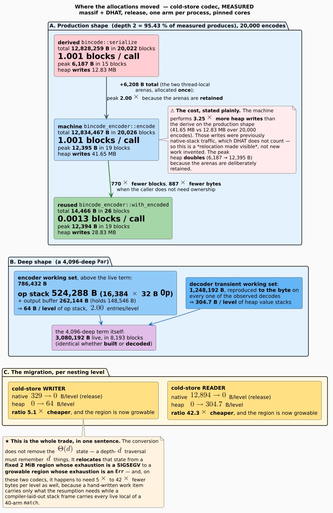

**Figure 15 —** The codec conversion's heap result: allocation counts and peaks for the derive, the like-for-like machine, and the reused-buffer machine, with the retained arenas and the 3.25× write cost drawn beside the 770× block win. An annotated bar/flow composite is used because the claim is where state moved, not just how much.

<!-- Source: [`heap-where-allocations-moved.puml`](../../design/stack-safety/figures/heap-where-allocations-moved.puml). -->

---

## 5. Discussion

Six lessons generalize past their subjects. They are stated here as prose because they are the part of this report most likely to be reused elsewhere.

**Lesson 1 — the explicit-worklist shape is smaller than what it replaces.** Trampolining is usually presented as trading space for safety; here it bought both. The heap cost per level of the converted codecs sits far below the stack cost it replaced — 64 bytes of heap against 329 bytes of stack per level for the writer (5.1×) and 304.7 against 12,894 for the reader (42.3×) — because a compiler-laid-out frame for a 40-arm match reserves slots for every arm's live locals and does not overlap mutually exclusive arms at `-O0`, whereas a hand-designed work item is a 32-byte enum carrying exactly what the resumption needs. The thing replaced was fat, not the thing introduced thin. The flat ladders of the register are the visible consequence.

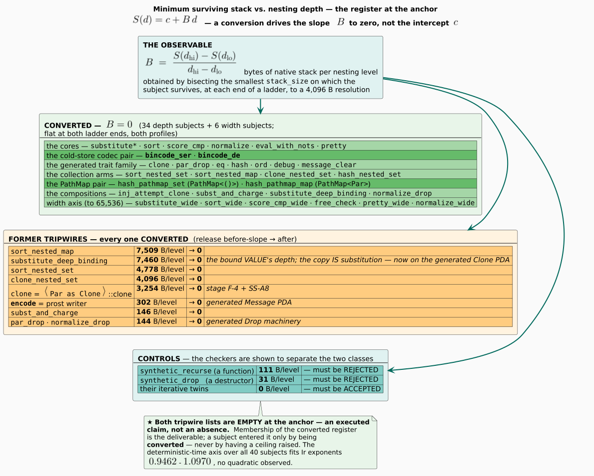

**Figure 16 —** The register at the anchor: converted subjects flat across the full depth and width ladders, with the empty tripwire lists beside them. A ladder/line diagram is used because the converted criterion is literally the flatness of these lines between their two measured ends.

<!-- Source: [`depth-vs-stack-ladder.puml`](../../design/stack-safety/figures/depth-vs-stack-ladder.puml). -->

**Lesson 2 — scope by Tarjan, not by intuition.** The SCC is the unit of conversion [[Tarjan 1972](#ref-tarjan1972)], because converting a proper subset of a cycle leaves the class intact. Three independent instances drew the boundary wrong by intuition and were corrected by decomposition: the substitution family, where converting a subset would have left the cycle live; the mettail lowering, where the reproducer's cycle ran through twelve iterator-adapter monomorphizations and the eighteen direct self-call sites were not the component at all; and the sorter, where converting the sort alone would have left the comparator depth-proportional while the gate still passed, because a linear chain sorts as a one-element vector on which the sort performs zero comparisons. The complement also holds: a Tarjan run over the schema cannot see a recursive Rust type that is not a schema message, which is why enumeration completeness is a threat (§6) and not a solved problem.

**Lesson 3 — neutrality is the hard part, not the driver.** Every converted traversal sits on a consensus-visible path, and the drivers were the easy half; the expensive half was proving that nothing observable moved, with the obligation derived per traversal rather than assumed. The sorter is the sharpest case: it takes no metering handle, so its whole obligation is the result — the signed canonical bytes — and a one-element reordering is a consensus fork, which is why the stable sort was kept and its unstable sibling refused (the comparator returns equality for distinct terms with equal scores, and an unstable sort would be free to reorder them). The other pole is the length function used for charging: its return value *is* the charge, so its neutrality cannot be inferred from control flow at all and had to be checked against both the recursive oracle and the emitted byte length. The transformation itself is standard — a defunctionalized interpreter in the functional-correspondence lineage [[Reynolds 1972](#ref-reynolds1972); [Ager et al. 2003](#ref-ager2003)] — and the retained recursive twins exist precisely because the two are equal by construction, so any divergence is a mechanization bug. Pointer-reversal traversal [[Schorr & Waite 1967](#ref-schorr1967)] was considered and rejected on the same neutrality grounds: it mutates the structure during traversal, which is inadmissible for borrowed and shared terms whose bytes are signed.

**Lesson 4 — the write/read asymmetry is one class, and its repair had an ordering constraint.** The campaign kept re-discovering one shape: a term written by an unbounded encoder and later read by a bounded decoder, with the two ends on different paths, processes, or times. Four independent instances were registered, and the closure took the only option that changes no accepted-input set: convert the reading paths rather than cap the writer (consensus-visible) or raise the vendored limit (equally consensus-visible, and worse — the recursion limit was also the sole guard on an attacker-controlled recursion in the unknown-field group-skip path, so removing it first would have introduced the very fault being repaired; the iterative group skipper had to land before the cap ceased to govern, and did). The same enumeration surfaced a second axis nobody had listed: protobuf's optional-on-the-wire encoding means an absent required child is something the decoder returns, not something it refuses, and a crafted message of about ten bytes was accepted while faulting 94, 55, and 1 consumer sites in three modules plus a foreign-function surface. The disposition — an internal invariant violation to be asserted, with the fix at the byte-admitting boundary — was settled once for all sites.

**Lesson 5 — the arm divergence, and the algebra that determines the machinery.** The pedagogical center of the campaign is one classifier arm. The generated term enums classify variants as leaves or containers; every sloped generated driver was one that still treated a container of sub-terms as an opaque leaf, reaching children by host recursion — correct for a true leaf, a depth-proportional defect for a collection. That single divergence unified two defects met from different angles: a consensus-visible fingerprint leak (a binder inside a collection literal leaking a run-varying identifier) and a stack slope across eleven generated drivers, and repairs aimed at either axis moved the other until the classifier itself was repaired. The slope was production-fatal by arithmetic, not rhetoric: the ground-ness driver's measured 2,225 B/level reaches

```math
2{,}225 \times 4{,}096 \;=\; 9{,}113{,}600 \ \mathrm{B} \;\approx\; 8.69\ \mathrm{MiB} \;>\; 8\ \mathrm{MiB}
```

at depth 4,096 — past the default main-thread stack, an uncatchable abort. Two sub-lessons carry the transferable content. First, a work-stack driver can only replace recursion for work its task enum can represent: the comparison and hash drivers could express descents but not "resume this comparison once the child has answered," so per-element pushes were not even spellable until the enum grew a resumption variant — the task enum is the real interface of a converted driver, not the push site, and a conversion plan that budgets only for a push under-budgets by the size of the enum extension. Second, the algebra of the combining operation determines the machinery, which makes the conversion derivable rather than inventive. For the ground-ness check, the fold is a conjunction over the descendant set,

```math
g(n) \;=\; \bigwedge_{m \,\in\, \mathrm{desc}(n)} \mathrm{base}(m)
```

and each algebraic property removes a piece of machinery a general driver would need:

| properties of the combining operation | driver shape it licenses | worked example |
|---|---|---|
| associative, commutative, and idempotent | a single accumulator over a flat worklist — no result stack, no combine step, no child-order bookkeeping | the ground-ness driver |
| associative only | an obligation stack plus value stack(s) — partial results park until the parent's combining step | the cold-store decoder, with its eighteen per-type value stacks |
| neither | resumable task frames — the enum must spell "resume with the child's answer" | the lexicographic comparison and hash drivers |

The presentation of that repair — prose specification first, refinement into named fragments, machinery derived from stated properties — follows the literate style deliberately [[Knuth 1984](#ref-knuth1984)]; the ledger carries the full literate algorithm.

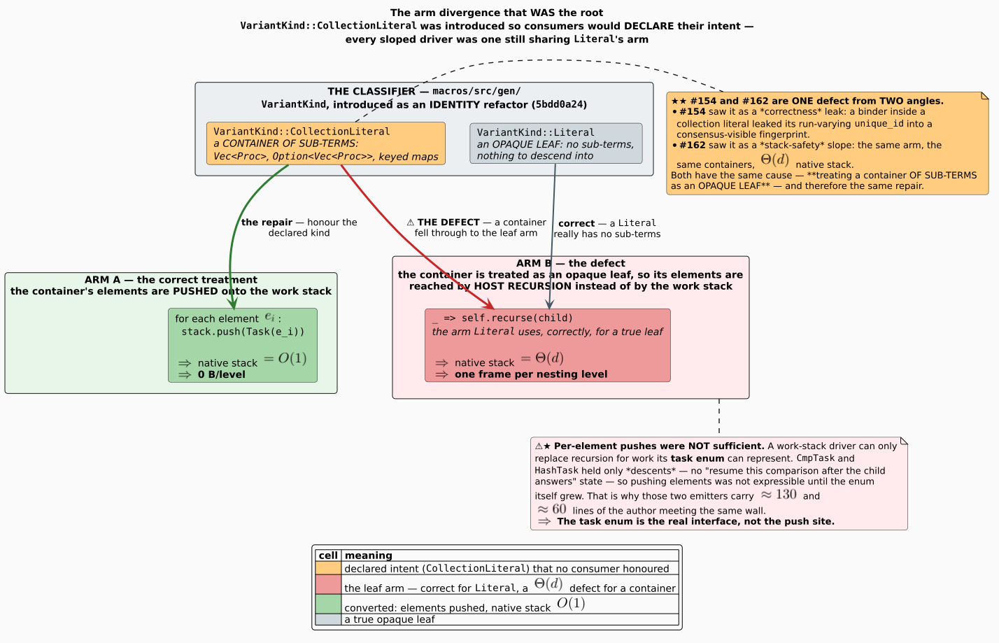

**Figure 17 —** The arm divergence that was the root cause: one classifier, two consumer arms, and containers of sub-terms falling through to the leaf arm in every sloped driver. An annotated decision-tree (dispatch-divergence) diagram is used because the defect is a wrong arm being taken, not a wrong value being computed.

<!-- Source: [`collection-literal-arm-divergence.puml`](../../design/stack-safety/figures/collection-literal-arm-divergence.puml). -->

**Lesson 6 — gate on the resource the defect lives in.** Recapped from §4.3 in one sentence: the same fix was correctly refused on the time axis at 0.78 percent of runtime and correctly accepted on the space axis at 96 percent of peak heap, so an acceptance gate must name its resource or it will refuse fixes worth orders of magnitude on the axis it did not profile.

---

## 6. Threats to validity

**The observable is a proxy.** B/level is the slope of minimum surviving stack bisected to 4,096 bytes, not a frame-size readout, and it aggregates every frame in the cycle. A traversal with a true slope below resolution divided by span is indistinguishable from zero: the gate's zero-slope ceiling over the 4 $`\rightarrow`$ 4,096 span is 4 B/level in integer arithmetic, with the sloped control roughly forty times above it — a real but finite margin. The estimator is also affine by assumption, and one subject in the corpus is flat-then-linear with a knee near depth 256 whose mechanism is deliberately not guessed at; any subject measured only below its knee would be misclassified, which is why the ladders end at 4,096 (depth) and 65,536 (width).

**Machine state and machine specificity.** The host was never idle (§3.2), so absolute timings are not hardware characteristics; the paired design protects only relative ones. All figures come from one microarchitecture at `target-cpu=native`, and frame layouts do not transfer: the same teardown function was observed emitted at 48 bytes in one binary and 64 in another — a 1.5× spread from register allocation alone, with no source difference — so per-level constants are properties of a build, not of the source.

**Workload representativeness.** The production-facing corpora are shallow (Figure 14): the throughput verdict is weighted by a measured distribution in which 95.43 percent of datums sit at depth 2, and no observed production root exceeded depth 5. The eliminated slopes therefore govern adversarial nesting, not the common case; the deploy ceilings are measured on synthetic maximally nested source, which is the right shape for a ceiling and the wrong shape for an average. Per-shape throughput magnitudes were never re-measured under the paired design and are not quoted.

**Enumeration completeness.** The traversal inventory is derived by three methods — Tarjan over the schema, a call-graph search with an explicit trait-dispatch pass, and measurement as the discriminator of last resort — and each has a demonstrated blind spot: the schema decomposition cannot see a recursive Rust type that is not a schema message (it missed the score tree and its five traversals); a derive scan cannot see hand-written implementations (a hand-picked list of four missed the hash implementation once); and a call-graph search cannot see the compiler's implicit drop glue, which has no source text anywhere. The list of depth-proportional traversals should therefore be read as a lower bound, not a census, and the registry that guards bounded reads is a scan precisely so a new site cannot appear without being dispositioned.

**The build overlay.** A B/level figure is a property of source, toolchain, profile, and build overlay together. The measurement tree carried a deliberately untracked dependency-patch block (an unpublished parser worktree required by the normalizers), so an archived checkout does not build by design; anyone pinning a baseline must restore the overlay and verify the baseline builds before attributing any figure to it. A re-run that strips the overlay will fail to build rather than disagree — but the provenance clause belongs in the record.

**The instrument shares the codebase it measures.** The gate's fixtures build and tear down terms using production dismantling code the campaign itself introduced; a defect there would corrupt subject and measurement together. This is mitigated — not eliminated — by the self-contained synthetic controls and by differential oracles that are compiler-generated and cannot drift.

**Suspect the instrument once.** Three apparent refutations during the campaign's own sessions were instrument problems (an un-split shell argument list, and two collisions with concurrent regeneration of build artifacts), and two published false readings — the intercept-masked parser slope and the two-value generator — looked exactly like results. The adopted rule: a premise that looks refuted buys the instrument exactly one audit before the claim is doubted — one audit, not unlimited, because the opposite failure mode, explaining away a real result as instrument error, is how the wrong ingress slope survived as long as it did.

---

## 7. Conclusions

What is now true, at the snapshot anchor: every production traversal of the `Par` term family is measured depth-independent on the native stack — 45 converted subjects, 37 depth and 8 width, with both tripwire lists empty and still executing non-vacuous synthetic controls — and the surrounding censuses (566 dispositioned recursive components; whole-project zero-recursion analyses of both repositories, revalidated 2026-08-12) close the enumeration to the limits stated in §6. The two headline availability defects — a term that could be built but not destroyed, and an unauthenticated pre-consensus ingress abort — are closed with no ceiling below the search bounds. The network read ceilings are gone; the cold store is depth-unlimited in both directions; the async machinery holds no stack-growing dependency. No stack-safety conclusion in this report depends on a timing: every slope and every ceiling is a stack-size bisection, deterministic given the build.

How it stays true is a contract, not a mechanism that parses documents: a stack-safety fix lands with its register row and its evidence body in the same commit; identifiers are never reused, and a superseded figure is annotated rather than overwritten; defect rows are discharged only by repairing commits and retained afterward; and conformance is re-executed after any edit. By owner ruling, no mechanized gate parses the ledger — the contract is the maintenance mechanism, and the generated tables in this report are checked against the register by `mk_tables.py` on the same principle (derive, then verify; never transcribe).

The ledger continues to live; results after the snapshot anchor append there first. This report is the anchor-dated, human-readable view of what the campaign measured, what it cost, and what it refused to claim.

---

## References

Abbreviations used in the entries below:

| abbreviation | expansion |
|---|---|
| ACM | Association for Computing Machinery |
| ICFP | International Conference on Functional Programming |
| PLDI | Programming Language Design and Implementation |
| POPL | Principles of Programming Languages |
| PPDP | Principles and Practice of Declarative Programming |
| SIGACT | ACM Special Interest Group on Algorithms and Computation Theory |
| SIGPLAN | ACM Special Interest Group on Programming Languages |

###### ref-ager2003

Ager, M. S., Biernacki, D., Danvy, O., & Midtgaard, J. (2003). A functional correspondence between evaluators and abstract machines. *Proceedings of the 5th ACM SIGPLAN International Conference on Principles and Practice of Declarative Programming (PPDP '03)*, 8–19. [doi:10.1145/888251.888254](https://doi.org/10.1145/888251.888254)

###### ref-cheney1970

Cheney, C. J. (1970). A nonrecursive list compacting algorithm. *Communications of the ACM*, 13(11), 677–678. [doi:10.1145/362790.362798](https://doi.org/10.1145/362790.362798)

###### ref-danvy2001

Danvy, O., & Nielsen, L. R. (2001). Defunctionalization at work. *Proceedings of the 3rd ACM SIGPLAN International Conference on Principles and Practice of Declarative Programming (PPDP '01)*, 162–174. [doi:10.1145/773184.773202](https://doi.org/10.1145/773184.773202)

###### ref-debruijn1972

de Bruijn, N. G. (1972). Lambda calculus notation with nameless dummies, a tool for automatic formula manipulation, with application to the Church–Rosser theorem. *Indagationes Mathematicae*, 75(5), 381–392. [doi:10.1016/1385-7258(72)90034-0](https://doi.org/10.1016/1385-7258%2872%2990034-0)

###### ref-felleisen1987

Felleisen, M., & Friedman, D. P. (1987). A calculus for assignments in higher-order languages. *Proceedings of the 14th ACM SIGACT-SIGPLAN Symposium on Principles of Programming Languages (POPL '87)*, 314–325. [doi:10.1145/41625.41654](https://doi.org/10.1145/41625.41654)

###### ref-ganz1999

Ganz, S. E., Friedman, D. P., & Wand, M. (1999). Trampolined style. *Proceedings of the 4th ACM SIGPLAN International Conference on Functional Programming (ICFP '99)*, 18–27. [doi:10.1145/317636.317779](https://doi.org/10.1145/317636.317779)

###### ref-georges2007

Georges, A., Buytaert, D., & Eeckhout, L. (2007). Statistically rigorous Java performance evaluation. *Proceedings of the 22nd ACM SIGPLAN Conference on Object-Oriented Programming Systems, Languages and Applications (OOPSLA '07)*, 57–76. [doi:10.1145/1297027.1297033](https://doi.org/10.1145/1297027.1297033)

###### ref-knuth1984

Knuth, D. E. (1984). Literate programming. *The Computer Journal*, 27(2), 97–111. [doi:10.1093/comjnl/27.2.97](https://doi.org/10.1093/comjnl/27.2.97)

###### ref-landin1964

Landin, P. J. (1964). The mechanical evaluation of expressions. *The Computer Journal*, 6(4), 308–320. [doi:10.1093/comjnl/6.4.308](https://doi.org/10.1093/comjnl/6.4.308)

###### ref-meredith2005

Meredith, L. G., & Radestock, M. (2005). A reflective higher-order calculus. *Electronic Notes in Theoretical Computer Science*, 141(5), 49–67. [doi:10.1016/j.entcs.2005.05.016](https://doi.org/10.1016/j.entcs.2005.05.016)

###### ref-milner1992

Milner, R., Parrow, J., & Walker, D. (1992). A calculus of mobile processes, I. *Information and Computation*, 100(1), 1–40. [doi:10.1016/0890-5401(92)90008-4](https://doi.org/10.1016/0890-5401%2892%2990008-4)

###### ref-mytkowicz2009

Mytkowicz, T., Diwan, A., Hauswirth, M., & Sweeney, P. F. (2009). Producing wrong data without doing anything obviously wrong! *Proceedings of the 14th International Conference on Architectural Support for Programming Languages and Operating Systems (ASPLOS '09)*, 265–276. [doi:10.1145/1508244.1508275](https://doi.org/10.1145/1508244.1508275)

###### ref-nethercote2007

Nethercote, N., & Seward, J. (2007). Valgrind: a framework for heavyweight dynamic binary instrumentation. *Proceedings of the 28th ACM SIGPLAN Conference on Programming Language Design and Implementation (PLDI '07)*, 89–100. [doi:10.1145/1250734.1250746](https://doi.org/10.1145/1250734.1250746)

###### ref-reynolds1972

Reynolds, J. C. (1972). Definitional interpreters for higher-order programming languages. *Proceedings of the ACM Annual Conference*, 717–740. Reprinted in *Higher-Order and Symbolic Computation*, 11(4), 363–397 (1998). [doi:10.1023/A:1010027404223](https://doi.org/10.1023/A:1010027404223)

###### ref-schorr1967

Schorr, H., & Waite, W. M. (1967). An efficient machine-independent procedure for garbage collection in various list structures. *Communications of the ACM*, 10(8), 501–506. [doi:10.1145/363534.363554](https://doi.org/10.1145/363534.363554)

###### ref-student1908

"Student" (Gosset, W. S.) (1908). The probable error of a mean. *Biometrika*, 6(1), 1–25. [doi:10.2307/2331554](https://doi.org/10.2307/2331554)

###### ref-tarjan1972

Tarjan, R. (1972). Depth-first search and linear graph algorithms. *SIAM Journal on Computing*, 1(2), 146–160. [doi:10.1137/0201010](https://doi.org/10.1137/0201010)

###### ref-welch1947

Welch, B. L. (1947). The generalization of "Student's" problem when several different population variances are involved. *Biometrika*, 34(1–2), 28–35. [doi:10.1093/biomet/34.1-2.28](https://doi.org/10.1093/biomet/34.1-2.28)

---

## Appendix A — data availability

### A.1 The evidentiary ledger

The complete evidentiary record and experiment log is [`docs/design/stack-safety/stack-safety-report-2026-07-29.md`](../../design/stack-safety/stack-safety-report-2026-07-29.md): per-fix defect narratives and repair architectures, per-clause provenance tags, full bisection ladders, the rejected-alternative records, and the maintenance contract (its Appendix G). The ledger is living; SS identifiers are stable and never reused, so rows cited here resolve permanently even as the document grows past this report's snapshot anchor.

### A.2 Durable measurement data of record

All committed measurement files under [`docs/design/stack-safety/measurements/`](../../design/stack-safety/measurements/), one line each, plus the companion EPM1 file:

| file | contents |
|---|---|
| [`phase7-cachegrind-fits-2026-08-03.tsv`](../../design/stack-safety/measurements/phase7-cachegrind-fits-2026-08-03.tsv) | per-subject Ir/Dr/Dw exponents and verdicts for the 40-subject deterministic-time cohort (ledger §5.14.3) |
| [`phase7-massif-2026-08-03.tsv`](../../design/stack-safety/measurements/phase7-massif-2026-08-03.tsv) | matched-control heap peaks and heap B/level for the four core conversions (ledger §5.14.2) |
| [`phase7-depth-histograms-2026-08-03.tsv`](../../design/stack-safety/measurements/phase7-depth-histograms-2026-08-03.tsv) | subject/root-kind depth histograms (ledger §5.15.1; Figure 14) |
| [`phase7-depth-corpora-2026-08-03.tsv`](../../design/stack-safety/measurements/phase7-depth-corpora-2026-08-03.tsv) | corpus denominators for the histograms (ledger §5.15.1) |
| [`evaluator-scc-pda-2026-08-04.tsv`](../../design/stack-safety/measurements/evaluator-scc-pda-2026-08-04.tsv) | the SS-G7 per-SCC evaluator closure: generated-artifact census and runtime/resource rows (ledger §5.6.11) |
| [`spatial-matcher-heap-2026-08-04.tsv`](../../design/stack-safety/measurements/spatial-matcher-heap-2026-08-04.tsv) | matched matcher/control allocator, peak-heap, and RSS rows across the SS-A10 refinements (ledger §5.16.4) |
| [`e8b-native-pathmap-par-e6a-2026-08-04.tsv`](../../design/stack-safety/measurements/e8b-native-pathmap-par-e6a-2026-08-04.tsv) | the locked E-8b samples, phase splits, and decision metadata behind SS-C11 (ledger §5.17.3) |
| [`mettail-recursive-lifecycle-closure-2026-08-06.tsv`](../../design/stack-safety/measurements/mettail-recursive-lifecycle-closure-2026-08-06.tsv) | the SS-G8 lifecycle-closure gate rows (ledger §5.18) |
| [`epathmap-canonical-worklist-2026-08-08.tsv`](../../design/stack-safety/measurements/epathmap-canonical-worklist-2026-08-08.tsv) | the SS-C12 quadratic predecessor, linear ladder, depth-20,000 worklist, and malformed-gate rows (ledger §5.19) |
| [`semantic-scc-pathmap-streaming-2026-08-09.tsv`](../../design/stack-safety/measurements/semantic-scc-pathmap-streaming-2026-08-09.tsv) | the SS-G43/SS-C13 capped gates and streaming-closure rows (ledger §5.20) |
| [`generated-parser-prefix-closure-2026-08-09.tsv`](../../design/stack-safety/measurements/generated-parser-prefix-closure-2026-08-09.tsv) | the SS-G44 predecessor/successor runtime, RSS, and profiler rows (ledger §5.21) |
| [`canonical-gll-boundary-summary-2026-08-09.tsv`](../../design/stack-safety/measurements/canonical-gll-boundary-summary-2026-08-09.tsv) | the SS-G45 exact counters, runtime, and proof/gate rows (ledger §5.22) |
| [`relational-ac-edge-reuse-2026-08-10.tsv`](../../design/stack-safety/measurements/relational-ac-edge-reuse-2026-08-10.tsv) | the D-E4/SS-A10 sparse-relation counters and capped gates (ledger §5.16.6) |
| [`slotted-state-indexed-channels-2026-08-10.tsv`](../../design/stack-safety/measurements/slotted-state-indexed-channels-2026-08-10.tsv) | the D-E5/SS-G46 state-quotient and indexed-channel ladders (ledger §5.23) |
| [`flt-retained-candidate-matcher-2026-08-11.tsv`](../../design/stack-safety/measurements/flt-retained-candidate-matcher-2026-08-11.tsv) | the SS-G49 paired retained-versus-spatial timings and state counts (ledger §5.26) |
| [`../pathmap/measurements/epm1-fixed-scale-2026-08-03.tsv`](../../design/pathmap/measurements/epm1-fixed-scale-2026-08-03.tsv) | the EPM1 fixed-scale benchmark (PathMap ledger §5.4; companion report) |

### A.3 Registered experiments (pgmcp)

| claim in this report | experiment | durable data | ledger § |
|---|---|---|---|
| locked evaluator integration: 32.281 $`\rightarrow`$ 18.730 ms ($`-41.98\%`$) | 171 (E-8b; accepted) | `e8b-native-pathmap-par-e6a-2026-08-04.tsv` | §5.17 |
| D-E4 displacement-control edge reuse (42.68× fewer repeated evaluations) | 172 (D-E4; accepted) | `relational-ac-edge-reuse-2026-08-10.tsv` | §5.16.6 |
| the first native `PathMap<Par>` treatment was slower and was rejected — cited as the negative result that redirected the integration | 170 (rejected) | context rows in the E-8b file | §5.17.1 |
| the §4.2 per-level conversions: eight pre-conversion slope endpoints, all driven to 0 | 175 `ss-tr-per-level-conversions-2026-08-12` (accepted; Wilcoxon signed-rank $`p = 0.0045`$, rank-biserial correlation $`-1.0`$) | [`data/bpl-conversions.tsv`](data/bpl-conversions.tsv) | abstract headline table; §5.1 |
| no quadratic subject in the Phase-7 cohort: maximum Ir exponent 1.0970 < 1.80 | 176 `ss-tr-phase7-ir-exponents-2026-08-12` (accepted; artifact 308) | `phase7-cachegrind-fits-2026-08-03.tsv` | §5.14.3 |
| the EPM1 fixed-scale table (companion report) | 177 `pm-tr-epm1-fixed-scale-2026-08-12` (accepted) | `epm1-fixed-scale-2026-08-03.tsv` | pathmap §5.4 |

Experiments 175–177 are retrospective registrations made for the 2026-08-12 technical reports over the already-committed measurement files; 170–172 were registered live during the campaign.

### A.4 Curated figure data and the table generator

The figure-backing files under [`data/`](data/) (`headline-metrics.tsv`, `bpl-conversions.tsv`, `depth-ceilings.tsv`, `memory-wins.tsv`, `time-wins.tsv`) are curated extracts, each row carrying a `ledger_section` and a `source_quote` column whose quote must occur verbatim in the named ledger section — a machine-checked provenance discipline, not an editorial convention. The checker is [`tools/mk_tables.py`](../tools/mk_tables.py) with subcommands `register` (parse the ledger's §0 and cross-validate the curated identifier set), `fixed-scale` (the companion table), `emit` (write the marker-wrapped fragments embedded in §4), `check` (byte-compare embedded fragments against freshly generated ones), `provenance` (verify every source quote), and `coverage` (assert the 96-identifier census); `register-map` additionally derives Figure 5's PlantUML source from the same curated register so the figure cannot drift from the tables.

### A.5 Reproduction

The ledger's Appendix A is the reproduction reference and is not duplicated here; one pointer per command family: the full gate run (ledger A.1), the S0 four-quadrant baseline (A.2), the end-to-end deploy bisection (A.3), the massif heap profiles (A.4), the DHAT allocation counts (A.5), the paired throughput bench (A.6), the CPU profile (A.7), and the figure render-and-check loop (A.9).

### A.6 Corrections to the ledger applied in this report

Two internal drifts in the ledger snapshot are corrected in this report's numbers rather than propagated. First, the ledger's evidentiary-convention note says seven not-measured entries while its §5.9 enumerates ten; this report says ten (§4.8). Second, the ledger's Appendix A.8 DOI-verification loop lists 15 of its 18 cited DOIs; all 18 references above carry their DOI links, including the three (Georges et al. 2007, Mytkowicz et al. 2009, Student 1908) the loop omits.
