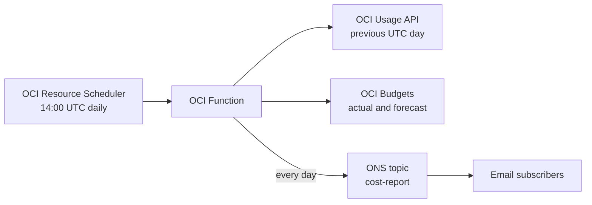

# OCI daily cost report

This OCI Function sends a cost report email every day. The report gives the tenancy spend for the previous UTC day and its largest costs. It also gives the month-to-date spend by compartment, and the actual and forecast spend of each budget. The title states whether the day was above the daily threshold. The default threshold is 70 USD. OCI budgets reset only monthly, and a budget alert sends one email for each threshold in a month, so neither gives a daily view.



The report is not a control. It does not stop or terminate resources. The Usage API can lag by several hours, so the report gives the previous day and the final figure can be higher. The monthly budgets `ci-runner-monthly` and `Monthly-Tenancy-Budget` stay in place.

## Create the topic

The deployed report publishes to the topic `cost-report` in the `ci-runner` compartment. Its subscribers are managed in OCI, and the recipient list never enters this repository. To create a new topic with the recipients of the existing monthly budget alerts:

```bash
export COMPARTMENT_OCID='<ci-runner-compartment-ocid>'
tenancy="$(oci iam compartment list --query 'data[0]."compartment-id"' --raw-output)"
SUBSCRIBER_EMAILS="$(
	for budget in $(oci budgets budget budget list --compartment-id "$tenancy" --all \
		--target-type ALL --query 'data[].id' --raw-output | jq -r '.[]'); do
		oci budgets budget alert-rule list --budget-id "$budget" --all --output json |
			jq -r '.data[].recipients // empty'
	done | tr ',; ' '\n\n\n' | grep '@' | sort -u | paste -sd, -
)" TOPIC_NAME=cost-report scripts/oci/create-ons-topic.sh 2>/dev/null
```

The script prints the topic OCID. ONS sends a confirmation email to each recipient. A recipient gets reports only after the recipient confirms. To add a recipient to an existing topic, use `oci ons subscription create --protocol EMAIL`.

## Deploy

The Function runs in the `f1r3node-ci-schedulers` application of the soak scheduler. Deploy that application first.

```bash
export OCI_COMPARTMENT_OCID='<ci-runner-compartment-ocid>'
export ONS_TOPIC_OCID='<topic-ocid-from-the-step-above>'
scripts/oci/deploy-spend-alert.sh
```

Optional settings:

| Variable | Default | Purpose |
|----------|---------|---------|
| `THRESHOLD_USD` | `70` | Daily tenancy spend above which the Function sends an email |
| `SCHEDULE_CRON` | `0 14 * * *` | UTC schedule of the check |

The script builds and pushes the image, creates or updates the Function and its schedule, and creates two dynamic groups and the `f1r3node-spend-alert` policy. The Function can read usage reports in the tenancy and publish to ONS topics in the compartment. The schedule can invoke only this Function.

To change the threshold, run the script again with a new `THRESHOLD_USD`.

## Verify

Run the Bash tests from the repository root:

```bash
bash oci/spend-alert/test-handler.sh
```

The tests cover the UTC day window, the report above, at, and below the threshold, and a custom threshold. They also cover the month-to-date and budget sections, and a report whose month-to-date and budget queries fail. The handler must fail on missing cost data, on a Usage API error, and on a bad threshold.

After deployment, invoke the Function once:

```bash
oci fn function invoke --function-id '<function-ocid>' --file - --body '{}'
```

The result is `{"status":"reported","over":true|false,...}`. A failed month-to-date or budget query does not stop the report. That section then reads "unavailable". Handler errors appear in the invoke log of the `f1r3node-ci-schedulers` application.
