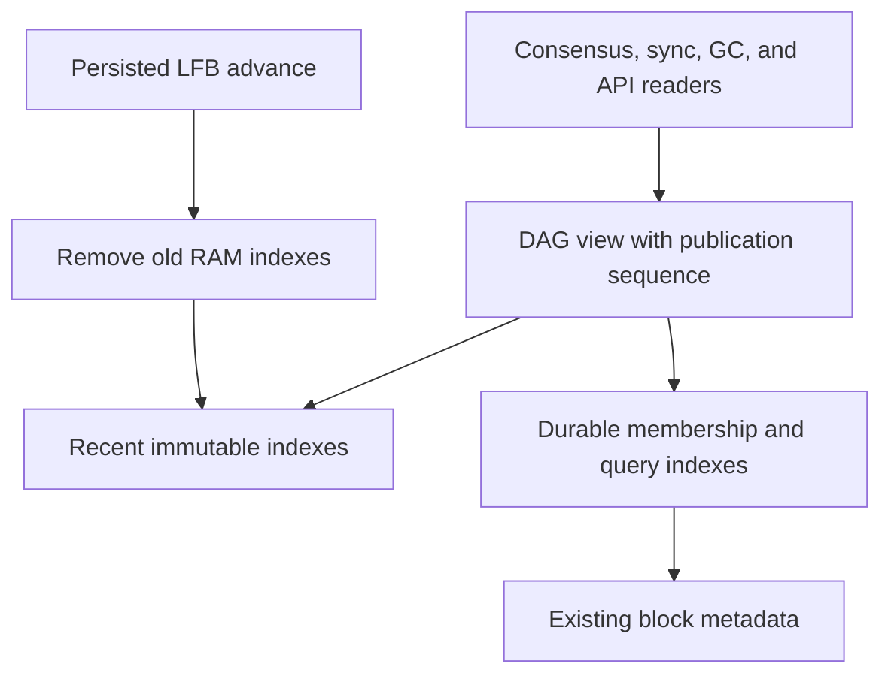

# Bounded in-memory DAG with durable historical queries

Source issue: [#933](https://github.com/F1R3FLY-io/f1r3node-rust/issues/933), read on 2026-11-05. The issue had no comments at that time. Repository inspection used commit `abf9d34f29adf0d3767205033b70a4e53bde2f91` and the local working tree.

Revision: 2026-11-06. This proposed specification incorporates the five confirmed design-review findings. Runtime implementation and benchmark evidence remain outstanding.

## High-level Objective

Stop the DAG indexes from retaining one heap allocation structure for every historical block. Keep recent indexes in memory and serve older DAG data from durable storage. A cache eviction must never change block validity, fork choice, finality, deploy status, or the ability to serve stored history.

The issue reports 3,493 bytes of live heap per inserted block in a 120,000-block allocator experiment. It also reports about 37 MB/hour of anonymous memory growth per node on an idle testnet. These are issue measurements, not measurements repeated for this specification. At the reported rate, cache growth continues even without deploys.

This work changes metadata indexing and access. It does not delete block bodies, metadata, finality evidence, floor/frontier records, or execution state. Disk retention belongs to [#923](https://github.com/F1R3FLY-io/f1r3node-rust/issues/923). Do not use the memory cutoff as a disk deletion threshold.

The guarantee is bounded **historical DAG index memory** as finality advances. A height window alone does not bound bytes under unlimited fork width or a permanent finality stall. The acceptance tests fix DAG width and finality lag. A separate admission/backpressure design would be necessary for an absolute process-memory limit under arbitrary input.

## Mid-level Objective

Each objective has a concrete completion condition:

| Objective | Completion condition |
| --- | --- |
| Bound historical index memory | With fixed DAG width and finality lag, resident entries stay within the specified height and edge bounds. Live heap growth meets the memory gates below. |
| Preserve logical DAG results | Differential tests return identical membership, ancestry, fork choice, finality, validation, and deploy status before and after eviction. |
| Preserve snapshot visibility | A view excludes later inserts, retains its captured maximum height, and can still read blocks evicted after that view was captured. |
| Preserve genesis identity | Ceremony and restored nodes retain the same genesis identity after eviction. A bond change with `W=1` succeeds after genesis leaves RAM. |
| Bound restart and migration memory | Startup loads only the resident window. Legacy migration uses batches of at most 1,024 records and meets the peak-heap gate. |
| Preserve historical consumers | GC, APIs, LFS restore, and offline replay pass the cold-history cases below. |
| Bound GC work memory | Candidate pages and traversal pages each contain at most 1,024 records. An old eligible candidate does not create a history-sized heap set. Traversal yields after 10,000 examined parent edges and resumes without losing progress. |
| Prevent GC discovery gaps | Inserts before and during a reserved scan range enter either that scan or the durable retry queue. Crash tests cover every reservation and cursor boundary. |
| Control performance cost | Warm-path median and p95 latency remain within the specified 10% regression limit. |

## Implementation Notes

### Selected design

Use one storage-owned DAG query interface with two sources: a recent immutable index snapshot and durable historical indexes. Callers ask logical questions such as “is this block held?” They must not infer those answers from cache residency.

Retain the existing metadata encoding. Add durable secondary indexes for relations that cannot be answered efficiently from a metadata point lookup: reverse children, height ranges, and publication membership. Main parent and self-justification already exist in metadata and do not need duplicate historical tables.

Do not select these alternatives:

- Prune RAM maps and keep the existing methods. This makes held blocks appear absent.
- Keep an unbounded hash-only membership set. This still grows with network age.
- Scan all metadata for each child or height query. GC and fork choice would acquire history-sized work.
- Recursively pin every ancestor of each latest message. This can retain the entire chain.
- Pin every unfinalized historical orphan. Such an orphan may never finalize.
- Hold an LMDB read transaction for the lifetime of each DAG snapshot. Long-lived readers can prevent page reuse. Use publication filtering instead.

### Terms, cutoff, and memory bound

A **held block** has completed DAG publication and has a durable metadata row. A block body written before DAG admission is not sufficient.

A **resident block** has entries in the hot indexes. A **cold block** is held but not resident. An **unknown block** has no published membership in the queried view. A sparse sync restore can contain unknown ancestors. Eviction must not turn a cold block into an unknown block.

Let:

- `F` be the block number of the successfully persisted last finalized block (LFB).
- `W` be the local hot-history depth, in block-number heights.
- `C = max(0, F - W)` be the inclusive lower bound of the hot window.
- `H` be the largest valid held block number, tracked independently of the cache.

Retain blocks with `block_number >= C`, including invalid blocks in membership and relation indexes. Exclude invalid blocks from the valid height index, as today. Evict lower blocks even if they are stale forks or unfinalized orphans. Their durable records remain readable. Main-parent and justification hashes in resident entries may point below `C`.

Proposed local setting: `dag-hot-window-depth = 1024`, a positive integer. It is a performance setting, never an on-chain validity parameter. Tests must also run with depths 1, 2, and 16 to force cold paths. Do not disable eviction when `max_parent_depth == i32::MAX`. Unlimited parent depth requires correct historical access, not infinite retention. Operators may change `W` on restart. Rebuild the selected window from disk.

The default is an initial engineering choice, not a proved minimum or measured optimum. It exceeds the present 256-height merge-distance limit, but these bounds use different anchors. The reader contracts below explain why no finite `W` removes the need for fallback.

Example: `F=10,000`, `W=1,024` gives `C=8,976`. Height 8,976 stays resident. Height 8,975 becomes cold. A later accepted block at height 8,900 goes directly to durable indexes without widening the hot window.

For `B` blocks and `E` parent edges in the retained band, resident DAG indexes occupy `O(B + E)`. With bounded width `b` and finality lag `L=H-F`, this is `O(b*(W+L+1) + E)`, independent of older history. Old immutable views can temporarily retain prior nodes. This work must measure that retention and release task-owned views when tasks complete. Do not promise immediate RSS reduction when the allocator retains freed pages.

### Durable indexes and view consistency

#### Required records

Implement a `DagHistoryIndex` owned by block storage. The following are proposed table names and required logical records:

| Table | Key and value | Purpose |
| --- | --- | --- |
| `dag-membership-v1` | block hash -> insertion sequence, height, invalid flag | Held membership and view visibility, including invalid blocks. |
| `dag-height-v1` | `(height, block hash)` -> insertion sequence | All held blocks by height. Queries explicitly choose valid-only or all blocks. |
| `dag-children-v1` | `(parent hash, child hash)` -> child insertion sequence | Complete reverse edges, including edges from cold parents to hot children. |
| `dag-history-state-v1` | named singleton keys | Schema readiness, last committed sequence, valid maximum height, migration progress, and GC discovery/retry cursors. GC state includes the claimed ceiling separately from completed progress. |
| `dag-gc-retry-v1` | candidate block hash -> height | Deferred GC candidates without a history-sized heap set. Store discovery and retry cursors in `dag-history-state-v1`. |
| `dag-gc-work-v1` | `(job id, block hash)` -> traversal position | Disk-backed pending ancestry work, including the next parent position for a partially processed block. |
| `dag-gc-visited-v1` | `(job id, block hash)` -> visited marker | Disk-backed duplicate suppression and completed ancestry membership for a GC job. |

Reuse the existing `genesis-hash` register. Do not create a second genesis identity table. GC work and visited tables contain derived scratch data, not chain evidence. Register them in the DAG environment and reclaim their rows in bounded batches when a job ends or is abandoned.

Allocate one monotonically increasing `u64` sequence for each newly published block. Duplicate insertion must reuse existing membership and must not advance latest messages or duplicate lifecycle events. Reject sequence overflow as a storage error.

Each representation captures `view_sequence`, `view_max_height`, its latest-message map, LFB, and hot indexes under the same global lock. Define `view_max_height` as `Option<i64>` containing the largest valid held block number at capture time. `None` represents an empty valid height index. A historical row is visible only when its insertion sequence is at most `view_sequence`. This prevents an old view from seeing a block inserted later, including a late insertion below its cutoff. Do not use the current volatile `dag_generation` as a durable sequence without changing its persistence and restart contract.

Maintain a RAM copy of the durable maximum valid height. Load it at startup and publish updates with the hot collection roots only after a successful transaction. Capture that RAM value into each view. `get_max_height` and `latest_block_number` return zero for `None`, otherwise the captured height plus one. `topo_sort` uses the same captured value to clamp its range. These methods must not read the live singleton after capture or infer the maximum from cache residency.

Metadata finality flags currently have live-read behavior. Preserve that behavior explicitly in this work. Membership filtering does not claim a fully versioned snapshot of mutable metadata. Floor/frontier memoization remains available on disk.

#### Ordered access

Provide cursor-based `scan_height_range`, `scan_children`, and `scan_membership` operations. Each page returns at most 1,024 rows and an exclusive continuation key. Capture the view sequence for the whole traversal. Filter later insertions on every page. Page transactions end before callers perform asynchronous work.

Use order-preserving keys: signed height encoded by flipping its sign bit and writing big-endian bytes, followed by fixed-length block hash bytes. Child keys contain two fixed-length hashes. Prefix searches must support odd-length hexadecimal input through a final nibble filter.

Do not assume that bincode ordering is numeric ordering. The existing LMDB wrapper also serializes byte vectors. Implement and test seek/range semantics at the storage boundary for the actual on-disk encoding. New index databases may use a dedicated raw-byte codec without changing old metadata keys. Tests must cover heights 255/256, prefix boundaries, empty ranges, and page continuation without omissions or duplicates.

#### Publication and failure ordering

Under the established writer serialization:

1. Check durable membership for duplicates.
2. Prepare metadata, membership, height, child edges, the next sequence, and the valid maximum height. Include genesis identity for approved genesis insertion. In this transaction, read the GC claimed ceiling and enqueue the block when its height is at or below that ceiling.
3. Commit these records atomically in the same LMDB environment. Include admission-owned latest-message/invalid-index changes, the required genesis write, and any GC retry entry in that publication transaction. Preserve each `InsertMode`, especially `SettledHistory`, which must not advance latest messages.
4. Publish the RAM view and maximum-height copy only after the commit succeeds. An old-height insert updates durable state but does not populate hot maps below `C`.
5. Advance generation counters used for cache invalidation as required by their existing contracts.

Preserve the existing body/lifecycle ingest ordering and orphan filtering. Update lifecycle visibility checks to use published membership, not resident membership. A failure before publication leaves a body or lifecycle row invisible to DAG readers. A crash after commit but before RAM publication is recovered from durable state on restart.

Do not silently accept the non-atomic fallback in `batched_put` for this contract. Validate a shared production environment. Provide an atomic test backend or an explicit transactional adapter for non-LMDB tests. Add injected-failure tests at each publication boundary.

For finalization, retain the existing effect/reconciliation procedure. Persist finality metadata successfully before advancing the cache cutoff. A failed finality write must not evict blocks or publish a newer LFB. Do not run asynchronous finalization effects while holding DAG locks.

Persist the selected LFB hash and height in the same transaction as its finality metadata. This record supplies exact LFB identity on restart. Keep any existing finality-store integration consistent with that record. The transaction must not reset mutable finality fields when an already-held block is submitted again.

Approved insertion of a valid height-zero genesis must also record its hash in the existing write-once genesis register. Apply this check even when the block already has membership. A matching register value is a no-op. A conflicting value is an error. A nonzero approved restore anchor is not genesis. Inside an already-held global writer lock, use a transaction-internal genesis operation. Do not call the public `record_genesis_hash` method, which acquires that lock again.

### Reader contracts and migration

All fallible disk-backed access must return `Result`. Propagate storage failures. Never turn an I/O or decode error into `false`, `None`, an empty child set, or a consensus-invalid verdict.

| Query or reader | Required behavior after eviction |
| --- | --- |
| `contains`, storage duplicate check | Check publication membership at the view sequence. A resident hit is an optimization. Malformed hash length returns false. Cold held hashes return true. |
| `lookup`, `lookup_unsafe` | Gate by publication, then fetch metadata. Unknown returns `None` or `MissingBlock` for the required form. Published membership with a missing metadata row is `KeyNotFound`/corruption. Preserve original I/O errors. |
| `block_number`, `main_parent`, `self_justification` | On a hot miss, read durable membership/metadata. A missing parent or self-justification is legitimate only after the block is known to be held. Genesis remains parentless. |
| `children`, `descendants` | Query all visible reverse edges through the durable index. Resident child sets are partial and cannot authorize a complete answer. Do not infer completeness from parent/child height ordering, including for invalid blocks. Unknown parent differs from a known leaf with zero children. |
| `is_finalized`, finalized enumeration | Keep a bounded positive cache and consult persisted flags. Do not treat the cache as the complete finalized set. Convert error-swallowing callers to fallible queries. |
| `find`, `topo_sort`, latest block number | Search durable membership and valid height indexes filtered by `view_sequence`. Use `view_max_height` for maximum-height queries and range clamping, preserving inclusive range endpoints and the maximum-height-plus-one convention. A unique historical prefix must remain searchable. Ambiguous prefixes have no stable choice today. |
| `genesis_hash`, newly bonded validator seeding | Read the existing persistent genesis register. If it is absent, use durable valid height-zero membership and select the minimum hash, as the current fallback does. Never depend on the resident height-zero bucket. Preserve `None` for a sparse restore that has neither a learned identity nor a held genesis. |
| `deploy_canonical_appearance` and carrier coverage | Replace both representation-level and storage-level RAM membership tests. Preserve ingest-orphan exclusion and historical terminal status. Carrier watermarks must use durable valid height, not the hot minimum. |
| Merge scope and floor/frontier derivation | Continue ancestor and self-justification walks through cold blocks. Keep persistent floor/frontier caches. Do not stop at `C`, replace the block-derived floor with local LFB, or change work-meter limits. |
| Parent-depth validation and proposer selection | Preserve the highest-parent-relative spread check, genesis handling, and unlimited-depth sentinel. Local cache depth cannot reject a block or remove a legitimate latest message. |
| Fork choice, finality, clique oracle | Resolve stale latest messages and genesis placeholders through storage. Migrate direct `block_number_map` access in `clique_oracle`. Do not recursively pin all latest-message ancestry. |
| Mergeable-channel garbage collection (GC) | Enumerate durable valid height ranges and read complete children/ancestry. Preserve finality and moved-past checks. Update sweep cursors only after successful page processing. |
| Last-finalized-state (LFS) restore and catch-up | Serve stored history regardless of local cache cutoff. Retain sparse-history `MissingBlock` behavior. Insert fetched settled history below `C` without making it a latest message. |
| Floor-cache request at startup | Replace `dag_set` enumeration with the explicit restored block set or a paged scan of that restore interval. Request every required restored hash, not merely resident hashes. |
| Soak capture and offline replay | Include the durable history needed by the captured view. Version the snapshot format and update canonical wire tests. Export incrementally under existing capture limits. Report limit failures explicitly instead of exporting incomplete history as complete. |

The source anchors for these requirements are [merge computation](../casper/src/rust/util/rholang/interpreter_util.rs), [floor derivation](../casper/src/rust/finality/floor.rs), [parent validation](../casper/src/rust/validate.rs), [GC](../casper/src/rust/util/mergeable_channels_gc.rs), [initialization](../casper/src/rust/engine/initializing.rs), and [clique oracle](../casper/src/rust/safety/clique_oracle.rs).

The merge backstop is 256 heights from the highest parent to the block-derived floor. It is not 256 heights behind local LFB. GC considers candidates through `floor.block_number - (max_parent_depth + gc_depth_buffer)`, then requires a strictly greater depth for deletion. Pending candidates may be arbitrarily old. Therefore neither 256 nor `max_parent_depth + gc_depth_buffer` is a sufficient historical cache-only contract.

For LFS, let `A` be the anchor height, `D` the adopted parent depth, `B` the GC depth buffer, and `L` the deploy lifespan. The metadata minimum is `max(0, A-D-B-L)`. The state minimum is `max(0, A-D-B)`. With current defaults these depths are 75 and 25. A supplied floor/frontier seed can lower the metadata minimum further to `max(0, min(unseeded_min, min(seed_floor_height, seed_frontier_height)-1))`. Unlimited parent depth sets the minimum to zero. Preserve these formulas and both pre-state and post-state roots for side branches. The [history-horizon implementation](../casper/src/rust/util/rspace_history_horizon.rs) provide the source context.

#### GC discovery and concurrent insertion

GC must not copy the whole cold history into `pending` during its first pass. Preserve deferred candidates in a durable retry queue, keyed by block hash. Materialize at most 1,024 candidates per batch. Revisit the queue in key order with an exclusive continuation cursor each cycle. An empty page does not mean the scan is complete if a continuation key remains.

Keep these distinct durable values: `discovery_claimed_ceiling`, `discovery_completed_ceiling`, and the current exclusive `(height, hash)` page cursor. Both ceilings start unset. A page cursor can represent partial progress within one height. Only a fully scanned range advances the completed ceiling.

For each discovery range:

1. Determine the target from the existing floor/depth rule. Under writer serialization, commit `discovery_claimed_ceiling = max(previous_claim, target)` before capturing the discovery view. Retain the claim after completion or failure.
2. Capture the view after that commit, then scan from completed progress through the reserved target. Apply the captured sequence filter on every page.
3. Commit each page's retry entries and its continuation cursor together. Advance the completed ceiling only when the final page succeeds. Do not hold the global lock across asynchronous candidate evaluation.
4. During every block publication, compare its height with the claimed ceiling inside the publication transaction. Queue blocks at or below the claim, including the equality boundary. Comparing only with the completed ceiling is insufficient.

If insertion commits before the reservation, the later scan view includes it. If insertion commits after reservation, publication queues it. A block may reach both paths, which is harmless because enqueue is idempotent by hash. On restart, preserve the claim and completed/page cursors, capture a fresh view, and resume the unfinished range. Queue writes and cursor progress must remain atomic across crashes.

A failure leaves the candidate queued. Delete a retry entry only after the existing deletion predicate permits deletion and deletion succeeds, or a successful storage query confirms that the target data is already absent. A read error is not proof of absence. A stale unfinalized orphan must not block later candidates or become a permanent heap entry. Advance the retry continuation cursor past deferred candidates, and wrap at the end for the next cycle.

#### GC ancestry memory and resumption

Candidate paging alone does not bound ancestry memory. The current `moved_past_by_every_validator` computes an ancestor `HashSet` from its anchor down to the oldest eligible candidate. One old eligible candidate can make this temporary set history-sized. This is a peak-memory and CPU problem, distinct from permanent DAG index retention.

Preserve the existing common-strict-ancestor and any-parent ancestry predicates. Replace their history-sized in-memory work/visited sets with `dag-gc-work-v1` and `dag-gc-visited-v1`. A job retains one captured DAG view, its floor, latest-message inputs, anchor-search positions, eligible candidate batch, and minimum candidate height. It must not collect earlier candidate batches. There is at most one active ancestry job per node.

Read and write work/visited records in pages of at most 1,024 records. Store pending nodes and visited membership on disk, including reached-but-unexpanded boundary nodes required by the existing predicate. Stream results into scratch tables instead of collecting all ancestors in RAM. Keep only the current pages and one decoded metadata record at a time. The byte bound therefore also depends on the accepted metadata-record size, not only the page count. Do not assume that all invalid-block parent edges decrease in height or add a new height-based pruning rule.

Examine at most 10,000 parent edges per scheduler turn, counting both the common-anchor search and the any-parent walk. Save the next parent position when a turn ends mid-record. Commit inserted work/visited rows and the consumed work position together. Release transactions and locks, yield, and resume the same job and captured view on its next turn. Also yield after 10,000 work records even if those records have no parent edges. These are proposed scheduling defaults, not measured optima.

Incomplete traversal cannot authorize deletion. After successful completion, test candidates against the disk-backed ancestry result using the existing GC predicate. On a storage failure, retain all unfinished retry candidates and release the job's view. On restart or job abandonment, discard that job's scratch rows in bounded batches and retry its durable candidates with a fresh view. Scratch rows are never standalone deletion authority. Successful job completion also releases the captured view and reclaims scratch rows. Measure scratch-disk growth and reclamation as well as heap use.

#### Other historical consumers

Similarly, remove all-history `invalid_blocks_index.to_map()` from normal snapshot construction. Query invalid latest messages by their hashes. Give callers that require all invalid blocks a paged historical iterator. Preserve invalid/equivocation evidence on disk.

Make the hot maps private once callers migrate. Expose explicitly named resident counters for metrics and test builders for synthetic DAGs. Audit the whole workspace, including fuzz fixtures and the soak observer, not only the six issue-named fields.

### Eviction procedure

Run eviction after a successful LFB update and before returning the next published representation. Serialize it with insertion through the existing global writer lock. Lock order remains global lock, metadata-store lock, then `DagState` lock.

Use an all-block resident height index for eviction, since the current valid-only height map cannot enumerate invalid blocks. Reuse its buckets for the resident valid height view where practical. Remove only crossed buckets, rather than scanning the entire hot state on every insert.

Build replacement collection roots privately under writer serialization. For each block `X` below the new cutoff:

1. Read its complete parent list from durable metadata before removing its resident indexes. The main-parent map alone cannot supply secondary parents. Process one metadata row at a time rather than collecting every evicted row.
2. Remove `X` from each parent's resident child set. Remove an empty parent key only when that parent is also below the new cutoff. Keep empty keys for resident leaf blocks.
3. Preserve `child_map[X]` while it contains a child that remains resident. Remove the key only after its last resident child is removed. Apply this rule to the completed replacement roots so processing order cannot leave an empty cold-parent key.
4. Remove `X` from resident membership, block-number, main-parent, self-justification, height, and finalized indexes. Keep scalar parent/justification references from surviving resident blocks to cold hashes.

If any required metadata read fails, discard the replacement roots and report the error. Do not publish a partial eviction. A successfully persisted LFB remains valid, but retain the previous cache cutoff until eviction succeeds. Retry eviction before publishing a view that advertises the newer cutoff. Invalidation and metrics must distinguish the durable LFB from the successfully applied cache cutoff.

Define the hot child map as edges whose child is resident, with keys for resident parents and cold boundary parents. Its key/edge count is bounded by resident blocks and their parent edges. It is a partial relation and cannot answer the public complete-children query by itself.

Publish the new collection roots and cache cutoff together. Existing `imbl` views remain valid and retain their captured membership sequence and maximum height. Complete-children queries continue to use the durable reverse-edge index, including for resident parents. Account for that I/O in the latency gate. Disk fallback must not mutate old views or repopulate the main hot indexes. Start without a separate cold metadata cache. Add one only if measurements justify it, with an explicit byte bound and no stale finality flags.

No LFB, or `F <= W`, means cutoff zero. Startup must still distinguish bootstrap-incomplete state from an initialized DAG. Height gaps are valid for sparse restores. Replace the current contiguity warning with checks of index membership, height accuracy, and the selected window.

### Startup, migration, and compatibility

An existing database must open without resetting the node or downloading the chain again.

1. Before consensus/network admission starts, inspect the history schema marker.
2. For a legacy database, stream metadata with bounded batches of at most 1,024 records. Build the new indexes in a staging schema. Assign sequence zero to pre-migration published metadata. Existing startup already treats these metadata rows as DAG members. Do not infer membership from block bodies or lifecycle rows.
3. Track progress in the same transaction as each batch. Resume idempotently after interruption. Validate edge targets as references, without assuming every referenced ancestor is held.
4. Recover LFB using the existing directly-finalized metadata semantics. Preserve a valid persisted LFB identity where available. For legacy recovery with several maximum-height candidates, validate the chosen hash and use a documented deterministic hash tie-break. Do not depend on `HashMap` iteration order.
5. Before enabling eviction, backfill genesis identity. Keep an existing learned register value. If valid height-zero rows are held, select their minimum hash, preserving the current fallback rule. Write that hash if the register is empty. Reject a conflict with an existing identity instead of overwriting it. A sparse restore with no height-zero row must retain its learned identity. If neither source exists, preserve the existing unknown-genesis state and recovery behavior.
6. Store durable maximum valid height and the completed schema marker only after the scan and required genesis backfill succeed. A decode or storage failure aborts startup with an actionable error. Do not reuse the constructor behavior that logs an error and opens an empty DAG.
7. Load only heights `>= C`, bounded latest-message state, a capped finalized cache, and the RAM copy of maximum valid height. Never build all DAG maps and prune afterward. Resume GC discovery from its durable claim and progress, and reclaim abandoned ancestry scratch rows in bounded batches.
8. On later restarts, read the ready indexes directly. Migration time may be `O(total history)` once. Normal DAG reconstruction must be `O(resident blocks + resident edges)`, apart from separately measured scratch cleanup and existing unrelated startup work.

If a ready schema has missing or inconsistent index records, stop startup and report the affected table and key. Do not silently open a partial history view. An explicit offline rebuild can regenerate derived indexes from metadata. It must use the same bounded migration procedure and must not run concurrently with writers.

Treat the new schema as a one-way upgrade for old binaries that do not maintain these indexes. Do not advertise downgrade compatibility. Back up the stopped database before rollout. A rollback uses that backup or a version that understands and maintains the new schema. Changing only the local cache depth does not require migration.

### Validation and acceptance criteria

#### Correctness tests

Use an unpruned reference DAG and a windowed DAG with identical insertion order. Compare logical results after each insert, finalization, eviction, and restart. Cover:

- Linear history, multiple blocks at one height, secondary parents, invalid blocks, orphan branches, and self-justification chains.
- Exact cutoff heights `C-1`, `C`, and `C+1`, genesis, no initialized LFB, and large finality jumps.
- Approved genesis insertion, duplicate approved insertion, and legacy genesis backfill. With `W=1`, evict height zero and then admit a block that seeds a newly bonded validator. Require the same placeholder as an unpruned node. Cover sparse restores with a learned identity, unknown identity, and a conflicting floor-cache response. A conflicting identity must remain an error, including after backfill.
- Evict a parent while its main-parent and secondary-parent children remain resident. Preserve both edges. Then evict those children and remove the empty cold-parent key. Include invalid blocks without assuming increasing edge heights. Inject a metadata-read failure mid-eviction and verify that no partial roots or newer cutoff become visible.
- Cold membership, duplicate insert, odd-length prefix lookup, topology ranges crossing `C`, and cold deploy terminal appearances.
- Missing metadata for a published hash versus a genuinely unknown sparse-restore ancestor.
- Late historical inserts, including `SettledHistory`, and GC discovery after its cursor has passed that height.
- Insert historical blocks before ceiling reservation, between reservation and view capture, between discovery pages, and before page-cursor commit. Include equality with the claimed ceiling. Require every block to enter discovery or the retry queue. Crash at each boundary and verify no candidate loss, duplicate deletion, or skipped height bucket.
- A view captured before insertion must exclude that insert. A view captured before eviction must still read its old blocks. Page boundaries must preserve both rules.
- Capture a view, insert a new highest valid block, and query both views. The older view must retain its original `latest_block_number` and `topo_sort` clamping. Cover an empty valid height index and invalid inserts that do not change the maximum.
- Restart after every injected transaction failure, migration interruption, and finality write failure.
- Finalized cache bounds after startup as well as after finalization.
- Cold floor derivation, cold frontier cache misses, fork choice, and ancestry through secondary parents. Compare parent sets, floors, validity decisions, finalized hashes, and resulting state hashes.
- Parent depth 15, a larger configured value, and `i32::MAX`. Repeat with different local hot-window depths and require identical consensus results.
- GC pending orphans across restart, cold child edges, delayed candidates, and failed reads. No missing read may authorize deletion.
- GC ancestry with one old eligible candidate, an initial historical backlog, and a candidate whose proof crosses unheld history. Compare completed deletion decisions with the existing unbounded reference algorithm. Verify bounded work/visited pages, yield at the edge/work-record budgets, and resumption without repeated full walks. No incomplete job can delete data. Restart must discard scratch authority, preserve candidates, and recompute with a fresh view. Verify scratch reclamation and view release after success and failure.
- LFS restore at an anchor older than the serving node’s cutoff, followed by catch-up. Also test a sparse responder that truly lacks the requested ancestor.
- Soak capture/restore and offline fork choice with cold blocks and explicit capture-limit failures.

Extend [block storage tests](../block-storage/tests/block_dag_storage_test.rs) and focused Casper tests. Run the affected `block-storage`, `shared`, `casper`, and `node` suites, plus fuzz fixture compilation and canonical snapshot tests. Full repository checks remain required before an implementation is merged. This documentation change alone does not establish any of those runtime gates.

#### Memory and performance experiment

Add a Rust benchmark with a counting allocator and LMDB, matching the issue fixture: 10 validators, 7 blocks per height, previous-height parents, 10 justifications, and 10 bonds. Compare 120,000, 240,000, and 480,000 inserted blocks. Use `W=1,024`, a fixed 32-height finality lag, and release all old views before measuring.

Acceptance gates:

1. Every resident block has height at least `C`. Resident map cardinalities satisfy the band/edge bounds at every checkpoint.
2. After warmup, additional live heap between the 120,000 and 480,000 checkpoints is at most 10 MiB in this isolated fixture. This is a proposed gate, not a measured result. Record allocator overhead separately.
3. Restart and legacy migration never materialize history-sized maps. Peak live heap for migration grows by at most 16 MiB between equivalent 120,000- and 480,000-block fixtures with the same hot band, excluding LMDB mapped pages.
4. No steady-state point lookup or child query scans all metadata. Report rows visited and cache/disk query counts.
5. Median and p95 insertion, snapshot, proposal, and validation latency regress by no more than 10% against the reference on the same host and workload. Run each benchmark three times and report all runs. Cold historical latency is reported separately.
6. Hold an old view across 10,000 inserts, then release it. Demonstrate that its retained heap is released from live allocations. Do not judge this by RSS alone.
7. Repeat the history-size comparison with GC enabled and a low-height eligible candidate that remains pending. Measure GC temporary live heap separately from resident DAG indexes. Candidate and traversal pages must stay within their 1,024-record limits, and additional GC peak heap between the 120,000- and 480,000-block fixtures must be at most 10 MiB with fixed record sizes. Report traversal edge counts, scheduler yields, completion time, scratch bytes, and scratch reclamation. The work may increase with history length, but its frontier and visited set must not move into heap collections proportional to that history.

The heap thresholds, 10% latency gate, and scheduling defaults are proposed acceptance targets. None has measured evidence from an implementation of this specification yet.

Follow with a 24-hour idle multi-node soak at a fixed cadence and a load/catch-up run. Report total held blocks, resident blocks and edges, LFB and cutoff, finality lag, live heap if available, container anonymous memory, disk bytes, eviction time, and cold-query latency. Require plateauing resident cardinalities and no history-correlated DAG heap slope. Whole-process memory is supporting evidence because other stores and allocator behavior can still grow.

## Context

The issue concerns heap retained by DAG indexes for the lifetime of the chain. The existing metadata store already holds historical block facts. The solution makes those facts accessible independently of cache residency and adds durable indexes for reverse edges, height ranges, and publication visibility.

The specification follows the original structure: objectives define the outcome, implementation notes define the behavior, beginning and ending context identify the code transition, and low-level tasks define the execution order. Existing behavior and proposed changes are stated separately.

## Beginning Context

The following files and behaviors exist before implementation:

| Source | Behavior relevant to this change |
| --- | --- |
| [BlockMetadataStore](../block-storage/src/rust/dag/block_metadata_store.rs) | `DagState` retains `dag_set`, `child_map`, `height_map`, `block_number_map`, `main_parent_map`, and `self_justification_map`. `add_block_to_dag_state` adds entries without historical eviction. |
| Same file, `new`, `try_new`, `recreate_in_memory_state` | Startup collects all metadata into intermediate collections and reconstructs the entire DAG. Pruning after this reconstruction would still permit an out-of-memory restart. |
| Same file, `record_finalized` | Finalized membership has a 50,000-entry threshold and a 25,000-entry retain target. The rebuild path does not apply this pruning helper. RAM publication currently precedes the metadata write. |
| [KeyValueDagRepresentation](../block-storage/src/rust/dag/block_dag_key_value_storage.rs) | `lookup` first checks `dag_set`. `contains`, `children`, height, and main-parent queries depend on RAM. `self_justification` treats a missing map entry as no self-justification for a held block. |
| Same file, `find`, `topo_sort`, `deploy_canonical_appearance`, `insert_internal` | Historical API queries, deploy visibility, and duplicate detection also depend on complete DAG membership. |
| Same file, `genesis_hash`, `record_genesis_hash`, newly bonded validator seeding | Genesis lookup falls back to resident height zero. The register is write-once, and its public writer acquires the global lock. Seeding a validator requires a genesis hash. |
| Same file, `get_max_height`, `latest_block_number` | Current maximum-height answers come from the captured immutable height map. Replacing that map must preserve this view-local behavior. |
| Same file, `get_representation_internal` | Immutable `imbl` collections provide structurally shared membership snapshots. The method also materializes every invalid-block row. Metadata itself remains shared and can receive later finality updates. |
| [Snapshot metrics](../casper/src/rust/engine/multi_parent_casper/snapshot.rs) | `dag_blocks_size`, children, and height metrics measure resident collection cardinalities. Their meaning must remain explicit after eviction. |
| [Mergeable-channel GC](../casper/src/rust/util/mergeable_channels_gc.rs) | Discovery advances a height cursor. The moved-past calculation builds a temporary ancestor set down to the oldest eligible candidate. Paging candidates alone cannot bound this set. |
| [Soak snapshot](../block-storage/src/rust/dag/soak_snapshot.rs) | Capture and restore serialize the maps. Cold data must remain available to offline replay after the representation changes. |
| [Store trait](../shared/src/rust/store/key_value_store.rs), [typed store](../shared/src/rust/store/key_value_typed_store_impl.rs) | Point lookup and streaming `iterate_while` exist. An ordered, resumable historical range API does not yet exist. `collect`/`to_map` are not bounded-memory substitutes. |
| [LMDB store](../shared/src/rust/store/lmdb_key_value_store.rs), [database mapping](../casper/src/rust/storage/rnode_key_value_store_manager.rs) | `batched_put` is atomic only for stores in the same LMDB environment. Its fallback performs independent writes. New DAG tables must share `dagstorage`. |

## Ending Context

After implementation, the repository must contain these changes. These are required deliverables, not claims that the files have already changed.

| File or area | Required resulting state |
| --- | --- |
| `block-storage/src/rust/dag/dag_history_index.rs` and module registration | A new durable query component owns membership, height, reverse-edge, and publication-sequence access. |
| `block_metadata_store.rs` | Hot indexes follow the cutoff. Eviction preserves cold-parent/resident-child edges and publishes replacement roots atomically. Startup and migration stream bounded batches. Finality persistence precedes eviction. |
| `block_dag_key_value_storage.rs` | Logical queries use durable fallback, preserve view visibility and captured maximum height, and propagate errors. Genesis identity survives eviction. Production callers cannot interpret resident maps as complete history. |
| Shared store interfaces and LMDB implementation | Atomic publication and ordered paged queries have tested contracts. Test backends preserve the same guarantees. |
| Casper storage manager and node configuration | New tables share the DAG environment. The local hot-window setting reaches storage initialization. |
| Consensus, GC, lifecycle, API, and sync readers | All historical readers use the migrated query interface. GC discovery uses a claimed ceiling and atomic queue/cursor writes. GC ancestry uses bounded disk-backed work with resumable jobs. Retry state and invalid enumeration do not materialize the full history. |
| Soak snapshot capture and replay | The versioned format preserves the historical data required by the captured view and reports capture-limit failures. |
| Rust tests, benchmarks, and metrics | Differential tests, migration tests, memory measurements, latency results, and network-soak evidence establish the acceptance gates. |

## Low-level-Tasks

> Ordered from start to finish. Each step must produce its listed evidence before dependent work proceeds.

| Step | Work | Evidence required before the next step |
| --- | --- | --- |
| 1 | Add durable membership, reverse edges, height indexes, atomic publication, genesis writes, and ordered paged access. Publish the RAM maximum-height copy. Keep eviction disabled. | Transaction-failure, duplicate approved genesis, view-sequence, maximum-height isolation, and range tests pass. |
| 2 | Migrate query methods and all direct map readers, including genesis lookup and complete children. Propagate storage errors through closures and callers. | Differential results match the unpruned implementation with forced cold reads. Genesis and topology queries remain view-correct. |
| 3 | Implement streaming migration, genesis backfill, and bounded startup. Update production database mapping and test managers. | Legacy reopen, conflicting genesis, sparse restore, interrupted migration, and peak-heap tests pass. |
| 4 | Implement GC claimed-ceiling discovery, atomic retry/cursor progress, disk-backed ancestry jobs, budgets, and cleanup. Migrate invalid enumeration, lifecycle checks, sync requests, and soak replay. | In-flight insertion and crash tests prove discovery coverage. GC yield/resume, bounded temporary heap, cold API, sparse sync, and capture tests pass. |
| 5 | Enable atomic eviction with complete parent reads and retained boundary edges, local configuration, resident metrics, and snapshot release checks. | Bonding after genesis eviction, child-edge boundaries, partial-eviction failure, late insert, concurrency, and restart tests pass with tiny windows. |
| 6 | Run the allocator experiment, GC peak-memory/work experiment, latency comparison, and network soak. | Attach commands, revisions, configuration, raw measurements, and failed gates to the implementation PR. Report scratch-disk cleanup and complete-children I/O cost. |

Expected implementation areas are the source files linked above, a new `block-storage/src/rust/dag/dag_history_index.rs`, store range/transaction support, node configuration wiring, and focused Rust tests/benchmarks. These are planned changes, not files created by this specification update.

The feature is complete only when old held blocks remain logically available, current DAG index memory no longer scales with finalized history, startup stays within the same bound, and all correctness/performance gates above have evidence. A smaller `dag_blocks_size` metric by itself is insufficient.
